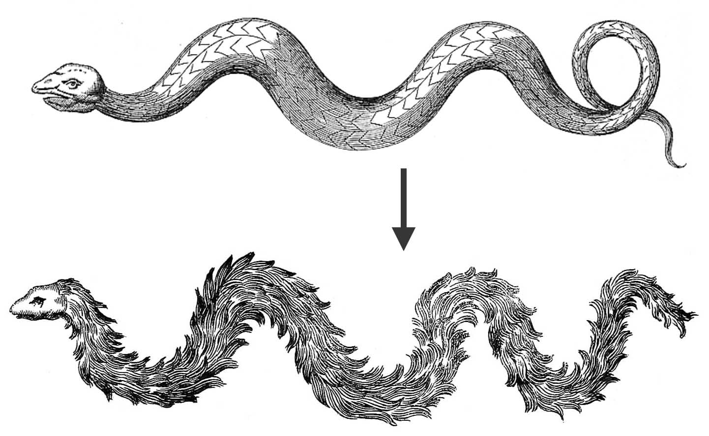
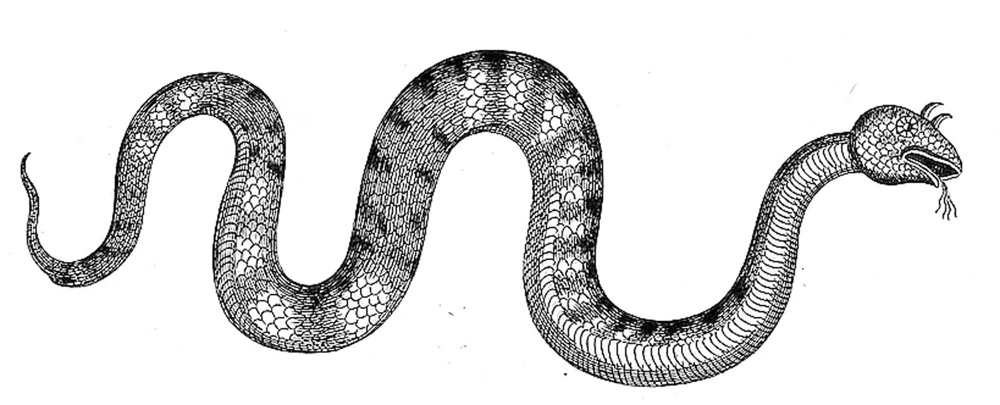
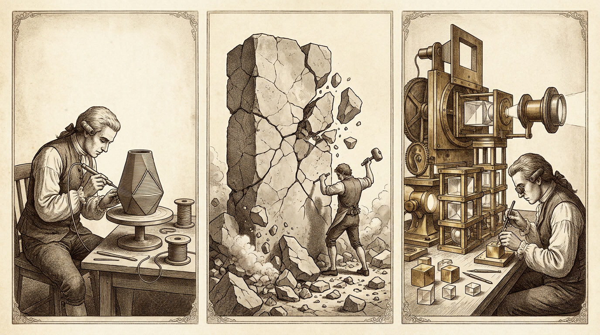

# Think Big 与 Build from Small：和 AI 共事的两点体会

最近和 AI 一起 cowork，我最大的感受可以归结为两点：一是要 **Think Big**，二是要 **Build from Small**。

我平时本来就是一个习惯 Think Big 的人。前阵子读到 Felix Rieseberg 写的 [*How to be more ambitious: A tutorial for humans with models*](https://felixrieseberg.com/how-to-be-more-ambitious-a-tutorial-for-humans-with-models/)，非常有共鸣。他在 Anthropic 负责 Claude 和 Cowork，每天都能看到别人用模型做出他没想过的事——有业余天文爱好者用它辅助找出了新的系外行星，有人做出了真正耐看的音乐短片，陶哲轩也在聊“数学 2.0”。

模型的能力长得很不均衡，借用陶哲轩的话说，“在某些方向上令人惊叹，在另一些方向上又捉襟见肘”。有的人已经摸透了那些惊人的部分，飞得很高；但大多数时候，人们面对模型，日常还是停留在问“法国的首都是哪里”，或者“帮我把这封邮件改得客气一点”。

每次看到别人做出惊艳的东西，大家转发时最爱写一句“还是不够有野心”。这句感慨很容易发，真要做到 Think Big，却需要具体的方法和心理上的破障。

## 高度、深度与广度

Felix 把和模型共事时的野心拆成了四个维度：速度（Speed）、高度（Altitude）、深度（Depth）和广度（Range）。“速度”是指用更少的时间干完同样的活，这当然有价值，但不太需要想象力。真正能让事情发生质变的，是后面三个维度。

**高度（Altitude）** 是往上走一层抽象，少盯眼前的单次任务，多想最终要的结果。平时我们给模型交代一个具体任务，那个任务往往只是为了拿到最终结果而自己拆出来的中间步骤。往上走一层，就是多问一句：接下来希望发生什么？目标背后的目标又是什么？

Felix 拿他自己的经历举过例子：去年年初他还会把单次报错丢给 Claude 去修，后来他的要求直接变成了“让应用保持零故障”。一旦目标拉高到这一层，工作方式就得跟着变——他得先让模型能自己拉取故障报告、看懂每次改动前后的关联，再给模型配好不同系统的运行环境，让它能自己复现和验证。

日常里的事情同样可以这样一层层往上推。比如准备一份季度复盘（QBR）的演示稿，最常规的做法是把数据丢给模型填模板；往高处走一步，可以把能拿到的所有业务数据都交给它，让它理出这个季度发生了什么变化、原因是什么、眼下最紧迫的三个决定是什么，以及每个方向的利弊；再往高处想一步，季度复盘本身只是人类处理不了海量信息时的产物，它的真正目的是尽早发现问题、调配资源。那完全可以让模型设计一套比季度汇报更灵敏的预警机制，拿历史数据跑一遍，验证它确实能更早抓住问题，再跟现有流程并行跑起来。

**深度（Depth）** 则是往下深挖一层，像那个领域最顶尖的专家那样去干活，直接去碰最原始的数据、工具和问题。

比如同样是分析用户流失问题，有几个把任务往深处推的办法非常管用：

- **坚持使用行业里最好的工具：** 只让模型“像专家一样思考”，它通常只会换一套专业的词藻，干活的方法并没有变。当它习惯性地想画张普通表格应付差事时，直接要求它上数据库和统计模型。使用者自己不需要精通这些工具，模型知道专家用什么。
- **提一个苛刻的目标，并告诉它这很合理：** 原本想从 10 秒压到 5 秒，不妨直接要求 200 毫秒。模型觉得做不到时，告诉它这个问题一定有解，继续试。
- **用原始数据验证既定印象：** 很多我们习以为常的判断只是粗糙的近似。可以把最原始的数据交给模型去反证：“大家都觉得流失是因为前期引导不好，试着从原始记录里看看能不能印证这件事。”
- **顺便产出新认知：** 既然模型已经钻进数据里了，可以让它顺手找找盲区：“根据过去一年的记录做一个用户仿真，找出那个还没被注意到的最早期流失信号，并在未见过的数据上验证它的预测能力。”
- **引入外部裁判：** 不要让模型自己评价自己。坚持引入外部验证，最好是一个模型能直接运行并立刻拿到客观反馈的工具。

Felix 给过一段提示词模板，很适合用来把任务往深处推：

> 我想要这个任务更深的版本，而不是更大的版本。在改写之前，请先说明：（1）这个领域的顶尖专家在这里会做哪些我没要求的事；（2）他们会从什么最原始的材料出发，而不是看已经整理好的摘要；（3）他们具体会用什么方法和工具；（4）除了你和我之外，什么客观结果能证明做对了。然后再按这个标准改写我的提示词。

**广度（Range）** 是借用不同学科的视角来看同一件事。就像劫案电影开头总要花半小时把各路奇才凑齐一样，现在用多智能体引入跨学科视角已经非常方便。

这里可以用《创新的艺术》里的一个老办法：**把名词换成动词**。季度复盘不是“一份演示稿”，而是“让一群大忙人在 30 分钟内看清因果关系，并在不确定中做出决定”。一旦换成动词，就很容易看清该从哪些学科借力——除了数据分析师，还可以拉来记者、编辑、视觉设计师，甚至拉一个做空机构的研究员和法务会计来做“红队”挑刺。唯一要注意的是别掉进角色扮演的怪圈：不要让模型模仿做空者的腔调说话，而是让模型去做做空者调查问题时真正会做的事。

除了高度、深度和广度这些具体方法，阻碍人们去 Think Big 的往往还有一层心理门槛：我们太容易被“自己觉得什么事情可能做成”给限制住。米开朗基罗当年不想画西斯廷教堂的天顶画，理由是他觉得自己是个雕塑家，不是画家。

心理学里把这种现象叫作**自我效能感（Self-efficacy）**。洛克（Locke）和莱瑟姆（Latham）梳理了 35 年的目标设定研究，发现设定具体的高难度目标，人的表现反而远好于只要求“尽力而为”。回看历史，帮人跨过这层心理门槛的往往是三件事：

- **因为相信它有解而解开：** 1939 年，乔治·丹齐格（George Dantzig）在伯克利上统计课时迟到了，把黑板上的两道题当成课后作业抄回去解了出来，其实那是统计学界当时还没解开的两道公开难题。
- **看到别人做到之后自己也做到了：** 人类追逐“4 分钟跑完 1 英里”追了几十年，直到 1954 年 5 月罗杰·班尼斯特（Roger Bannister）首次跑进 4 分钟；而在那之后仅仅 46 天，第二个人也破纪录了。今年 4 月的伦敦马拉松上也发生了类似的事，Sabastian Sawe 跑出了首个官方破两小时的成绩，同一场比赛的亚军也紧跟着跑进了两小时。
- **卸下包袱反而发挥得更好：** 《网球的内心游戏》（*The Inner Game of Tennis*）的核心观点是，人太紧绷、太怕搞砸时，反而打不出好状态。就像当年 Linux 刚发布时，林纳斯也只是说“这只是个业余爱好，不会像 GNU 那样庞大而专业”。

## 当许愿变成系统爆炸

在 Think Big 这件事上，我和 Felix 的看法是一致的。但也正因为我平时就习惯 Think Big，在和 AI 一起往大了做的时候，我很快撞上了另一面墙：**当人只管许大愿、让 AI 直接去 Think Big 时，事情极其容易失控。**

好几次，当我把一个宏大的想法直接交给模型去发挥，模型确实能很快端出一整套庞大的系统；但仔细一看，这套系统并不那么 solid。等我真正接手过来时，发现自己已经完全失去了掌控力，想做优化也无处下手。

这背后的原因，其实可以追溯到非 AI 时代的一个老问题。A. Jesse Jiryu Davis 写过一篇很有名的文章叫 [*API Evolution the Right Way*](https://emptysqua.re/blog/api-evolution-the-right-way/)，他在里面打了个比方：设计系统就像造物主设计生物的演化，看到一条蛇，一时兴起想给它插上羽毛、安上鹿角，觉得这样功能更强大；但“特性就像孩子：在一时冲动下怀上，却得养活好多年（Features are like children: conceived in a moment of passion, they must be supported for years）”。他拿 Python 的 `asyncio` 举过例子：早期为了方便调试协程，开发者顺手暴露了一个权限极大的 `set_coroutine_wrapper`，结果它可以把所有协程改成任何东西，导致整个生态都没法放心假设协程的行为，最后不得不痛苦地把它删掉，换成窄得多的接口。所以在传统时代，有经验的设计者总是拼命克制：**少加特性（Minimize Features），把边界收窄（Keep Features Narrow）**。一旦冗余的设计长进了系统的身体结构里，事后想砍掉它，永远比当初加上它痛苦十倍。

*“不要给蛇插上羽毛！”——配图引自 A. Jesse Jiryu Davis，《API Evolution the Right Way》。*

在非 AI 时代，人的精力是有限的。以前全靠自己动手，做东西就像 **3D 打印**，每一层都得从无到有一点点敲出来。这个过程很慢，但也正因为慢，它成了天然的刹车片——就算一时冲动想给蛇插羽毛，也得自己一根一根去敲，敲到一半可能就嫌麻烦放弃了；而且每一层都是亲手铺出来的，里面的结构每一处都清楚。

到了 AI 时代，尤其是当我们开始“许愿式编程”的时候，这块天然的刹车片彻底消失了。

AI 会把过去那种边界扩张和失控的过程成倍放大。对着模型许一个很大的愿、让它自由去 Think Big 时，模型“一时冲动”的成本是零。原本只想要一条能钻进洞里的蛇，模型在几十秒内不仅给它插满了羽毛，还顺手安上了鹿角和四叉舌头——它会大幅扩展任务的边界，预设十种根本不存在的未来需求，把每个模块的口子都开得极大，而且内部互相缠绕。以前在人手里需要几年才会慢慢长歪的系统，在许愿编程下几个回合就会直接**系统爆炸**，整个系统彻底不再收敛。

*当“一时冲动”的成本变成零，系统几个回合就会长出鹿角和四叉舌头。*

这也是为什么我接手那套系统时会觉得无从下手。它早就不像以前 **3D 打印** 那样是一层层长出来的了；可面对这头长满羽毛和鹿角的庞然大物，也没法像 **雕刻** 一样反过来拿凿子把它修出来。雕刻能够成立，前提是石料本身致密均质，凿掉外面一层，底下还是好石头。而一个已经爆炸、不再收敛的系统，内部到处都在互相依赖那些发散出来的特性——凿子一碰，旁边好几块地方就跟着塌了。

*左：一层层亲手堆出来的 3D 打印；中：系统爆炸后不再收敛，试图逆向雕刻却一碰就塌；右：大积木 + 微雕刻 + 光刻机式组装。*

## 积木、微雕刻与光刻机

夹在 3D 打印和逆向雕刻这两个极端之间，要想让事情重新收敛，我摸索出来的方式是 **积木 + 微雕刻**。

我依然希望 AI 帮我想更大的积木，我也可以许愿更大、Think 更大。在单块积木的内部，完全可以用足前面说的高度、深度和广度，让 AI 做出以前单凭人力很难做出来的那种大积木。但对外，这块积木必须死守“把边界收窄”的原则——它只是一块接口极窄、职责收敛的积木，绝不允许它自己蔓延成整个系统。

当范围被严格收敛在单块积木内时，我就可以在它上面做 **微雕刻**。我能看清这块积木的内部结构，趁着其他部分还没有依赖它多余的枝节，拿刻刀把那些“羽毛和鹿角”削干净，用外部工具去测它，把它打磨得真正 solid。哪怕哪块积木实在长歪了，因为它的边界足够窄，直接换掉重做一块就行，不会引起系统爆炸。

而真正把这些积木往上搭的过程，落地的脚步要像 **组装一台光刻机**。光刻机非常庞大复杂，但它的每一个模块、每一段光路都是清晰、收敛、可控的。我可以许愿更大、Think 更大，让 AI 帮我想更大的积木；但落地的每一步要像组装一台光刻机，在设计足够大的同时，足够清晰可控。

在一个模型能力每隔几周就会跃升一次的时代，我们需要能帮自己打开想象力的方法，去 Think Big；同时也需要用大积木和微雕刻，像组装光刻机一样稳住自己的脚步，去 Build from Small。

这是我在当下对 AI 的思考，做任何创造性的事情莫过于此。

---

*本文关于 Think Big 的框架与案例参考自 Felix Rieseberg 的文章 [How to be more ambitious: A tutorial for humans with models](https://felixrieseberg.com/how-to-be-more-ambitious-a-tutorial-for-humans-with-models/)；关于特性演化与边界克制的讨论及博物学插图引自 A. Jesse Jiryu Davis 的文章 [API Evolution the Right Way](https://emptysqua.re/blog/api-evolution-the-right-way/)；题图源自弗朗西斯科·戈雅（Francisco Goya）的版画《飞翔的方式》（Modo de volar）。*
