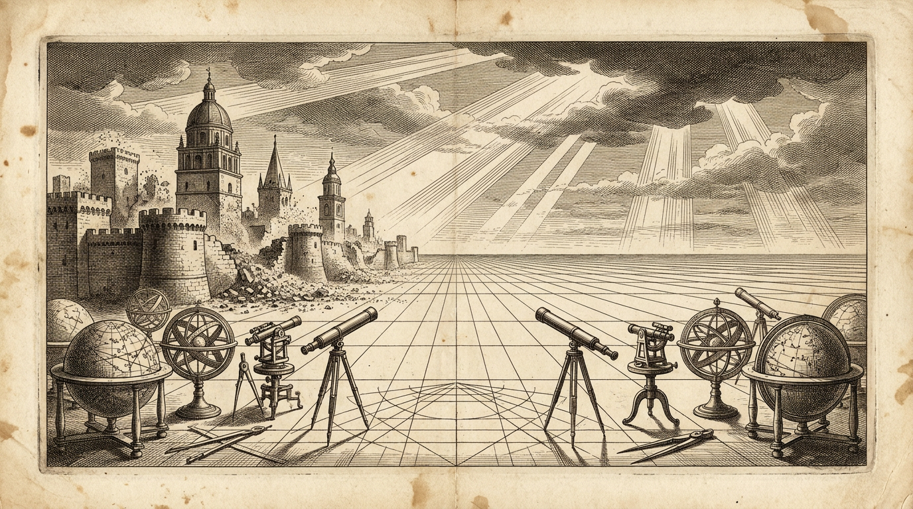
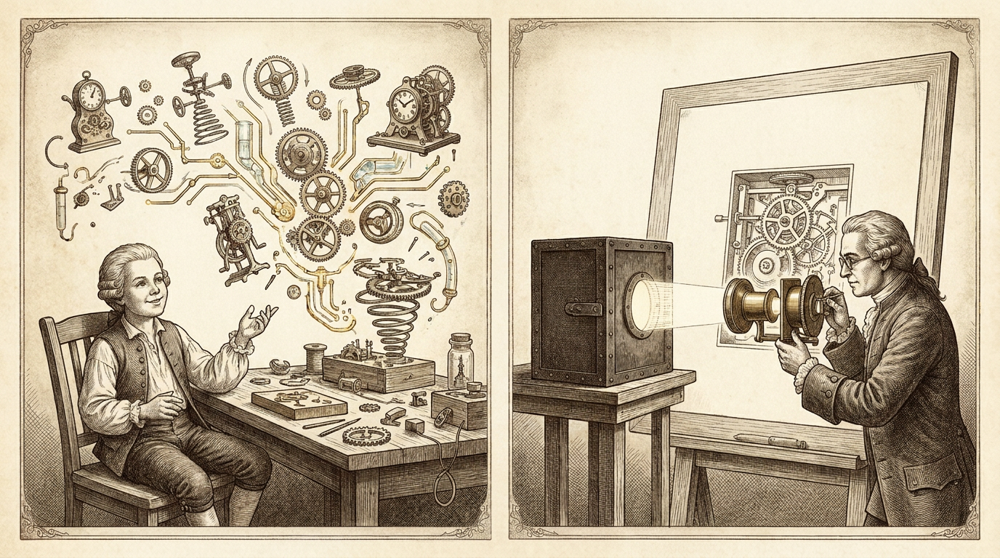
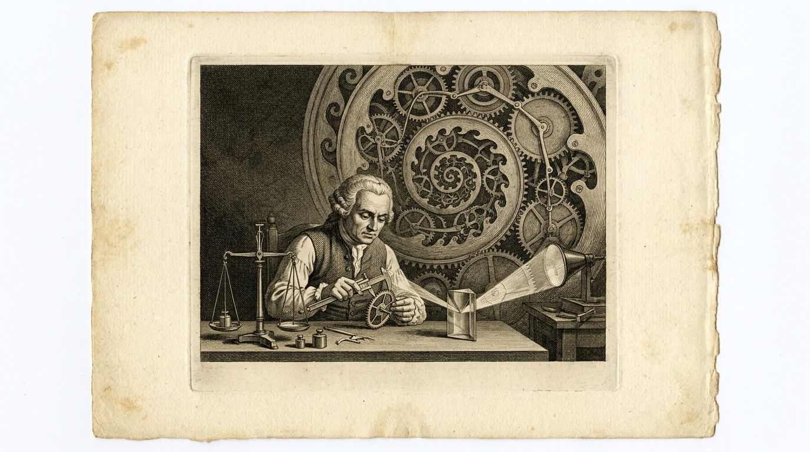

# 下一个 Flat 时代

*当昔日的专业高墙坍塌，所有人再次站在同一条平坦的起跑线上。*

2005 年，托马斯·弗里德曼（Thomas L. Friedman）在《世界是平的：21 世纪简史》（*The World Is Flat: A Brief History of the Twenty-first Century*）里讲过一个核心观察：进入 21 世纪，由于互联网、跨洋光缆、工作流软件、外包和全球供应链的迅猛发展，横亘在世界各地之间的地理与制度阻碍被彻底打通。整个世界被“抹平”了，无论身处硅谷、班加罗尔还是北京，全球的企业和个人第一次站在了同一条竞技跑道上。

但回过头看，二十年前的那次“抹平”，打通的其实只是**信息与连接的管道**。

在那条跑道上，人与人、企业与企业之间依然隔着厚重的专业高墙。一个想法要想变成现实，必须经过漫长的“翻译”——你得懂编程语言、懂系统架构、懂硬件电路，或者养得起一整支懂这些的工程团队。在长达二十年的时间里，知识工作者和软件公司正是靠着这层“把想法翻译成机器语言”的壁垒，享受着全球化最大的红利。

站在 2026 年的今天，这堵墙突然塌了。

不久前，微软和谷歌相继启动并扩大了大规模的“自愿离职计划”（Voluntary Exit Program）。微软向全球约 6 万名涵盖至 VP 级别（Level 70 及以下）的员工开放自愿买断；谷歌也把买断计划一路扩展到了美、英、瑞、日等多个核心工程区，唯独把 DeepMind 和 AI 算力基础设施排除在外。这不再是过去因为业务收缩而做的周期性裁员，而是一场静默的置换：巨头们正在把维持庞大传统白领与中层工程团队的预算抽出来，换成机房里的算力。原因再直接不过——AI 已经进化到把知识工作积累多年的技能壁垒，在一夜之间全干掉了。

## 从许愿编程到逆向一切

这道壁垒是如何在一夜之间瓦解的？最先让人察觉的信号，是“写代码”变成了“许愿”。

以前做一款像样的游戏，哪怕只是能跑通的原型，也需要策划、美术、前后端组成的专业游戏工作室磨上好几个月；现在，完全不懂编程的小孩子只要坐在屏幕前跟 AI 聊天，一下午就能把脑子里的奇思妙想变成可以直接试玩的游戏。

去年 Andrej Karpathy 刚提出 Vibe Coding 时，很多人还以为这只是程序员偷懒写脚本的方式，觉得它顶多留在屏幕里做点小玩具。没想到到了今年，Vibe Coding 彻底进入了**许愿编程**时代，甚至跨出数字沙盒，直接漫过了物理世界的硬件开发板。

过去软硬件之间有一道极高的门槛：点亮一块开发板，你得去翻几百页的英文数据手册（Datasheet），配寄存器和中断，在 EDA 软件里画原理图、算机械公差。现在，随着 Atopile、TSCircuit 这类“硬件即代码”框架和端到端 Agent 的成熟，连硬件开发板也能靠许愿驱动了。把一块 ESP32 和传感器连上电脑，跟 AI 说清楚想要什么效果，它就能自己完成器件选型、生成电路网表与底层固件、自动编译烧录，遇到报错顺着串口日志自己重调，甚至直接生成 3D 结构件图纸发给云工厂打样。

当软硬件的实现门槛一起塌陷，变化开始以天为单位发生。人们很快发现，被抹平的不只是个人玩具，连最讲究工程积累的企业级应用也守不住了。

过去传统 SaaS 的商业模式，本质上是收“实现能力”的过路费。一线业务人员最清楚痛点在哪，但不会写代码；而软件公司的顶级工程团队虽然技术精湛，却不在真实的业务现场里。为了把一套软件卖给成千上万家客户，他们只能取最大公约数，做出一套塞满冗余配置和妥协的通用系统。

现在，中间这层翻译损耗归零了。一夜之间，天天泡在具体问题里的业务人员，自己对着 AI 许愿磨出来的系统，反而超越了传统 SaaS 乃至顶级团队设计的应用——因为它没有半点多余的假设，每一处逻辑都精准咬合着真实的业务流转。

面对这种反超，传统软件工程原本还有最后一道防线：**历史积累的黑盒**。

很多人会想，业务人员靠许愿或许能搭出新系统，但那些沉淀了五六年、处理过无数极端边缘情况（Edge cases）、包含复杂状态机和私有协议的成熟商业软件，总不可能靠几句提示词就凭空猜出来吧？

结果今年爆火的开源工具 **REA（Reverse Engineer Anything）**，直接把这道防线也击穿了。

REA 通过 MCP 协议，把 Claude Code、Codex、Antigravity 等编程智能体和 Ghidra、IDA Pro、Hopper、Chrome DevTools 等逆向工程工具连在了一起。在这套工具面前，编译后的二进制文件、桌面端的 Electron 应用、打包好的商业软件不再有黑盒可言。你只需要让 Agent 用 REA 去观察某款成熟软件是怎么处理某个核心特性的，它就能自己反编译、追踪内存偏移与调用栈，把底层的业务逻辑和边缘处理规则连同真实证据链一起提取出来，再在净室（Clean-room）环境下用全新的技术栈重写出一份干净的代码。

*左：孩童张口许愿，软硬件与机械结构便在空中自动成形；右：REA 借光学透镜穿透密闭黑盒，将内部齿轮与逻辑完整映射在图纸上。*

当写新代码可以靠许愿，而旧代码的工程积累又可以被 REA 随时逆向拆解时，纯代码作为壁垒的时代就彻底结束了。

## 当 Taste 遇上递归自我改进（RSI）

眼看知识、技能和代码壁垒一层层失守，大家不约而同地退守到了最后一座精神堡垒：**Taste（品味）**。

现在技术圈和创作者最常说的一句话是：“就算 AI 什么都能造、什么都能逆向，它也没有 Taste；最终决定上限的，还是人的审美与判断力。”

这句话听着很让人宽慰，但如果诚实地往深处想一步，就会意识到：**我们常说的 Taste，无非是因为我们自己还不够厉害，没法把那种隐性的判断标准具象化（Explicit）而已。**

当一个资深工程师说“这个架构味道不对”，或者一个优秀的产品经理说“这个交互差点意思”时，背后并不是什么不可言传的神秘玄学，而是一组还没有被拆解清楚的约束条件、先验权重和评估标准。过去我们之所以把 Taste 当成护城河，仅仅是因为人类受限于表达和总结的能力，没法把脑子里的感觉写成明确的规则，只能靠长年累月的浸泡去“悟”。

一旦看清 Taste 只是“尚未被具象化的规则”，就会明白为什么到了 2026 年，连 Taste 也开始被越来越多领域的 **RSI（Recursive Self-Improvement，递归自我改进）** 所淹没。

现在的 RSI 走的是一条极其务实的路线——双层优化（Bi-level Optimization）与“模型—脚手架协同演进（Model-Harness Co-evolution）”。内层智能体负责海量尝试与生成，外层的元智能体（Meta-agent）则根据验证器（Verifier）的反馈，不断修改搜索策略、工具链和判断标准，再把成功的演化轨迹反哺给下一代模型。

随着越来越多人把原本模糊的行业审美、研究嗅觉和交互体验拆解成可量化的评估基准（比如今年专门用来测研究品味的 *TasteVal*），那些曾经“只可意会”的 Taste 就变成了一把把客观的标尺。

在 RSI 的闭环里，只要标尺立住了，系统就能在一个周末跑完人类几十年才经历得完的“尝试—评估—修正”循环。人类靠直觉攒下的那点微弱优势，在递归自我改进的指数级迭代面前，就像沙滩上的城堡一样被迅速漫过。

*背景是无限递归演化的机械洪流，前景的工匠正将模糊的 Taste 具象化为卡尺、天平与棱镜构成的客观标尺（Verifier）。*

## 下一个平的世界

从 2005 年到 2026 年，人类历史迎来了下一个 Flat 时代。

二十年前的第一次 Flat，抹平的是**地理与信息差**，让世界各地的个人和企业站到了同一条跑道上；而今天的第二次 Flat，抹平的则是**从想法到现实之间的一切中间层**——多年苦练的专业技能、软硬件的工程鸿沟、商业软件的代码壁垒，直到曾被视为人类专属领地的 Taste。

但这并不意味着所有的差异都消失了。恰恰相反，当世界在“怎么实现”这个维度上被彻底抹平，真正拉开差距的地方反而水落石出：

- 第一，当任何人都能随时许愿造出系统时，稀缺的不再是造系统的手艺，而是**你究竟身处哪一个真实的物理或业务现场，看见了什么别人没看见的真问题**。
- 第二，当 RSI 的洪流开始淹没那些靠直觉维持的 Taste 时，真正厉害的人不再是抱残守缺地感叹“AI 没有灵魂”，而是**逼自己把脑子里模糊的 Taste 具象化，把它变成一套严密、可验证的标尺，去驾驭递归自我改进的闭环**。

跑道再一次被彻底推平了。只是这一次，我们手里握着的不再是光纤和外包合同，而是许愿的权利，以及定义标尺的能力。

---

*本文提到的历史背景参考自 Thomas L. Friedman 2005 年著作《The World Is Flat: A Brief History of the Twenty-first Century》；2026 年行业动态综合自微软（VEO）与谷歌全球自愿离职计划报道、开源逆向工具 [REA (Reverse Engineer Anything)](https://rea.tools) 技术文档，以及近期关于硬件 Vibe Coding 与递归自我改进（RSI / Model-Harness Co-evolution）的研究讨论。*
