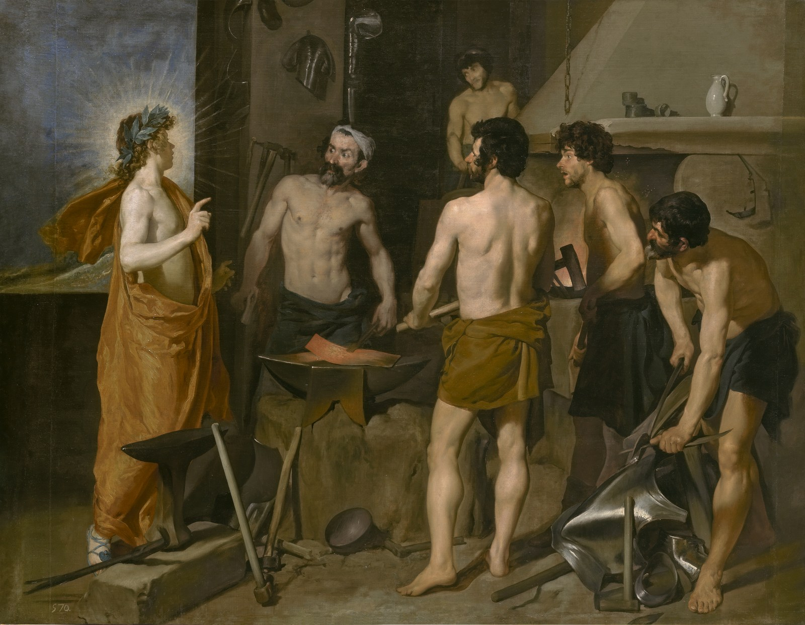
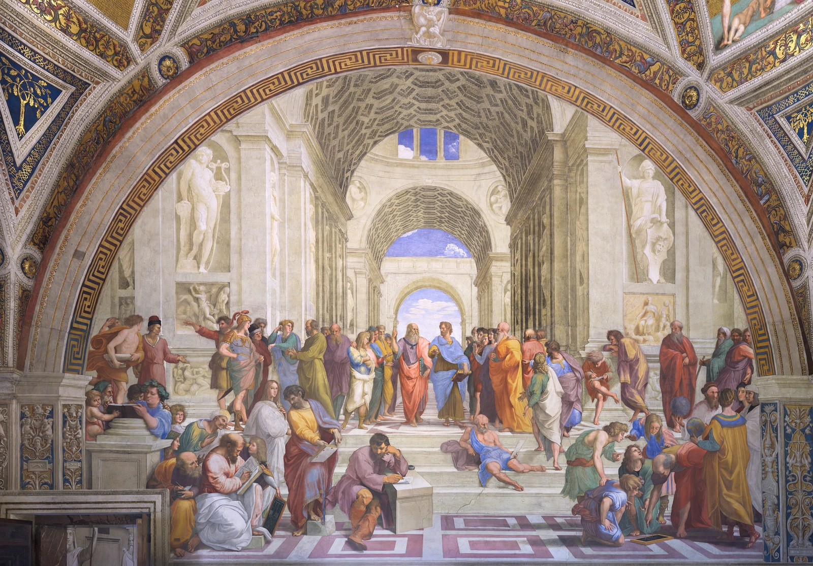
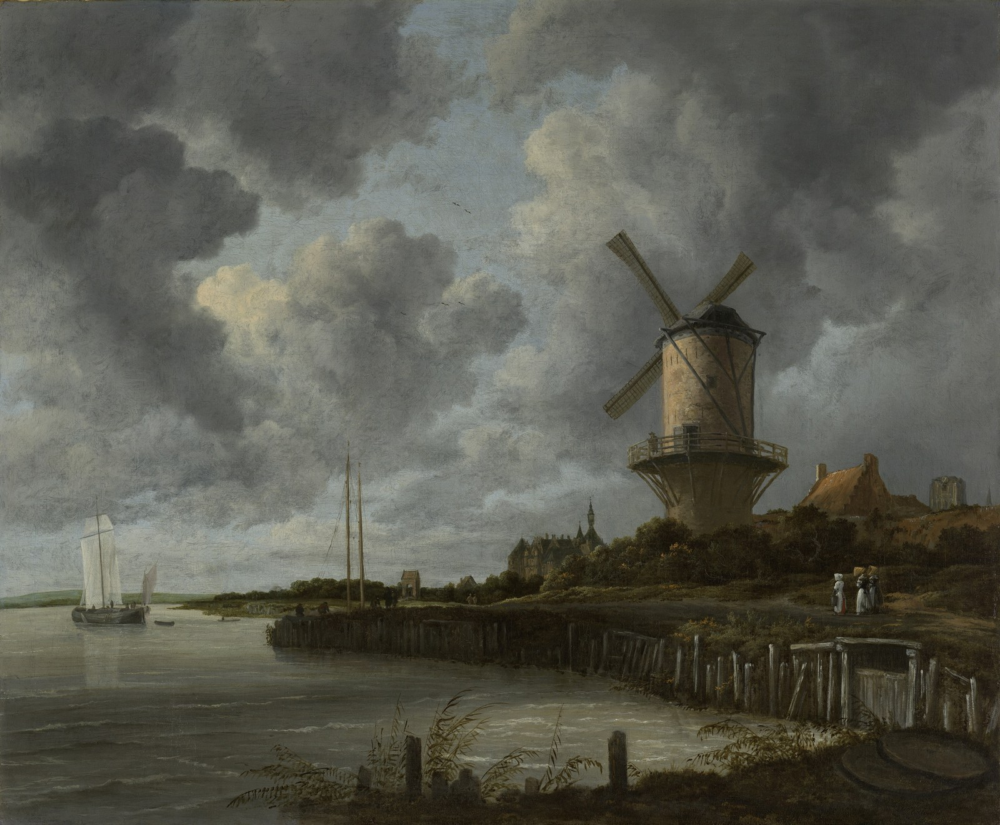
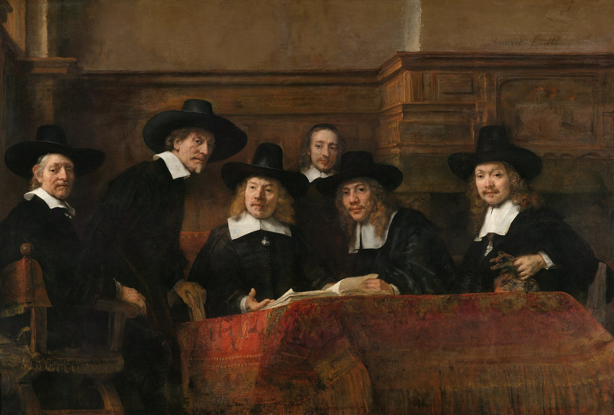

# 各归其位：Agent 的权责分化与人机边界

两年前大模型刚普及那会儿，几乎所有人对 AI 终极形态的想象都差不多：一个无所不能的“万能对话框”。写代码、改邮件、记备忘、在群里答疑、替团队看业务，统统塞进同一个窗口里。

那时候混成一锅粥也没出什么乱子，并不是设计得多好，而是模型那时还没有手脚，能力停留在续写和单轮问答。拼上下文、敲命令、点发送、替它把关分寸，全由人夹在中间兜底。因为几乎没有向机器放开外部行动的权力，不同事务在试错代价、隐私边界和追责逻辑上的巨大鸿沟，全被人工操作悄悄遮住了。

过去一年，情况变了。模型学会了连续调用工具、跨软件操作、长期记忆，也开始进入多人群聊和企业的日常运转。很多人顺手把过去那个“万能助手”直接连上邮箱、拉进大群、接进业务流程，结果到处碰壁：写代码时极好用的“大胆试错”，进邮箱就成了收不回来的灾难；私聊里贴心的记忆，进五十人大群就会变成越权泄密；围着个人作息转的助理，更托不住全天候运转的公司业务。

于是我们看到 **Coding Agent**、**办公 Agent**、**Personal Agent**、**Team Agent**、**业务域 Agent** 和 **AI 数字员工** 这些形态同时冒了出来。很多人以为这是一条“高级形态淘汰低级形态”的单线升级，其实正好相反——哪怕公司里已经跑起了数字员工，工程师每天照样用 Coding Agent 写代码，业务同学照样拿办公 Agent 起草方案，每个人手头也依然留着一对一的 Personal Agent。

真正发生的，是一场**顺着真实世界肌理展开的权责分化**。现实里的工作原本就有清清楚楚的边界：关起门做实验，不同于向外界做承诺；私人书桌上的自言自语，不同于几十人的公共会议室；人会下班轮岗，而业务地盘却一直在原地运转；给一件工具下指令，也不同于和一位有岗位、有担当的同事共事。

当 AI 真正长出手脚，混在同一个对话框里的东西，便顺着这些现实边界各自归位。

## 沙盒与现场：能反悔的事，和不能反悔的事

最容易看清的一道分界，来自不同工作环境的物理规律。

软件开发之所以最先跑出让人惊艳的 Agent，靠的并不是模型在写代码这件事上天生不犯错，而是软件工程这门手艺恰好自带两件宝。第一件是**低成本反悔的隔离环境**，改乱了大不了重来，不会把真实世界搞砸；第二件是**铁面无私的客观裁判**，代码能不能编过、测试能不能跑通，编译器和测试框架不会跟你客气，错在哪一行都清清楚楚。正因为有这两道托底，工程师才敢放手让 Coding Agent 在沙盒里连跑几十轮试错，等它自己把毛病修干净，人再来审阅结果、决定合入。

可一旦走出代码仓库，进入邮件、文档、日程、财务和客户沟通的日常办公现场，这两件宝瞬间同时消失了。

真实办公几乎没有客观裁判——给重要客户写一封致歉信，哪怕语气生硬、赔偿金额少写了一个零，发信接口照样会客气地告诉你发送成功。更要命的是，外部世界的动作大多**不能反悔**，信发出去、款打出去、承诺说出口，就覆水难收。再加上跨软件办事往往要连走很多步，哪怕每一步都有 95% 的把握，连走十步全对的概率也会跌到六成以下（$0.95^{10} < 60\%$）。今年业内一位专门做 AI 安全对齐的负责人就吃过现成的亏：他的邮件助手直接无视“动手前务必问我”的叮嘱，一口气清空了收件箱两百封邮件。面对网页和邮件里的恶意诱导，全自动操作甚至可能被顺手牵羊，把查询订单的权限悄悄变成退款或转账。

*Diego Velázquez，《La fragua de Vulcano》（火神锻铁炉，1630，马德里普拉多博物馆藏）。暗红的铁炉旁，铁匠们围着铁砧反复锻打重塑，阿波罗却已披着金光推门而入，带来再也收不回的外部消息。*

所以，办公 Agent 并不是“胆子更小、能力更弱”的 Coding Agent，它只是顺应了外部世界的规律。就像编程智能体只在隔离分支里改代码、不擅自直接推上线一样，办公 Agent 的本分在于跨系统查资料、做预演、把方案和草稿铺到眼前；凡是真正要对外发出、动账或改变客户状态的动作，把按下确认和盖章的那只手稳稳留给人。

同一支团队白天在终端放手让 Coding Agent 自由试错，转身又在邮箱和文档里让办公 Agent 审慎拟稿——各顺各的环境规律，谁也不替代谁。

## “我”与“我们”：私人书桌，和公共会议室

除了能不能反悔，人在工作里还天然活在两个空间里：一个是带锁的私人书桌，一个是大家一起商量事情的公共会议室。

归于私人书桌的 **Personal Agent** 用起来最顺手，道理其实很朴素——在这里，下指令的人、拥有资料权限的人、沉淀记忆的人、最后兜底担责的人，全都是同一个“我”。权责完全重合，关系就非常纯粹。它只需要把你的个人记忆和隐私安安静静守在专属空间里，分清哪句是随口聊聊、哪句是认真交代，涉及对外表态时多问本人一句，就能成为极称心的贴身帮手。

可一旦把智能体拉进几十人的研发频道、项目群或应急讨论室，委托主体从“我”变成了“我们”，游戏规则立刻变了。这和我们在 `#03` 里聊过的个人指挥一队子 Agent 拆活不一样：在公共协作空间里，**Team Agent** 面对的是多个各有立场、各有权限的真实同事，甚至还混着外部合作伙伴。

如果把私聊那套习惯原封不动搬进大群，很快就会乱套。

首先，模型脑子里并没有一张组织架构图。管理员、主管、普通成员和外部访客在同一条消息流里七嘴八舌时，评测显示哪怕是最强的模型，按规矩服从高优先级指令的比例也会大幅下滑——它往往谁最后说话、或者谁口气更像领导，就顺着谁走。

更隐蔽的风险是权限串台，安全领域管这叫“糊涂代理人”（Confused Deputy）。如果图省事给群里的机器人配了一把过高的通用权限，或者把私聊记忆和群聊混在一起，外部访客顺口一问，甚至是一条精心伪装的公开消息，都可能借机器人的手把内部资料套出来。开源社区就真发生过事故：一个公开接单的仓库分流机器人同时握着写代码和发版本的权限，结果被一条恶意标题诱导，直接泄露了发布密钥。除此之外，公共空间还讲究起码的安静——两个过于礼貌的机器人在群里互回一句“收到，谢谢”，没人拦着就能聊光整月预算。

*Raphael，《Scuola di Atene》（雅典学院，1509–1511，梵蒂冈博物馆藏）。宏阔的拱顶大厅里，数十位立场各异的学者同处一室，各自低声争辩、推演或旁听，在清晰的建筑秩序里彼此共存。*

因此，走进公共空间的 Team Agent 首先要懂公共分寸。谁有拍板权，不靠模型猜语气，而由外层机制说清；它去查资料时，看的是提问人和它自己共同被允许看到的那一小块交集，绝不替没权限的人“借光”；往群里开口前先看清房间里都有谁；平时安安静静旁听，不被点名绝不抢话。会议室取代不了私人书桌，Personal Agent 和 Team Agent 自然长期并存。

## 流动的人，与常驻的业务

往公司日常运转的深处再看一层，还会发现一个很有意思的错位。前面聊的 Coding Agent、办公 Agent、Personal Agent 乃至群里的 Team Agent，归根结底都还是**围着人转的**。

可人在组织里永远是流动的。人会下班、会休假、会跨时区睡觉，过半年还会换岗位、去带新的项目。而真正全天候运转、一年又一年留在原地的，是一块块客观存在的**业务本身**——某条产品线、某个海外市场、某条供应链、某个核心渠道或服务。

过去大家只把智能体绑在个人身上，公司规模一大，立刻会碰到几种挥之不去的尴尬：凌晨三点海外业务出波动时，个人助手也跟着主人一起睡着了；白天十位同事各带各的助手查同一个经营指标，能跑出十套互相打架的口径；最可惜的是，带业务的老同学一轮岗，那些原本散落在他个人聊天记录里的排障脉络、历史坑点和上下文，转眼就散得干干净净。

顺着“人会流转，地盘常驻”这条现实纹理，**业务域 Agent** 自然生长了出来。它不归属于某一个具体员工，而是直接锚定在一块业务单元上，像一座守望塔一样常年留在原地。它手里沉淀着这块业务统一的概念口径、历史异动脉络和上下游关联，全天候照看业务的健康度。遇到拿不准的缺失信息，它如实说明哪里还看不清，绝不为了交差胡乱凑数；一旦发现波动，它能顺着业务关系网主动找上下游相关的业务节点彼此核对，把碎片化的蛛丝马迹收敛成清晰线索，而不是等人类第二天上班才手忙脚乱从头翻找。

*Jacob van Ruisdael，《De molen bij Wijk bij Duurstede》（韦克比杜尔斯特德的风车，约 1670，阿姆斯特丹国立博物馆藏）。河岸上的行人与渡船日复一日地往来更替，唯独那座厚重的石砌风车始终立在原地，迎风转动。*

到这里，人侧代理和业务域 Agent 形成了一种非常舒服的上下配合：个人助手跟着人走，最懂你的岗位视角与当下意图；业务域 Agent 留在业务里，守住组织的连续记忆与统一事实。人换了一茬又一茬，业务的脉络不再跟着断档。

## 从“帮手”到“同事”：AI 数字员工的责任与协作

聊到这里，很多人的下一个问题往往是：既然已经有了常驻业务的 Agent，那今天大家常说的 **AI 数字员工** 到底有什么不一样？

如果说业务域 Agent 更像一位守着领地的领域哨兵——专心盯住一块业务、统一口径、发现苗头及时吹哨并协助定位，那么 **AI 数字员工** 跨过的是一道组织学意义上的门槛：**它不再只是挂在工具栏里等你调用的帮手，而是被放进正式岗位里，与真人同事并肩承担责任、推进协作的组织成员。**

既然谈的是“员工”，就不必去发明一套玄乎的技术词汇，回到人类公司花了几百年才摸索清楚的常识上，一切马上就清楚了。一家公司为什么敢把事情放心交给一位正式员工？核心从来不在他单点技能有多炫，而在于**岗位担当、身份托底、多方协作和权责对等**这四件事立住了。

**第一，从“回应单次指令”走向“对一段岗位结果负责”。** 面对一个工具，你推一下它动一下，答完这轮对话就两清了；而一个入驻应急协调、客户入驻、合规初审或常规运营岗位的数字员工，接下的是一段端到端的岗位职责。它知道自己的目标边界在哪里，会在授权范围内主动拆解待办、盯住跨系统的流转卡点、持续跟进未决事项，直到事情真正闭环，或者把必须由人拍板的取舍清清楚楚摆上桌面。

**第二，清清楚楚的组织身份，与具体的人类托底。** 在真实公司里，没有哪个来路不明的匿名账号可以到处发通知、派任务、动预算。数字员工一旦进入组织，就必须拥有明确的岗位身份：它归属哪个团队、被授予了哪些权限、服务于什么边界、背后由哪位人类负责人担任它的主管与担保人。就像真人团队一样，主管调岗或离职时，对它的管理与背书关系也能顺理成章地交接下去。微软等企业平台之所以专门把智能体纳入正式组织身份体系，并不是为了给机器起个拟人花名，而是让每一个跟它共事的人心里踏实：我知道你是谁、你能决定什么、真出了状况该找谁。

**第三，它不是关门单干的孤岛，而是协作网络里靠谱的队友。** 复杂工作几乎从来不是一个人干完的，数字员工真正的价值恰恰体现在协作上。面对真人同事，它要懂分寸：什么时候该同步关键进展，什么时候该拉起跨部门对齐，给研发、商务、法务和外部伙伴各自呈现什么粒度的信息；面对其他专业 Agent，它又能像一位经验老道的协调人，把分散的专业能力串成一条线——向业务域 Agent 核实背景，请 Coding Agent 在沙盒里准备修复，让办公 Agent 起草对外沟通初稿。协作里最怕的不是慢，而是“好心办坏事的失控”：业内早已出现过跨平台多系统缺乏统筹协调，结果看似每步都合规，合在一起却并发给客户打出上百封催款信和重复工单的教训。靠谱的同事，永远懂得控制节奏、过程留痕、不给队友制造额外噪音。

**第四，权责对等——清晰的制衡，恰恰是组织敢放权的前提。** 摘掉拟人头像看，数字员工的治理逻辑和现代公司制度一模一样：公司会给正式员工发工牌、配日常预算、授予岗位权限，但绝不会让经手业务的人自己修改审计账本，更不会让运动员自己兼任裁判、替自己签批大额放行。这从来不是出于猜忌，而是人类组织规模化信任的基石。正因为日常执行权与独立监督权拆开了，预算和行动范围有明明白白的封顶，涉及重要承诺、资金或结案定性时必须呈上正反两面证据交由真人签字拍板，组织才敢放心地把大量日常推进工作交给数字员工。

*Rembrandt van Rijn，《De Staalmeesters》（布商行会的理事们，1662，阿姆斯特丹国立博物馆藏）。红毯桌案上摊开着公开的查验账册，五位各司其职的行会理事齐齐抬头直视前方——有明确身份、有公开记录、敢直面问责，才是组织里真正的担当。*

没有制衡的自主叫失控，权责对等的授权才叫担当。

## 当它们走到一起：一场普通的跨部门协作

把这六类角色拆开讲，是为了看清各自的边界；放回真实运转的公司里，它们往往自然地咬合在同一件事上。不妨设想一个很多团队都遇到过的寻常场景：深夜，某项面向海外用户的核心服务突然出现交易失败率异常。

*Canaletto，《The Stonemason's Yard》（石匠工场，约 1725，伦敦国家美术馆藏）。寻常早晨的威尼斯一隅：院中石匠专注凿石，运河船夫来回摆渡，对岸邻里在窗前照应——各自守好手头那块地盘，整场协作反而自然顺畅。*

凌晨三点，常驻在这块业务上的**业务域 Agent**最先察觉异动。它没有半夜连发几十条告警把所有人吵醒，而是先顺着业务脉络找关联的地区与客户端节点彼此核对，把碎片线索收拢成一份克制、清晰的初步提示，静静挂在事件记录里。

早上九点，业务负责人打开电脑，一对一服务她的 **Personal Agent** 已经在私密工作台里，把昨晚的异动提示和她这周的发版安排整成了一页简报。她迅速翻看核对，确认需要研发、运营和商务一起处理，顺手拉起一个临时的应急讨论组。

进了讨论组，**Team Agent** 默默撑起公共秩序：没人点名时安安静静不插话；外部合作方在群里询问进展时，它只按对方应有的权限脱敏同步，不会把公司内部敏感数据漏出去；群里意见交错时，也清楚听谁统筹。与此同时，几个业务域 Agent 很快把问题锁定在昨晚灰度发布的一处接口兼容改动上，负责人看清来龙去脉后拍板定性。

方向一定，担任应急协调岗位的 **AI 数字员工** 正式接棒，像一位沉稳的项目经理把善后拆成两路同步推进：一路把定位好的问题线索转给研发侧的 **Coding Agent**，让它在隔离沙盒里写出修复补丁、跑通全套测试，交由研发工程师审阅发版；另一路请 **办公 Agent** 梳理受影响客户清单，起草致重点合作方的说明信与对账方案，停在发出前的确认门槛上，由商务负责人核对无误后亲手点下发送。

中午时分，服务彻底恢复平稳。AI 数字员工把整件事的前因后果、影响范围与对外沟通记录整理妥当，连同正反信息一并呈上桌面；负责人核实完整个过程，签字确认结案，临时讨论组随之归档。

回头看这一整个上午，六个角色边界清清爽爽：守私域的守私域，管秩序的管秩序，盯业务的盯业务，担岗位的担岗位，进沙盒的进沙盒，拟草稿的拟草稿。没有谁越界包办，也没有人被淹没在无穷无尽的催进度和抄数据里。

## 尾声：各归其位之后，真正属于人的东西

*Johannes Vermeer，《Gezicht op Delft》（代尔夫特风景，约 1660–1661，海牙莫瑞泰斯皇家美术馆藏）。高阔云天之下，城垣、水闸、河港与泊船各安其位，阳光安静落在远岸屋脊上，近处几人从容交谈——边界清朗了，人也真正回到了自己的位置。*

穿过这一年热闹非凡的形态演进，如果把所有喧嚣拨开，这场分化往最底层看，其实只完成了一次朴素的三重归位。

**概率推演、海量试错与全天候的注意力，归大模型。** 在纷乱的线索里寻找模式、在沙盒里不厌其烦地尝试、不知疲倦地照看成百上千个业务角落，这些本就是机器远超单人带宽的强项。

**刚性的边界、权限与制度约束，归确定性的工程与规则。** 模型骨子里始终是概率性的，上下文一长就会淡忘早期叮嘱，自己检查自己也难免手软，指望写几句措辞严厉的提示词去防住越权和误操作，注定靠不住。隔离沙盒、发出前的确认门槛、公私权限的隔离、审执分离的治理机制，都必须落在确定性的系统规则里——也正因如此，在下一篇 `#07` 里我们会接着聊，形式化验证如何正在成为这套确定性护栏里最坚固的一块拼图。

**价值判断、制度设计与最终责任，归具体的人。** 模型没有肉身痛感，也没有法律人格、个人信用和声誉去为一次失误买单。判断什么事值得做、把组织经验立成规矩、最后在充满不确定性的现实里拍板签字，永远只能归于具体的人。

再往后看五到十年，这套分化带来的变化，可能远不止“效率更高”。过去大公司之所以长出那么多层汇报金字塔、开不完的跨部门周会，根源在于单个人脑装不下跨领域的实时上下文，只好靠一茬又一茬的人充当“胶水”，在部门之间抄数据、传消息、写摘要、催进度。当常驻业务的 Agent 守住事实连续性，有岗位担当的数字员工稳稳推着协作往前走，那些靠人力传话维持的中间层就会自然消融。

很多人难免担心：当写代码、拟邮件、群协调、看业务乃至日常岗位推进都归位到了机器手里，人的位置会不会越挤越窄？

回看两百年分工史，答案恰恰相反。一旦人从“搬运上下文的人工胶水”里解脱出来，真正属于人的东西，反而以最纯粹的面貌回到了我们手里：

- **留在真实的物理与商业现场，去看见值得解决的真问题。** 机器一夜能推演上万套方案，但它体会不到真实生活里的挫败与欣喜，也回答不了“我们到底想把世界推向哪里”。
- **把隐性的直觉、品味与分寸，沉淀成清晰可守的标尺与制度。** 单打独斗时可以凭感觉说“味道不对”；带着一群日夜运转的智能体同事往前走时，人必须学会把模糊的经验和底线讲明白，立成整个协作体系共同遵守的规矩。
- **在不确定的现实面前拍板签字，用真实身份与信用担起最终责任。** 证据摆得再齐，统计规律与真实因果之间总还隔着最后一步跃迁。总得有一个具体的人看清利弊，在关键时刻签下自己的名字说：“按这个方向走，后果我来担。”

上帝的归上帝，凯撒的归凯撒。把边界分清了，机器才能真正放开手脚，人也才能真正回到人的位置上。

---

*参考资料：编程与办公智能体部分参考自 Anthropic [Claude Code Worktrees](https://code.claude.com/docs/en/worktrees)、[Claude Cowork Architecture Overview](https://support.claude.com/en/articles/14479288-claude-cowork-architecture-overview) 与 OpenAI [Agents API Computer Use](https://developers.openai.com/api/docs/guides/agents-api/tools/computer-use)；团队协作与权限边界部分参考自 Slack [Code API](https://slack.com/blog/developers/slack-code-api)、[ManyIH-Bench](https://ar5iv.labs.arxiv.org/html/2604.09443) 与 CSA [Confused Deputy & Cline 复盘](https://labs.cloudsecurityalliance.org/research/csa-research-note-ai-agent-confused-deputy-prompt-injection/)；企业数字员工与组织治理部分参考自 Microsoft [Entra Agent ID](https://learn.microsoft.com/en-us/microsoft-agent-365/developer/identity)、ServiceNow [AI Passport](https://newsroom.servicenow.com/press-releases/details/2026/ServiceNow-advances-its-operational-harness-for-enterprise-AI-with-AI-Passport-and-expanded-governance-capabilities/)、Sierra [Release Governance](https://sierra.ai/blog/release-governance-guardrails-for-agents-at-scale) 与 [Cycles Cross-Platform Governance](https://runcycles.io/blog/cross-platform-ai-agent-governance-salesforce-servicenow)。文中 6 幅公版馆藏画作依次引自迭戈·委拉斯开兹、拉斐尔、雅各布·范·雷斯达尔、伦勃朗、卡纳莱托与约翰内斯·维米尔。*
