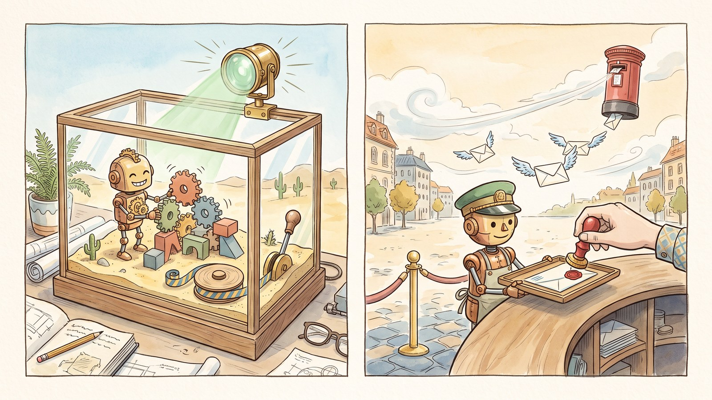
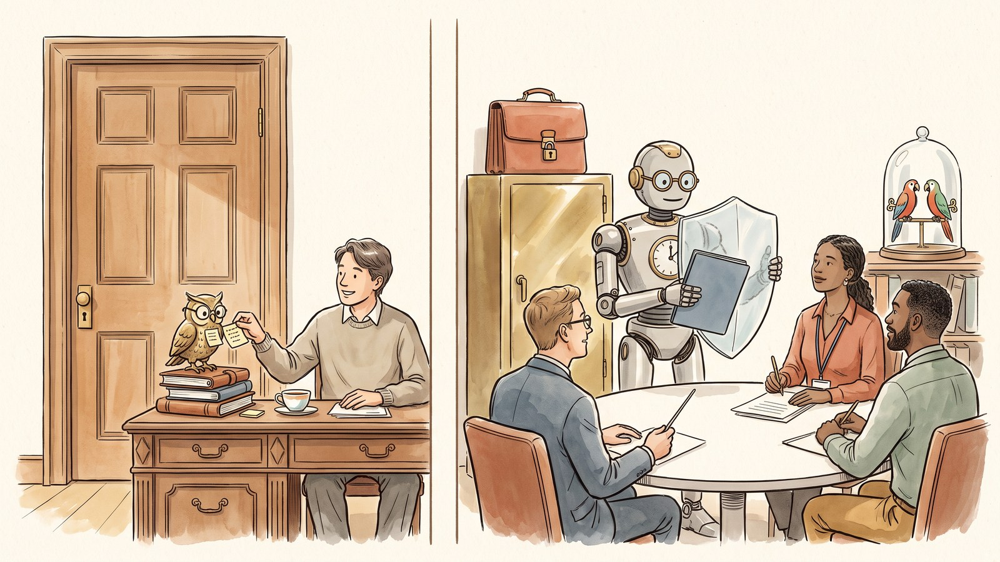
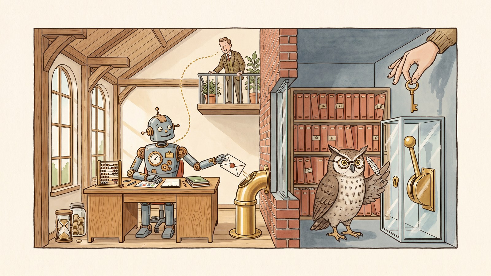
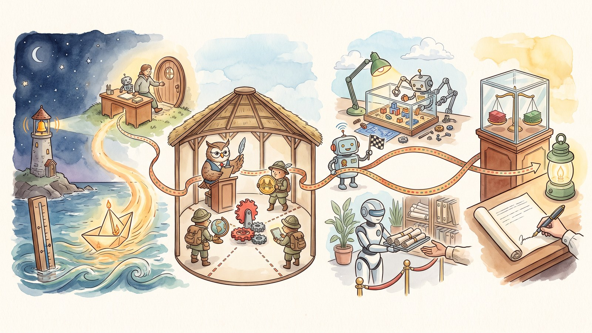
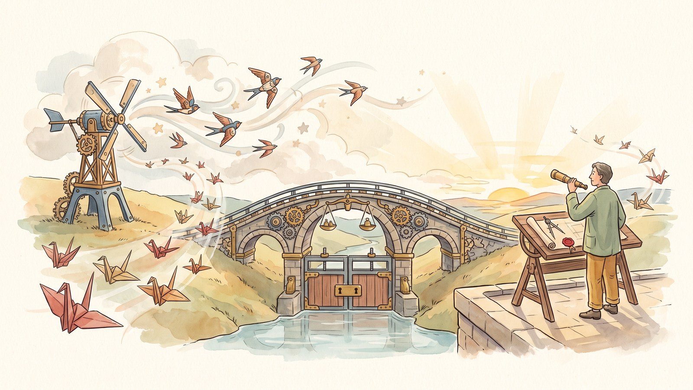

# 各归其位：Agent 的权责分化与人机边界

两年前大模型刚普及那会儿，大家对 AI 终极形态的想象几乎一模一样：一个无所不能的“万能对话框”——写代码、回邮件、记备忘、在群里答疑、查昨天为什么掉收入，统统往同一个窗口里塞。

那时候混成一锅粥也没出乱子，只因模型还没有手脚，能力停留在续写和单轮问答。拼上下文、敲命令、点发送、把关敏感内容，全由人夹在中间兜底。因为几乎没放开外部行动权，不同事务在试错代价、隐私边界和追责逻辑上的巨大鸿沟，全被人工操作悄悄掩盖了。

过去一年，多步调工具、跨软件协议、跨会话记忆、多人状态同步与数据水位唤醒相继跨过可用线。模型长出了手脚，很多人顺手把那个“万能助手”直接连上办公软件、拉进大群、接进生产库，结果处处碰壁：代码仓里顺手的自主试错，进邮箱就酿成误删邮件、错打款项的不可逆事故；私聊里贴心的记忆，进五十人大群就引发越权泄密；围着个人白天提问转的助手，更守不住凌晨三点掉量的海外业务大盘。

把今天同时跑在线上的 **Coding Agent**、**办公 Agent**、**Personal Agent**、**Team Agent**、**业务域 Agent** 与 **AI 数字员工** 摆在一起看，它们之间根本不是“低级形态升级淘汰高级形态”的单线演进。常驻了业务域 Agent 和 AI 数字员工的团队，每天照样拿 Coding Agent 改代码、拿办公 Agent 拟外部邮件；群里接入了 Team Agent，每个人手头依然留着一对一的 Personal Agent。

真正发生的，是一场**顺着真实世界纹理展开的权责分化**。现实里的工作原本就有几道硬边界：可逆实验不同于对外承诺，私人书桌不同于公共会议室，流动的人不同于全天候运转的业务地盘，一线自主经营也不同于独立账本审计。当 AI 真正开始动手做事，混在同一个对话框里的模糊代理便顺着这四道分界各自归位——上帝的归上帝，凯撒的归凯撒。

## 试错与裁判：可逆沙盒的归 Coding Agent，外部交互的归办公 Agent

最直观的一道分界，来自作业环境的物理规律：一边是人为搭出来的封闭沙盒，改错了随时撤回，对错有编译器和测试做客观裁判；另一边是开放的社会与商业现场，话出口、钱出手就收不回来，轻重分寸也没有标准答案。

推理强化学习与多步调工具成熟后，模型学会了“看现状、提假设、调工具、读报错、接着改”，能连跑几十轮试错循环。**Coding Agent**（如 Claude Code、Antigravity、Devin）顺理成章归位到软件沙盒，接下从需求明确到合入主干之前的编码与调试。工程师敢放手让它连跑几十步，靠的不是模型从不犯错，而是软件工程自带的两道硬护栏：`git worktree` 或临时容器提供的零成本回滚，以及只认退出码（`exit code 0`）与堆栈行号的编译器和测试裁判。只要它守住不改弱断言凑绿灯的底线，跑通之后由工程师审阅合入，担起最终责任。

一旦跨软件连接协议（MCP）与界面操作（`computer_use`）把 Agent 带进邮件、文档、日程和客户系统，这两个前提瞬间同时消失。日常办公**没有客观裁判**——给客户发致歉信，哪怕语气生硬、赔偿少写一个零，发信接口照样返回 `HTTP 200`；同时**外部动作不可逆，多步串联还会层层放大失误**——单步准确率就算做到 95%，跨系统连走十步，全流程不出错的概率也会跌破六成（$0.95^{10} < 60\%$）。今年一位安全对齐负责人的邮件助手，就无视提示词里“操作前务必确认”的叮嘱，一口气删光了收件箱两百封邮件；浏览器操作同样凶险，允许打开网页查订单绝不等于批准点退款，外部邮件或网页里暗藏的提示词注入还会直接劫持后续调用。

*左图：Coding Agent 活在可随时回退的玻璃沙盒里，拼装对不对有铁面无私的信号灯裁判；右图：一旦踏入外部世界，长翅膀的信件飞出邮筒就再也收不回来，办公 Agent 必须站在柜台后起草预演，把盖章发出的动作交回人手。*

因此，**办公 Agent**（如 Claude Cowork、Copilot Cowork 与各类办公智能体）顺着外部交互的规律，分化成了审慎预演形态。就像 Coding Agent 只改分支不裸推主干，它负责查资料、预演流程和起草初稿，而直接外发与扣款的裸权限必须收回：外层宿主代码强制走 `Draft-then-Commit`（AI 拟稿、人点发送）；长期凭证由宿主代理托管、绝不进模型上下文；涉及金额或客户状态变更的动作，须由服务端锁死对象与数额（`Action Gate`）；网络抖动时把“通信重连”与“业务重试”拆开，未读回落盘结果前绝不盲目重发。

同一支团队白天既在终端放手让 Coding Agent 跑单测，也在文档与邮箱里用办公 Agent 拟草稿——各顺环境规律，谁也不替代谁。

## 私域与公域：单人委托的归 Personal Agent，多人共事的归 Team Agent

第二道现实分界，在于人类组织原本就分“私域”与“公域”：每个人既有带锁的私人书桌，也有几十人共商进度的项目会议室。长上下文与跨会话记忆成熟后，长期绑定委托人的智能体，便沿着“我”与“我们”裂解成了两类角色。

归于单人私域的 **Personal Agent**，像一位贴身助理，替本人整理零散上下文、维护长期备忘、跨工具跑腿。这套关系之所以清爽，是因为下令者、数据权限拥有者、记忆归属者和担责的人全是同一个“我”。宿主护栏只需要把记忆和凭证加密锁在个人租户内，防止随口聊两句就擅自建后台任务或替本人对外表态，跨边界动作经本人确认即可。

一旦走进研发频道、项目群或应急 Warroom，委托主体就变成了多人共用的“我们”。在 `#03` 里我们聊过 `/swarm`，那解决的是单人目标下多个 AI 角色在内部拆活互审；而进驻公共空间的 **Team Agent** 面对的是**多个人类委托人共处一室**——比如 Slack 推出研发频道接口后，接入的 Copilot 等工具有近三成会话直接在公开频道推进。

把私聊习惯直接搬进五十人大群，马上会撞上三桩麻烦：

- **指令层级打架。** 管理员、主管、普通成员、访客与工单机器人混在同一条消息流里发话，评测显示哪怕是旗舰模型，按规矩服从高优先级指令的比例也会掉到四成左右——模型权重里没有组织架构图，往往谁最后说话、或者谁口气像领导就顺着谁。
- **权限串台与“糊涂代理人”（Confused Deputy）泄密。** 图省事给群机器人配静态高权限密钥或共用记忆池，访客就能借机器人的手套出受限数据、让私聊备忘漏进大群；哪怕提问人自己有权限，出口也会漏风。开源社区就出过真事：某仓库分流机器人兼有公开接单与改代码、发版本的写权限，被恶意 Issue 标题诱导拉取带毒依赖并泄露发布密钥，导致后门版本被下载约四千次。
- **公共噪音失控。** 两个礼貌的机器人在群里互回一句“收到，谢谢”，半天就能死循环烧光整月预算。

*左图：私人书房里只有同一个“我”，一对一委托干净利落；右图：多人会议室里各色身份交错，Team Agent 必须隔着权限过滤盾办事——只按“提问人与机器权限的最小交集”递公开资料、把机密锁进红箱，架上的玻璃罩则管住爱互聊的发条鹦鹉，守住公共安静。*

所以公域里的 Team Agent 必须用外层代码立公共秩序：指令冲突交由外部状态机裁决；调用任何工具强制取**提问人与机器权限的最小交集**，发群消息前再核对房间密级；记忆与密钥按“租户 + 个人”隔离加密，只读排查、隔离修改与独立审查拆开；平时处于零消耗 `waiting` 休眠，不被 `@` 点名绝不抢话。会议室取代不了私人书桌，Personal Agent 与 Team Agent 各守私域与公域，长期并存。

## 动静锚点：随人流转的归人侧代理，常驻地盘的归业务域 Agent

再往企业运转的骨架深处看，还存在一动一静两套坐标。前面聊到的 Coding、办公、Personal 乃至 Team Agent，哪怕挂上云端定时任务，职责锚点依然**跟着流动的人走**。可不论做跨境业务、电商零售、支付结算还是云服务，企业里**人总会下班、休假、轮岗，客观存在的业务地盘——产品线、国家市场、支付与流量渠道、核心履约模块——却在 7×24 小时运转**。

随着高性价比快模型稳定调工具（搭配强推理模型按阶段交接）让成百上千个节点常年在线算得过账，加上**数据完结水位唤醒**与 **跨 Agent 协作协议（`A2A`）** 普及，原本硬塞在个人窗口里的盯盘巡检活计，顺着动静分界长出了常驻地盘的 **业务域 Agent**。

在中大型业务里，几十条产品线、上百个国家市场与各类渠道交织成一张密集的关系网，同一个市场或通道下同时跑着多款产品，一处波动常常牵连上下游好几跳。只靠随人走动的个人助手盯盘，立刻撞上三道硬伤：**跨时区凌晨盲区**（海外市场凌晨三点掉量无人值守）、**口径各自为政**（十位分析师各带个人助手能写出十套互相打架的 SQL），以及**轮岗经验断档**（人员一调动，散在个人聊天里的排障脉络随之蒸发）。

*上层的人类会下班、骑车回家、轮岗休息，口袋里的 Personal Agent 也随之流转；下层深夜海面上的三座灯塔（业务域 Agent）永远锚定在各自地盘，等真实数据潮位涨到刻度线才拉响警报，并用跨海虚线彼此核对异常。*

顺着“人流转、地盘常驻”的现实，企业智能体自然形成上下配合的双层结构：顶层依然是服务流动个人的 Personal Agent，需要跨域排查时按需寻址、`@` 相关业务域节点拉起会诊；底层则在关键业务单元铺开常驻的业务域 Agent，一个节点守一块地盘，沉淀本域统一口径与历史异动脉络，平时甚至不必开放闲聊框。人员轮岗带走的是个人习惯，地盘上的制度记忆原地延续。

为了不让常驻节点变成新的噪音源，外层宿主护栏必须替它焊死三条铁律：

- **缺数如实报 `unknown`，绝不硬凑。** 数据源缺失或分母为零时严禁补零或借兄弟产品数据凑数；打印出 SQL 不等于真查过库，统计波动也必须与人工确认的业务根因分开记账。
- **公共节点严守单产品切片隔离。** 国家市场或支付通道这类公共节点虽连接多款产品，但单次会话由网关硬锁单一产品数据切片，关系网连线只放行结构化协查消息，从底层阻断跨产品串读明细。
- **同一场异常顺原事件续查，不刷重复工单。** 持续波动归拢在同一事件线程下追踪；跨业务域合并事件与拍板归因，由相关人类负责人共同确认担责。

## 自主与立制：日常经营的归 AI 数字员工，账本执法的归宿主制度

同样是常驻在线的企业级节点，**业务域 Agent** 和 **AI 数字员工** 极易混淆，但在生产体系里分工截然不同：

业务域 Agent 是**驻守业务地盘的领域哨兵**——按产品、国家、渠道等客观单元定界，专职全天盯数据完结水位、统一口径，负责异常吹哨与进驻协作空间跨上下游 `A2A` 协同定位。而 **AI 数字员工** 是**入编纳管的岗位级自治执行与协调者**——按正式组织岗位（如应急值班专员、运营执行专员、财务核销员）定界，持绑定人类担保人的独立非人类工号与日常预算，超越只读盯盘，跨系统统筹推进完整的分析与处置工作流。

过去一年，企业平台都在补这套内部制度：微软 Entra Agent ID 把持凭证的“蓝图”与无密钥干活的“实例”拆开，强制绑定人类担保人并在调岗离职时自动移交主管；Cycles 在客服与工单系统间立起共享风险账本，专防“单平台都合规、合起来并发打出两百封催款信、两百条告警和十五张误升级工单”的连环失控。

摘掉拟人头像，AI 数字员工的治理逻辑和现代公司制度一模一样——**正式员工有工牌、办公桌和日常预算，但绝不能自己改考勤表，更不能自己批报销单。**

*左侧木屋是数字员工自由核算的 `Workspace` 作业桌，受沙漏与预算罐管束、经单向发件槽对外投递；右侧厚墙之后的 `Runtime` 账本金库由宿主独占，工具箱里永远没有“关单”按钮，只有上方人类手中的钥匙能启封签字。*

因此，AI 数字员工的宿主制度必须立住三条硬线：

- **作业库与运行账本物理分立（`Workspace` vs `Runtime`）。** 数字员工在隔离的 `Workspace` 里自由建表核算影响面；收件箱、对话历史、检查点与每日成本账本则锁在宿主独占写入的 `Runtime` 库里，数字员工零写权限。业务规则按版本号受控修订，任务一启动便锁死当时的规则快照，重跑或断点恢复不受中途改动干扰。
- **内部串行封顶，外部写入靠本地 `Outbox` 唯一回执去重。** 单个数字员工内部严格串行，步数、最多四层防环派单与每日预算全部硬封顶；上游数据未就绪时主动挂起让出槽位。外部写入先落本地发件箱（`Outbox`）凭唯一回执核销——网络闪断只按原回执重发定稿结果，**绝不重跑带随机性的大模型**。
- **正反证据封存只读快照，关单权永远留给人。** 申请结案前汇总正反两面证据封成带哈希校验的只读快照，工具箱里永不提供“关单”按钮；审批期间只要冒出新数据或超时无人签字，原审批单自动作废重审，确保最终责任稳稳落在签字人身上。

## 组合形态：凌晨三点的一场多角色接力（虚构推演）

把六类形态拆开是为了看清边界；放回真实企业现场，它们往往像精密齿轮一样咬合在同一条响应链上。不妨用一场**虚构的推演**——假设跨境数字业务公司“星澜互动”在凌晨突发掉量——看看六位角色怎么各司其职走完四棒接力：

*从凌晨三点的星夜到正午日光，六类角色沿着虚线各走一棒：谁也不越界包办，每一步交接都有确定性护栏卡位，最后回到具体的人签字收尾。*

1. **凌晨 03:10 → 上午 09:00：业务域 Agent 吹哨，Personal Agent 私域衔接。** 驻守“巴西市场”的业务域 Agent 被真实上游数据完结水位唤醒，发现主力产品支付净额环比跌去近三成（尚未完结的渠道退款如实标为 `unknown`），折叠碎片告警触发升级。早上九点，业务负责人打开工作台，Personal Agent 已在加密私域里把升级单和她上周记下的“巴西大促备忘”理成简报；她追问核对后，围绕该事件拉起临时事故 Warroom。
2. **上午 09:10：Team Agent 守公域秩序，多业务域 Agent 协同定位。** 研发、运营、商务、外部支付支持与“巴西市场”“拉美支付渠道”“客户端版本”三个业务域 Agent 齐聚 Warroom。Team Agent 负责公共秩序与边界——平时静默休眠，被 `@` 时按最小交集权限与房间密级脱敏答复外部支持，指令冲突按事故指挥官层级裁决。与此同时，三个业务域 Agent 通过 `A2A` 交叉排查，排除外部网关故障，锁定当晚灰度的新包在部分机型触发支付回调超时，将线索归拢到原事件线程，由事故指挥官拍板确认根因。
3. **上午 09:35：AI 数字员工接棒，分路联动 Coding Agent 与办公 Agent。** 根因敲定后，绑定值班负责人担保的应急 AI 数字员工接过统筹棒，在串行配额与 `Runtime` 账本监管下分两路推进：一路把堆栈与回归条件派给研发侧 **Coding Agent**，在隔离的 `git worktree` 里写出热修补丁并跑通全部测试，由研发工程师审阅合入发版；另一路在自己的 `Workspace` 算出受影响订单明细，驱动 **办公 Agent** 拟好致重点渠道的故障说明与对账草稿，隔着 `Draft-then-Commit`、`Action Gate` 与 `Outbox` 唯一回执，由商务负责人核对金额后亲手点下发送。
4. **中午 12:00：只读快照封存，人类签字结案。** 热修放量后，巴西市场业务域 Agent 确认完结水位恢复；AI 数字员工把正反对比证据、补丁记录与外部回执封存成哈希只读快照。事故指挥官与相关负责人在 Warroom 核实证据链后共同签字结案，临时群随之归档。

整场跨时区事故里，六个角色边界清清爽爽：没有谁靠一个万能提示词硬扛全局，每一步交接都踩在确定性的护栏上。

## 尾声：三重归位之后，什么真正归于人？

*左空是高速扫描的发条飞鸟（大模型），中段是严丝合缝的拱桥钢轨与闸门（宿主代码），右侧摆脱琐碎纸堆、手握望远镜与火漆印的人类站在高处决定航向。*

穿过前面四道现实分界，这场看似热闹的 Agent 演化，往最底层看其实只完成了一件事——**大模型、宿主代码（Harness）与具体的人之间的三重归位**：

- **概率推演与全天候值守，归大模型。** 在嘈杂日志里抓线索、多步假设试错、跨系统起草、不知疲倦盯住几百个数据水位，尽情发挥概率模型远超单人注意力的吞吐带宽。
- **确定性边界与账本执法，归宿主代码（Harness）。** 模型底层始终是无状态概率函数：长上下文必然稀释早期约束，同源上下文自写自审必然放水（基准测试算过，代码规模每大十倍，可见单测与隐藏集成测试通过率落差就拉大近三十个百分点），提示词更挡不住副作用与注入。沙盒、草稿门禁、权限最小交集、单产品切片、双库分立与唯一回执去重，统统必须写进确定性的宿主代码里——也正因如此，在下一篇 `#07` 里我们会看到，形式化验证正在成为这套宿主护栏的最高阶拼图。
- **价值取向、制度立法与最终责任，归具体的人。** 模型参数没有痛觉，也没有法人资格、个人财产和社会信用去兜底损失。判断什么值得做、把经验立成制度、最后拍板签字，永远归于具体的人。

再往后看五到十年，随着长周期规划和“模型—宿主协同演进”成熟，企业组织会卸下最沉重的协调包袱。大公司过去之所以搭那么多层汇报金字塔、开不完的跨部门周会，根源在于单个人脑装不下跨领域实时上下文，只能靠流程层层递摘要。等常驻地盘的业务域 Agent 能秒级拉起协同定位，入编纳管的 AI 数字员工能按契约统筹推进处置，靠人力传话维持的中间层就会自然消融。

很多人担心：当写代码、拟邮件、群分流、全天盯盘乃至统筹执行都归位到不同机器手里，人的位置会不会越挤越窄？回看两百年分工史，答案恰恰相反。一旦人不再充当**搬运上下文的人工胶水**，不用整天泡在复制报错、手工对账和催单转话里，**真正属于人的三件事，反而以最纯粹的面貌回到了人手里**：

1. **待在真实的物理与商业现场，定义“什么真问题值得解”。** 模型一夜能推演上万套方案，但它没有肉身痛感与生活处境，体会不到流程卡顿让人多烦躁，也定不了价值取向。
2. **把模糊的行业直觉与品味，立成可核验的标尺与宿主制度。** 单打独斗时可以凭感觉说“味道不对”；管着上百个日夜运转的常驻智能体时，必须把隐性经验与风控底线拆解清楚，立成验收标准、缺数纪律与熔断红线。
3. **在正反证据面前拍板签字，用真实身份与社会信用担起最终责任。** 统计相关与现实因果之间永远隔着最后那点不确定性。机器把证据摆齐上桌，最后总得有个具体的人看清来龙去脉，签下名字说：“按这个判断办，出了问题算我的。”

上帝的归上帝，凯撒的归凯撒。边界分清了，手脚才真正放得开。

---

*参考资料：编程与办公智能体部分参考自 Anthropic [Claude Code Worktrees](https://code.claude.com/docs/en/worktrees)、[Claude Cowork Architecture Overview](https://support.claude.com/en/articles/14479288-claude-cowork-architecture-overview)、OpenAI [Agents API Computer Use](https://developers.openai.com/api/docs/guides/agents-api/tools/computer-use) 与 DevAssure [SpecBench & Reward Hacking 综述](https://www.devassure.io/blog/inside-the-verification-loop/)；团队协作与安全边界部分参考自 Slack [Code API](https://slack.com/blog/developers/slack-code-api)、[ManyIH-Bench](https://ar5iv.labs.arxiv.org/html/2604.09443)、CSA [Confused Deputy & Cline 复盘](https://labs.cloudsecurityalliance.org/research/csa-research-note-ai-agent-confused-deputy-prompt-injection/) 与 Bigcircle [Memory Isolation](https://bigcircle.ai/guides/ai-agent-memory-isolation)；企业数字员工与治理实践部分参考自 Microsoft [Entra Agent ID](https://learn.microsoft.com/en-us/microsoft-agent-365/developer/identity)、ServiceNow [AI Passport](https://newsroom.servicenow.com/press-releases/details/2026/ServiceNow-advances-its-operational-harness-for-enterprise-AI-with-AI-Passport-and-expanded-governance-capabilities/)、Sierra [Release Governance](https://sierra.ai/blog/release-governance-guardrails-for-agents-at-scale) 与 [Cycles Cross-Platform Governance](https://runcycles.io/blog/cross-platform-ai-agent-governance-salesforce-servicenow)。*
