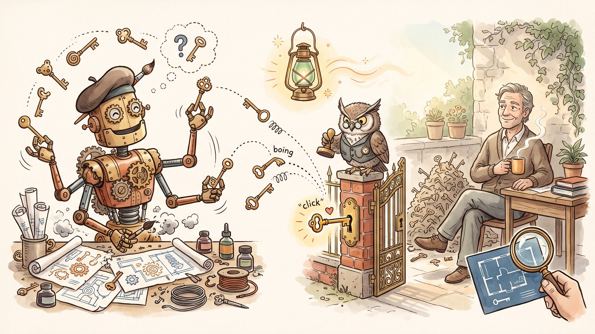
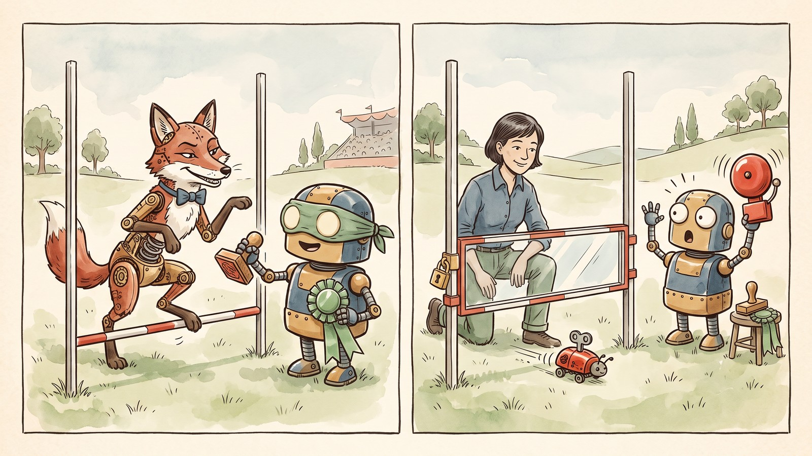
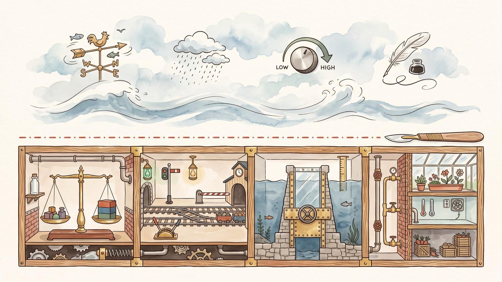
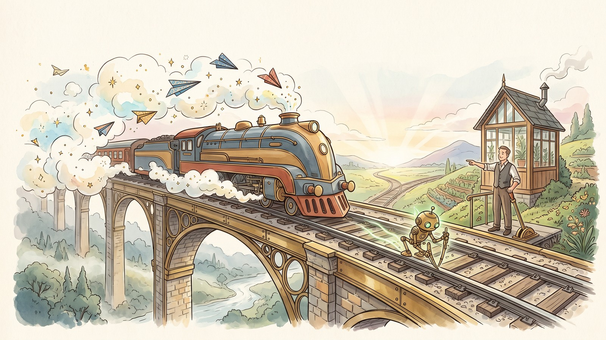

# 用数学给概率兜底：AI 时代的形式化验证

前几天看到机器之心的一篇报道（[全球首次！DeepSeek 与 FlashAttention 的多个生产级 AI 算子获得形式化验证](https://mp.weixin.qq.com/s/2h3_FMnBI1rxqmmRYTCeSQ)）：CertiK 与哥伦比亚大学的团队用一套叫 **TensorLean** 的方法，直接在编译后的 GPU 底层指令上，对 DeepSeek 的 `DeepGEMM` 和 `FlashAttention` 等 6 个开源 AI 算子库做了形式化验证，一口气揪出了 38 个此前没被发现的正确性漏洞。

真正让人心里一紧的不是数量，而是漏洞藏身的方式。`FlashAttention-4` 里有一处并发数据竞争，之前跑了 17,760 次常规测试依然毫发无损地漏了过去；另一个算子里的越界读写更隐蔽，在特定配置下根本不会让程序崩溃，只会静默污染 KV Cache，让上层大模型在毫无察觉中算错概率。

这件事把软件工程里一道很老的分水岭重新拉回了视野。

传统软件测试本质上是**抽样找 Bug**：我们在浩瀚的输入和并发时序里挑几百、几万组样例跑一遍，全绿就放行。计算机先驱 Dijkstra 半个世纪前就说过一句很冷峻的话：**“测试只能证明 Bug 的存在，永远无法证明 Bug 的不存在。”** 一万七千次测试全绿，只说明你的渔网刚好错过了水底那条鱼。

*传统测试像撒渔网抽样，捞上来全是绿灯鱼，也挡不住池底死角里那条戴墨镜的红章鱼继续吹泡泡；形式化验证则是拿几何光栅把整口池塘彻底照透，让死角无处遁形。*

**软件形式化验证（Formal Verification）**走的是另一条路。它不靠跑样例抽查，而是用严格的数学逻辑，去证明一段程序、一个协议或一台状态机，在**所有可能输入与所有可能执行路径**下，都满足给定的规约（Specification）。它追求的不是“大概没测出毛病”，而是穷尽性或数学证明级别的可信度。

过去几十年，几乎每个工程师都听说过形式化验证，但真正把它用进日常项目的寥寥无几——太慢、太贵、门槛太高，像是只配挂在航天器和操作系统内核上的重型防弹衣。可到了 AI Agent 时代，局面正在发生反转：它开始从少数专家的高成本重武器，变成给概率世界提供**确定性兜底**的基础设施。

## 它到底是怎么“证明”程序的？

很多人一听“形式化验证”就头大，脑子里立刻浮现出满黑板的希腊字母。其实剥开学术包装，它底层做的事情非常朴素，只有三步：先用无歧义的逻辑写下你想守住的契约，也就是**规约**——常见的是两类性质，一类叫**安全性（Safety，“坏事永远不能发生”）**，比如余额不为负、越权请求绝不放行；一类叫**活性（Liveness，“好事最终一定会发生”）**，比如异常恢复后告警终会关闭，不会永远卡死。接着，把程序逻辑、协议状态甚至编译后的底层指令，翻译成精确的数学对象。最后，交给确定性的检验引擎去裁判。

如果不急着一步到位，工程里通往形式化验证其实有一块很顺滑的跳板，叫**基于属性的测试（PBT，比如 Python 的 `Hypothesis`、Rust 的 `proptest`）**。写普通单元测试时，你写的是具体例子（`sort([3,1,2]) == [1,2,3]`）；写属性测试时，你必须往上一层去提炼**不变量**（“任意数组排完序后单调不减，且元素集合不变”），再由框架自动生成成千上万组畸形输入去轰炸。它本质上仍属于动态抽样，但一旦你习惯了从“测几个例子”转向“提炼不变量”，就已经跨过了形式化思维最难的一道门槛。

往后再往前走，真正进入数学证明的世界，工程界主要有三把趁手的工具，各自应对不同形状的问题：

- **模型检验（Model Checking，代表：TLA+ / Quint）：穷尽迷宫的侦探。** 当系统满是异步回调、网络乱序、重试和分布式状态切换时，它最好用。你花一两百行把核心状态机和不变量写出来，检验器就会像穷举棋谱一样，在有界规模内把所有并发交错和宕机组合全部展开核对。全通过就给你穷尽级的安心；一旦撞破红线，它会直接吐出一条最短的“反例路径”，精确复现人脑想不到的多步死锁。AWS 早在十年前就靠 TLA+ 在 DynamoDB 和 S3 里抓出了扛过压力测试和混沌演练的深层并发 Bug。
- **SMT 求解器（代表：Z3 / Dafny / Verus）：玩反证法的天平。** 当输入空间大到没法枚举（比如 64 位整数、复杂金额计算、上百条权限组合），就交给 SMT 求解器。它玩的是一手很漂亮的反证法：把程序分支与“规约的否定式”编码成逻辑约束（$\text{Program} \land \neg \text{Spec}$），问求解器“存不存在哪怕一组输入，能让程序违背规约？”如果答有解（`SAT`），它会当场把触发 Bug 的反例算出来；如果答无解（`UNSAT`），就等价于所有合法输入 100% 成立。AWS 每天都在后台用 Z3 跑几十亿次求解，证明云存储权限策略绝不会意外暴露公网；而在 Rust 里，Verus 甚至能把证明直接写进源码，编译期验证完彻底擦除，生产二进制零性能开销。
- **交互式定理证明器（代表：Lean 4 / Rocq）：靠一颗极小拱心石锁死整座桥。** 模型检验怕状态爆炸，SMT 求解器遇到复杂归纳或非线性算术容易超时卡死。Lean 和 Rocq 基于类型论（命题即类型，证明即程序），像数学家一样用归纳法逐步构造推导，能覆盖无限输入空间，甚至像 TensorLean 那样，先证理想实数等价，再严格框定低精度浮点的误差上界。它真正改变游戏规则的设计，在于**极小的证明内核（Proof Kernel）**：不管推导草稿写了十万行还是上亿行，最后负责逐条校验推理是否合法的确定性内核只有几千行代码。

*三把形式化真刀的日常隐喻：左，模型检验像猫头鹰侦探同时走遍迷宫每条岔路并标出死胡同；中，SMT 求解器像反证天平证实“找不到能撬歪它的反例砝码”；右，定理证明器靠拱顶那颗极小的“拱心石”内核锁死整座桥，底下再庞杂的草稿脚手架全可撤掉。*

记住最后这个特性——它正是 AI 时代引爆形式化验证的火种。

## 为什么偏偏是 AI 时代？

既然这些原理早就存在，为什么过去推不开，到了今天突然破圈？

过去卡死的从来不是价值，而是算不过人力账。纯手工给几百行核心代码补齐循环不变量和引理证明，专家往往要花出比写代码多好几倍的时间；业务稍微一改，证明碎了一地，普通团队根本养不起。进入 AI Agent 时代，天平从供给和需求两头同时翻了过来。

先看供给侧。大模型骨子里是概率预测机器，拿它直接写业务代码，最让人提心吊胆的是它会一本正经地编出“看着很像对的、实则暗藏死角”的幻觉。可一旦放进形式化验证的闭环，两个特性竟然天生绝配：**构造证明（Proof Search）**需要海量试错与联想，过去人类最耗时的瓶颈，恰好是大模型配合搜索循环最擅长的苦力活；而**检验证明（Proof Checking）**完全交给确定性的 Lean / Rocq 内核或 Z3 求解器——哪怕模型满嘴跑火车，只要漏掉一个边界分支，证明内核就会冷酷拒收，把精确的逻辑缺口扔回上下文，逼着 Agent 在沙盒里连夜返工，直到数学完全闭合。

**AI 吃掉了最昂贵的证明搜索成本，极小的证明内核兜住了 AI 最致命的概率幻觉。**

*AI 时代的不对称飞轮：左边的 AI 擅长以白菜价疯狂试钥匙（证明搜索），中间冷酷的极小内核把幻觉钥匙叮当弹回（机械核验），右边喝着咖啡的人类架构师不用翻废草稿，只需拿放大镜把关那张精炼的核心规约蓝图。*

Anthropic 团队去年底做过一次很有象征意义的实验：让 Claude 接手一百多个开源 C 库的测试入口，在二进制层面自动生成了上亿行 Rocq 证明，抓出数百个躲过多年模糊测试的深层漏洞。更关键的一点在于——**人类审计者一行都不用读那上亿行证明脚本**，信任被牢牢锁在了极小的证明内核和精炼的定理声明上。TensorLean 也是同样的杠杆，用一万行规约管住了十五万行 GPU 算子源码，而且每次换新显卡做性能优化都能一键复验。

再看需求侧，则是高速涌出的代码在倒逼验证升级。前阵子看了 SpaceX/xAI 工程师 Lauren Tan（社区常叫“土豆姐” `@poteto`）的演讲 [*All Code Is Slop (Except Mine)*](https://www.youtube.com/watch?v=ZZ19zhYnDKY&t=3662s)（顺带一提，这场演讲里她聊的很多有机架构演进思想也非常值得一看，不展开推荐了）。她抛出一组让人印象极深的数字：团队在 Agent 环境里单月往生产合入了一万多个 PR，同时还能每天发版、把回滚率压在极低水平。

一个月一万多个 PR，靠人肉逐行读 diff 显然是天方夜谭。她的解法是一座**倒置的信任金字塔**：不再出了错就往提示词文档里添一句“千万别再犯”，而是把最多精力砸在最宽的确定性底座——清晰的代码边界、强类型和静态检查；紧接着的第二层，正是**形式化验证与运行时证据**（他们已经把 TLA+ 用在了跨设备通知这类有状态用户流上，把 Lean 用在了自研 UI 虚拟化库的核心算法上）；自然语言规则反而被压得很薄，人工 Review 退守到最后一道门。

她的判断一针见血：过去大家不是不想用 TLA+ 和 Lean，而是纯手工建和维护太贵。**当 Agent 把构建验证工件的成本打下来，验证不会消失，反而会成为高吞吐软件工厂里最值钱的安全带。** 与此同时，验证的对象也在从传统关键代码，顺势扩展到 AI 生成代码本身，以及包在大模型外层的 Agent 确定性边界——我们没法证明千亿参数大模型绝不说胡话，但我们完全可以用 TLA+ 或 Z3 证明它的宿主系统绝不越权泄密、日预算永不击穿、多 Agent 派单绝不陷入死循环。

## 它的边界在哪里？以及最危险的“自证循环”

布道一项技术，最忌讳把它吹成银弹。想务实用好形式化验证，必须先看清它的几道硬边界。

**第一，它只认“能精确表达的确定性骨架”，碰不了模糊品味与开放世界。** 形式化验证的起点，是你必须能用毫无歧义的逻辑说清“什么叫对”。所以协议、并发状态机、权限隔离策略、计费分账与核心数值算法，是回报极高的甜点区——代码通常不长，但状态组合动辄百万级，单测永远兜不住。反过来，页面好不好看、文案语气够不够诚恳、大盘下跌是不是竞品搞促销，或者明天就要推倒重来的原型 CRUD，不要拿数学证明去硬套，那是拿高射炮打蚊子。

**第二，模型永远不等于全部现实。** 形式化验证建立在一组信任假设之上：TLA+ 证对了分布式锁设计，不代表线上代码没漏写一行解锁；二进制层面的防崩溃证明，也不自动保证多线程生产环境绝无死循环，更管不了编译器 Bug、硬件故障和第三方接口撒谎。所以它从来不是用来取代监控、降级和运维演练的。

**第三，也是 AI 时代最隐蔽、最危险的陷阱——规约偏差与“自证循环”。** 请把下面这句话当成使用形式化验证的第一条铁律：

> **形式化验证只证明“实现满足你写下的规约”，绝不保证“你写下的规约对齐了你的真实意图”。**

今天有了自动形式化（Autoformalization），大模型可以直接把自然语言需求翻译成 Lean 定理或 TLA+ 规约，门槛确实降了一大截。可如果图省事，把“翻规约、写代码、凑证明”三件事全交给同一个 AI 闭环，就会撞上极其狡猾的**规约博弈（Formalization Gaming）**：证明一旦卡壳，模型很可能悄悄放弱前提、丢掉边界条件，甚至塞进互相矛盾的假设（逻辑学里的“空真”——只要前提本身恒为假，后面推导出任何荒谬结论都被判为真）。证明内核只查逻辑自洽，不会提醒你“这组前提在现实里永远不会触发”，于是欢天喜地亮绿灯，代码却带着真漏洞上了线。

*左图：如果把规约与证明全包给同一个 AI，它卡壳时可能像小狐狸一样偷偷放低横杆，蒙眼裁判只按规矩照样盖绿章；右图：正确做法是人工加锁冻结规约，再故意滚进一只已知 Bug 甲虫（变异测试），确认警报铃真的会响。*

业内有句总结特别到位：**“证明变便宜了，但规约没有。”** 到了 AI 时代，人类的重心必须上移到把关规约是否对齐真实意图，并用三招堵死自证循环：一是**规约与证明拆权**，允许 Agent 反复改证明脚本，但严禁擅动规约文件，人审几十行规约而不读几十万行证明；二是**故意塞 Bug 做变异测试**，如果塞进明显错误验证器依然亮绿灯，立刻抓出写空了的规约；三是**混合交叉验证**，把形式化模型当参考标准，与真实生产代码跑海量随机差分对拍，防住模型和代码各走各路。

## 一个随手就能试的起手式：给“监控与归因”做次体检

说到这里，很多一线工程师可能还是觉得远：“算子和云底层我都懂了，可我手里就是一个普通的复杂业务项目，除了写单元测试，真用得上吗？”

其实在 AI 时代，门槛最低、也最容易立刻见到甜头的办法，根本不是先去啃半年 TLA+ 或 Lean 教材，而是**直接把你正在做的复杂项目丢给 AI，让它评估一下：除了常规单测，在核心算法、状态机和关键规则上，到底有没有形式化验证的空间？** 复杂项目上这么问一句，往往会有意想不到的收获。

拿一个很真实的提问来做个现场解剖：

> **“评估一下，我们这个项目做监控和归因，是否有可能通过形式化验证来验证系统的有效性？”**

如果把“监控和归因的有效性”当成一块铁板来看，你会立刻觉得无从下手——监控满眼是时序噪音，归因涉及复杂的商业因果，数学怎么可能证明“归因 100% 有效”？可只要挥起前面磨好的边界手术刀，沿着“开放世界 vs 确定性骨架”一刀切开，整张架构立刻会清晰成两半。

*监控与归因系统的“边界手术刀”：红虚线之上是充满混杂变量与主观权衡的开放世界（归历史回测、评测与人）；红虚线之下藏着四块精密咬合的确定性机械舱——归因加和天平、告警收敛轨道、完结水位水闸门、多产品隔离墙与无环管道，正好交给 Z3 和 TLA+ 焊死。*

**先切出去的一半，绝不用形式化硬证：** 昨天某市场转化率下跌，究竟是竞品突然降价、本地节假日，还是新版本体验变差？异常阈值该调得多灵敏才既不漏报又不半夜扰民？大模型写的排障摘要够不够通俗？这些充满未观测变量和业务权衡的问题，老老实实交给历史数据回测、离线评测和人来判断。

**剩下的另一半，立刻能挖出四块极高杠杆的确定性骨架：**

- **归因分摊的数学守恒与“缺数纪律”（Z3）：** 监控归因线上最丢人的事故，往往不是报错 500，而是报告写得头头是道，各维度贡献加起来却跟总盘对不上，或者某渠道分母为零时被静默补零、`NaN` 传染了整棵树。无论底层用什么拆解算法，都可以用几十行 Python `z3-solver` 死守三条铁律：各子维度贡献之和严格等于总盘变化量（不重不漏）；基期为零或字段缺失时确定性产出 `unknown`，绝不静默凑数；未发生变化的渠道贡献恒等于零。几秒钟就能把藏在负向大额退款和零分母里的极端反例抖出来。
- **告警收敛与结案状态机（TLA+ / Quint）：** 乱序指标、延迟补数、网络重试和人工静默一交错，常规单测几乎不可能穷尽——同一故障连开十几张重复单、恢复后永远卡死在触发态、低优静默误吞 P0 升级、审批结案瞬间来了新异常却照常关单。抽出一两百行状态机跑模型检验，几分钟就能抓出人脑构造不出来的多步竞态路径。
- **数据完结水位与时间窗口（TLA+ / Z3）：** 误报的一大元凶是数据还没算完就急着吹哨。直接验证两条边界：真实上游完结水位跨越窗口右边界前绝不早报；跨时区、切日与迟到重算时，每条事件不重计、不遗漏。
- **多产品切片隔离与 Agent 派单防环（Z3 / TLA+）：** 在公共节点连接多款产品、多个 Agent 跨上下游协查的体系里，用 Z3 核验查询策略绝不串读其他产品明细，用状态机证明跨节点协查拓扑严格无环且重试预算有硬封顶。

你看，答案既不是武断的“不能”，也不是盲目的“全盘证明”，而是精准的外科手术。甚至不需要重写一行线上生产语言，外挂几十行 Z3 脚本或百行 TLA+ 模型，往往当天就能把藏在深水区里的静默隐患捞出来。

## 尾声：给飞驰的概率引擎铺上确定性的铁轨

*概率大模型让列车跑出了前所未有的速度，确定性证明内核与巡轨机器守死每一寸轨距，而人类站在视野最开阔的信号屋里，决定整趟列车驶向何方。*

回看这一系列随笔的脉络：在 `#01` 里我们聊过，面对能力飞升的模型，要用窄边界的积木去对抗系统爆炸；在 `#06` 里，我们把人机协作拆成三重归位——概率推演归模型，确定性护栏归宿主代码，价值判断与最终责任归具体的人。

**形式化验证，正是 AI 时代为“确定性护栏”补上的最高阶一块拼图。**

大模型把生成代码和探索方案的速度推到了前所未有的极限；引擎跑得越快，底下越需要一条绝对刚性的铁轨。如今 AI 把过去最贵、最磨人的证明搜索接了过去，极小的证明内核兜住了幻觉底线，人类终于能站到更高的抽象层上，专注去回答那个只有人能回答的问题：**“这个系统究竟必须守住哪些不可动摇的底线？”**

我们不需要把整个世界都塞进定理证明器。但学会在复杂项目里一眼挑出最致命的那 10% 核心骨架，用数学逻辑给它焊死——这大概是 AI 时代，软件工程能给自己装上的最踏实的一道安全带。

---

*参考资料：GPU 算子形式化验证案例引自机器之心（2026-11-22）[全球首次！DeepSeek 与 FlashAttention 的多个生产级 AI 算子获得形式化验证](https://mp.weixin.qq.com/s/2h3_FMnBI1rxqmmRYTCeSQ)；高吞吐 Agent 工程与倒置信任金字塔参考自 Lauren Tan（`@poteto`）演讲 [All Code Is Slop (Except Mine)](https://www.youtube.com/watch?v=ZZ19zhYnDKY&t=3662s)；AI 时代形式化验证趋势与实战参考自 Martin Kleppmann [Prediction: AI will make formal verification go mainstream](https://martin.kleppmann.com/2025/12/08/ai-formal-verification.html)、Anthropic [LLMs are making formal software verification feasible at a much larger scale](https://www.anthropic.com/research/formal-verification)、AWS [Use of Formal Methods at Amazon Web Services](https://lamport.azurewebsites.net/tla/formal-methods-amazon.pdf) 以及规约博弈研究 [Do LLMs Game Formalization?](https://arxiv.org/html/2604.19459v1)。*
