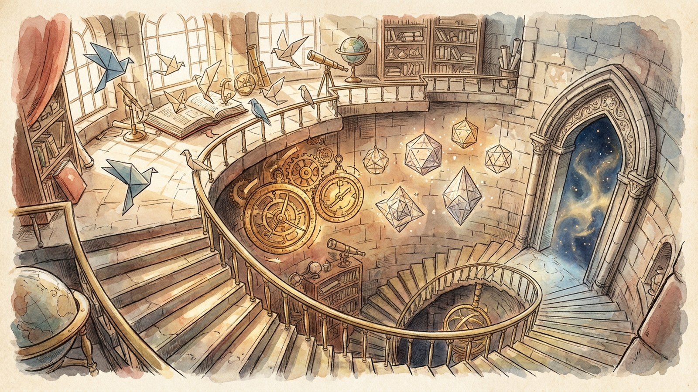
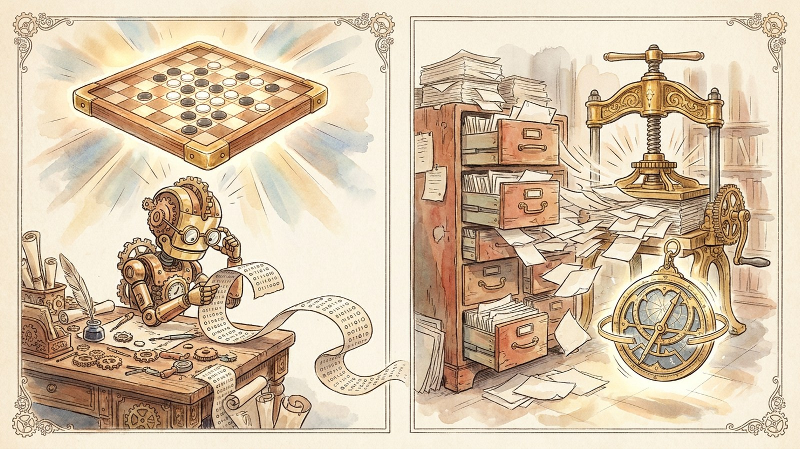
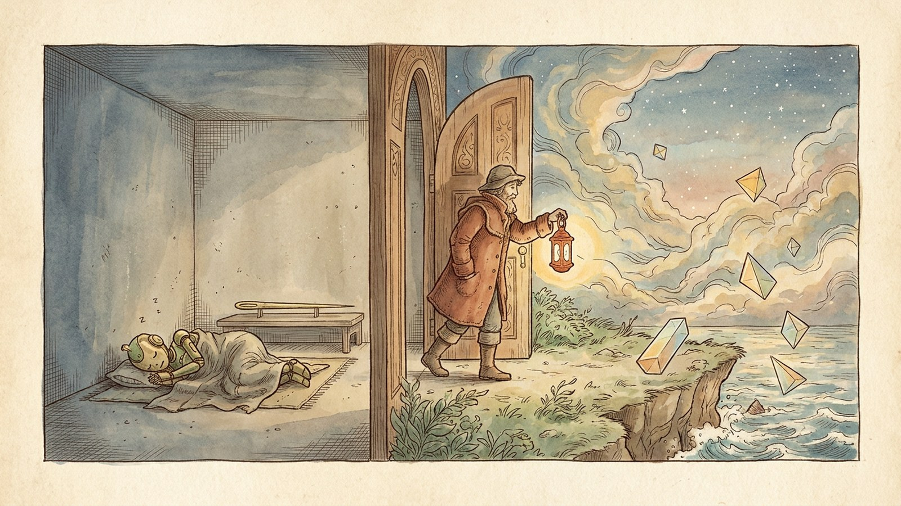

# 逼近 0.618：压缩、泛化与智能的本质

前几天，OpenAI 首席科学家 Jakub Pachocki 罕见地公开了一组内部指标：从 GPT-3.5 一路到最新内部模型，在固定代码库上的对数困惑度曲线。

曲线本身非常朴素，只有一个纵轴数字在往下掉。可随着这个数字从 `0.99` 降到 `0.91`，再压进 `0.83`、`0.76`，一连串从未在预训练里被单独设计过的能力接连冒了出来——流畅对话、受益于“先想再答”的思维链、写代码、安全攻防，直到解出长期悬而未决的前沿数学难题。在图表最底部 `0.68–0.70` 那条线下方，Pachocki 只留下了一个问号。

看着那条一路俯冲、贴近 `0.68` 的曲线，不少人忍不住开起了一个带着几分浪漫的玩笑：再往下走一点，就是 **`0.618`**——自然界与美学里反复出现的黄金分割点。难道 `0.618`，就是模型智能的终极奥义？

玩笑归玩笑，数字本身的巧合当然没有魔力——困惑度的绝对数值本就取决于分词方式和评测数据集。但这个小插曲之所以让人会心一笑，是因为它恰好撞上了一个严肃的问题：那条曲线一直往下压，尽头到底在哪里？

*困惑度一路向下，从未被单独设计的能力顺着同一条曲线接连浮现，尽头是一个尚无法命名的问号。*

这组曲线把一个反复被提起的命题推到了台前：**压缩即智能**。

预训练做的事情看起来简单到近乎粗糙——不过是盯着海量数据猜下一个词，把预测误差一点点压低。可为什么仅仅是把“压缩”推向极致，就会长出看起来属于推理和创造的能力？如果我们把大模型看作一座高度压缩的数据库，它凭什么具备面对未知也能成立的泛化能力？顺着这条线往底处想，智能的本质到底是什么？

## 规律是被压缩逼出来的

在信息论里，预测和压缩本就是同一件事。能猜中的部分不必存下来，猜不中的例外才占空间。

假如要向别人转述一串 24 颗红蓝珠子，逐颗报色要说 24 遍；如果看出其中结构，只需要一句话：“红蓝交替 12 次，第 17 颗改蓝。”规则替你省掉了大段重复记录，剩下的例外才是真正需要传输的信息。语言模型也是如此：收发双方共用同一个预测模型时，模型对下一个词猜得越准，无损还原整段文本所需的比特就越少。困惑度衡量的正是这件事。

有意思的地方在于，压缩不只是在省空间，它还会反向逼出对世界结构的把握。

有一个很干净的实验：只把黑白棋的落子坐标按顺序喂给模型，从不教它规则，也从未给它看过棋盘，只要求它预测下一手落在哪里。按说模型可以去背常见开局和局部套路，可后来研究者检查它的内部状态时发现，它竟然自己长出了一张完整的 8×8 棋盘，清清楚楚追踪着此刻每个格子是黑、是白还是空。人为拨动它内部代表某一格棋子的状态，它对下一手的判断立刻随之改变。

*只读坐标序列却在内部重建了整张棋盘；当存储空间收紧，臃肿的查表记忆被迫坍缩成简洁的规则。*

**规律不是谁塞进去的，而是压缩压力逼出来的。** 把每一盘棋的走法死记下来太费空间，想要把预测误差再往下压一点，唯一的出路是自己悟出棋盘背后的规则。

## 当一座数据库装不下世界

很多人习惯把大模型理解成一座“高度压缩的数据库”。这种说法常常带着一丝轻视：把十万本书压成一个压缩包，再怎么省硬盘，它终究只是个死档案，书里没写过的问题照样答不上来。

可问题恰恰出在这里——为什么一个“高度压缩的数据库”，没有变成一堆糊掉的旧碎片，反而表现出了面对陌生局面也能举一反三的泛化能力？

反过来想一步，就能看清其中的反转：**记忆越完美，越不需要智能。**

一张 1:1 比例尺的地图最精确，却毫无用处；一个能记住每一片树叶在每一秒钟不同光影的头脑，反而认不出什么叫“树叶”。只要存储空间无限大，最省事的策略永远是死记硬背——把见过的一切原封不动存下来。这样存出来的档案最忠实，也最无能：世界稍微换一个没见过的角度，它就束手无策。

神经网络面临的是相反的处境。它的参数容量终究有限，而它必须吞下的世界经验近乎无限。死记硬背很快就会撞墙，系统被迫开始**遗忘**——舍弃那些一次性的表面细节，只留下在不同场景下反复成立的骨架。

压缩越过临界点之后，数据库里的东西就变了质。传统压缩包存的是被折叠起来的旧数据；神经网络在容量挤压下被迫存下来的，是**生成数据的规则**。

假设面前有一百万个散落在圆周上的点。当成数据库存下来，是一百万组坐标；压到尽头，只剩下一行方程 $x^2 + y^2 = r^2$。最微妙的跃迁就在这一刻发生：你原本只是为了省空间、去压缩过去见过的那一百万个点，可这条最短的生成规则，顺手就把第一百万零一个从未见过的点也算出来了。

*1:1 的庞大档案穿过有限容量的瓶颈，被迫坍缩成一条极简的生成法则，从而把边界延伸进从未见过的区域。*

所以，泛化能力并不是压缩之外多出来的神秘附赠品。当你只能用有限的尺度去容纳无限的现实，抽离共性、丢掉噪点、把事实压成生成法则，是唯一行得通的活法。人类语言里的每一个抽象概念，本质上也是大脑在有限带宽下做出的有损压缩——丢掉每一只具体猫的偶然差异，留下那个能接住陌生新例子的结构。

这件事之所以能走通，背后还藏着一个更深的哲学前提：**世界本身是可压缩的。** 如果现实只是一锅毫无秩序的随机噪声，任何压缩都会失败，过去也无从推演未来。模型从压缩里长出泛化，本质上是有限的载体在高压之下，撞上了宇宙深处本就存在的简洁秩序。

## 压缩的尽头，和压缩做不到的事

把“压缩”讲透之后，还得冷静看清它的两道边界。否则很容易把一个锐利的洞见，用成一句遮蔽问题的口号。

第一道边界，是**不可压缩的余数，以及“算对”与“理解”的断层**。

不管困惑度的底线最终停在 `0.618` 还是别的什么数字，它都永远不可能降到零。现实里有真正的随机，更有尚未落子的自由选择——今晚的一则预告里，本来就没有明早签约还是取消的答案。越逼近数据固有的不确定性底线，困惑度表面上降得越慢，可每一次微小的下探，都要求模型触碰更深层的因果。

更耐人寻味的是最近数学界出现的奇观：AI 已经能协助数学家写出上千万行、通过严格程序校验的黎曼猜想形式化证明，可人类数学家眼下依然讲不清它“为什么成立”。这暴露了一个容易被混为一谈的区别：对机器而言严丝合缝的高维压缩，并不自动等于人类的理解。人类所谓的理解，其实是把庞杂推导再次压进人脑有限带宽里的**二次压缩**。当压缩器的表达维度甩开人类太远，真理本身也会显得陌生。

第二道边界，藏在一个更尖锐的思想实验里。

如果智能的唯一目标就是把预测误差压到最低、让世界毫无意外，那最理性的选择根本不是去认识宇宙，而是把自己关进一间漆黑、隔音、一成不变的屋子。在暗室里，下一秒永远和上一秒相同，困惑度直接归零。

*只追求预测误差归零，最完美的归宿是左侧的暗室；活着的智能却会推开门，走进充满意外的现实。*

可活着的智能恰恰拒绝待在暗室里。它不会为了“猜得准”就退回死水，而是主动推开门，走进充满噪音和不确定性的现实里去试探、去干预、去承受反例，再把新撞出来的世界重新压成秩序。被动压缩历史数据，只能拟合一个静止的世界；敢在未知里行动并接受现实的敲打，智能才算真正闭环。

## 智能的本质

*混沌穿过有限的棱镜被压成秩序，而决定光束下一刻投向何方的，不在棱镜本身。*

回头再看“压缩即智能”，它真正有力之处，在于剥掉了智能身上所有神秘的修辞，露出了最朴素的物理起点：**以有限对抗无限。**

载体有限，世界无限。装不下，就必须遗忘；遗忘杂音，就逼出规律；有了规律，静态的记忆就坍缩成了动态的生成法则，由此长出面对陌生世界的泛化能力。这是智能最坚硬的骨架。

但压缩本身并没有方向。面对同一片浩瀚现实，该保留什么、舍弃什么、什么时候走出那间毫无意外的暗室，答案不在交叉熵曲线里。

回到开头那个关于 `0.618` 的小插曲。这个数字当然不会真的是宇宙写死的通关密码，却意外成了一个极好的隐喻：如果 `1` 是毫无规律的混沌，`0` 是毫无意外的死寂，那么智能从来不属于这两端的任何一边——它恰好活在秩序与未知之间的某个微妙张力点上，既能把纷繁的过去压成规律，又留着足够的空白，让人愿意推开暗室的门继续往前走。

智能的本质，从来不是记住一切，也不是算尽一切——而是**在有限之中把混沌压出秩序，又敢带着这份秩序，主动走向不可压缩的未知**。

---

*延伸阅读：OpenAI 首席科学家 Jakub Pachocki [Perplexity and Intelligence](https://openai.com/index/perplexity-and-intelligence/)、机器之心编译报道 [《刚刚，OpenAI首次公开预训练核心指标》](https://mp.weixin.qq.com/s/naPnZnOTCEMixOAsHG4OWQ)，以及小红书笔记 [《压缩即智能？》](https://www.xiaohongshu.com/explore/6b056c74000000002b0329fd?xsec_token=CB8awwuYrHVZCEJvOqxdQfAym0s30hwEK6oNg7ODpsfMs=&xsec_source=app_share)。*
