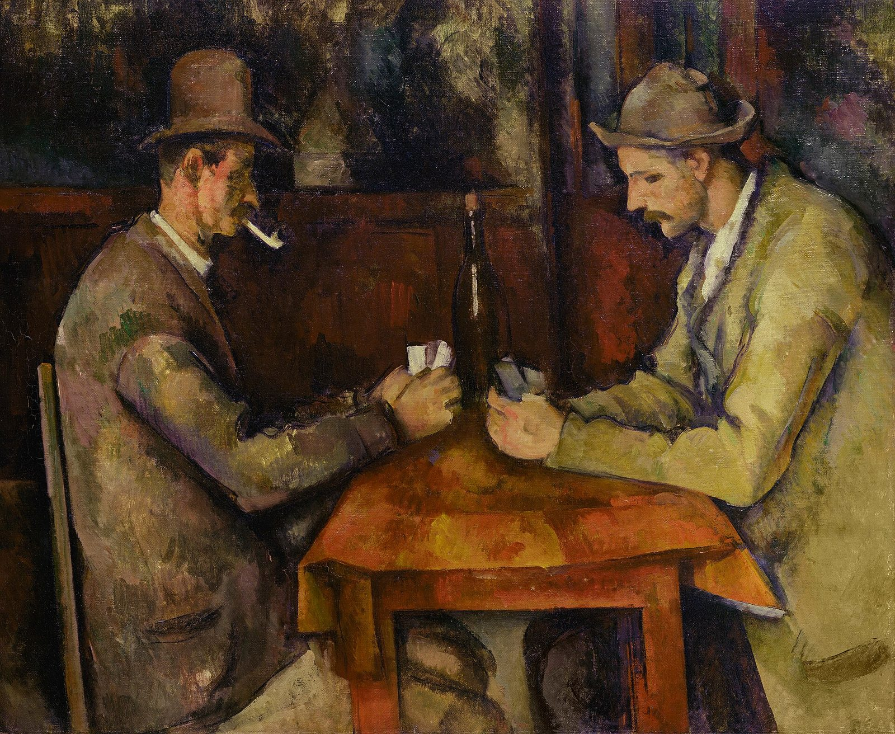
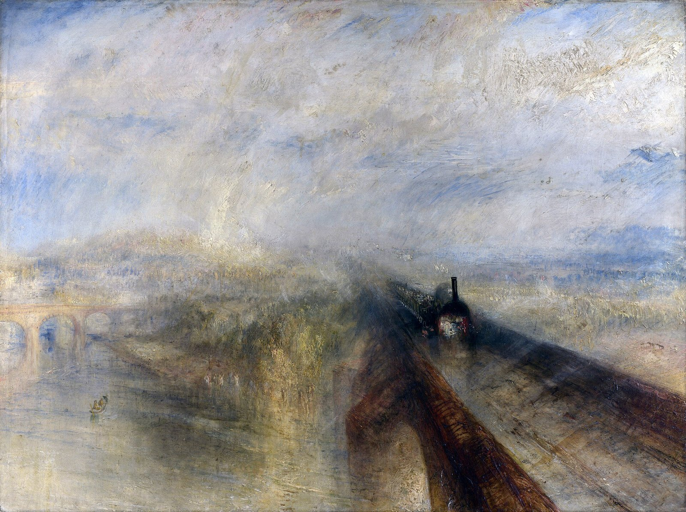
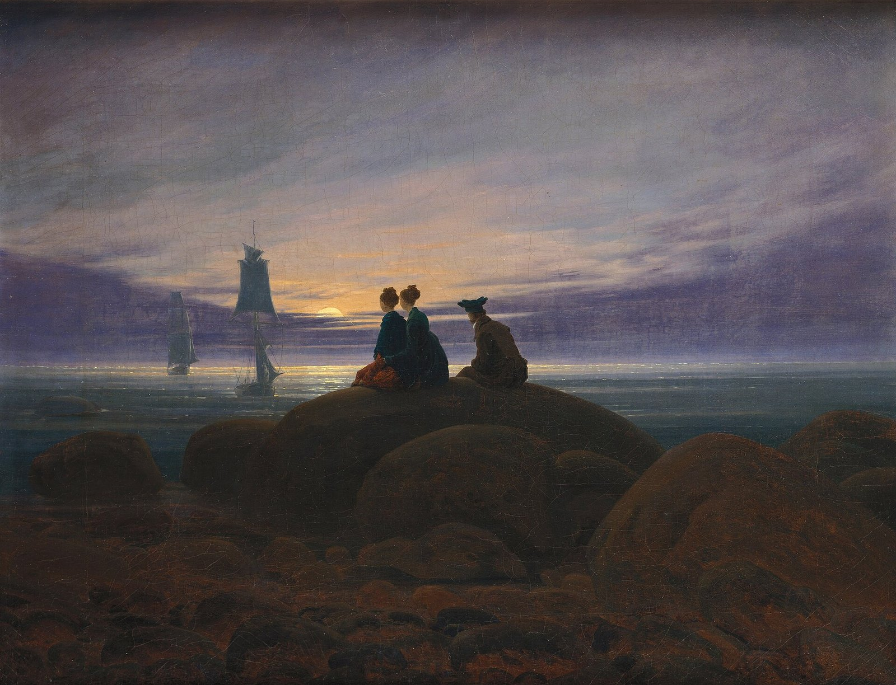

# 机器与花园：AGI 前夜重读《有限与无限的游戏》

1986 年，纽约大学宗教史教授詹姆斯·卡斯（James P. Carse）写过一本很薄的小书，叫《有限与无限的游戏》（*Finite and Infinite Games*）。

全书第一句话流传极广：“世上至少有两种游戏：有限游戏以取胜为目的，无限游戏以延续游戏为目的。”

过去很多年，这句话频繁出现在书腰和商业演讲里，听久了难免显得轻飘飘，像在劝人把眼光放长远些。可这两年，当 AI 真正进入日常工作、以周为单位刷新能力边界，再把这本四十年前的哲学小书翻出来重读，字句背后的分量忽然沉了下来。它谈的不再只是抽象的人生修辞，倒像一则提前四十年的预言：当一台天生擅长通关所有有限游戏的机器坐上牌桌，人究竟该怎么往下玩？

*Paul Cézanne，《Les Joueurs de cartes》（玩纸牌的人，1894–1895，巴黎奥赛博物馆藏）。窄木桌、几张手牌、一只酒瓶，两个牌手低头俯身其中，桌外的一切仿佛都退出了视野。*

## 当机器成了“大师级玩家”

我们熟悉的生活，很大一部分就是由一张张这样的牌桌拼起来的。升学、考证、晋升、解算法题、啃透一套复杂系统的架构——每件事都有清晰的起点、终点和计分板。

在人力稀缺的年代，这并没有什么不好。哪怕是一场规则写死的有限游戏，也足够深、足够难，花十年甚至半辈子钻研透彻，就能换来体面与安稳。卡斯把在有限游戏里修炼到极致的人叫作**大师级玩家（Master Player）**。这个词在书里其实带着几分反讽：大师级玩家之所以战无不胜，是因为他们把规则里的每一种变化都练成了肌肉记忆，几乎不再会被场上的突发状况打乱阵脚——可也正是在消灭所有意外的过程中，人不知不觉被规则彻底驯化，反倒交出了自由。

直到 AI 坐上了牌桌。

剥掉市面上那些玄乎的形容，AI 眼下最擅长的事其实极其朴素：**只要边界画清、规则写明、结果能够验证，它就是有史以来最极致的大师级玩家。**

围棋界最早体会到这种失重感。职业棋手面对 AI 时的挫败，往往不止于输掉几盘棋，而是突然发现自己背了二十年的定式与“棋理”，原来只是人类算力有限时的权宜之计。如今，同样的事情正发生在更日常的工位上：写了很多年底层代码、靠熟稔各种边角细节安身立命的资深工程师，看着那些曾需要多年浸泡才攒下的“手感”，在几个月里变成模型随手就能生成的标准输出；代码审查、方案权衡、竞品拆解，甚至设计稿与文案的初版——只要能拆出清晰的评估标尺，机器就能在短时间内跑完人类几十年的试错循环。

人心里隐隐发慌，大多源于这种错位：你花十年练熟的牌桌，突然来了一个不知疲倦、也不受情绪起伏影响的对手。如果继续蹲在封闭的规则里跟它比拼谁算得更准、记得更全、响应得更快，输赢其实早已写定。即便咬着牙赢下一两局，代价也是把自己先改造成一台更累的机器。

## 头衔属于过去，意外属于未来

牌局打完，赢家通常会拿到一个**头衔（Title）**——冠军、资深专家、某某总监，或者某所名校、某家大厂的履历。卡斯指出，头衔有一个共同特征：它永远指向过去。它是一枚盖在已完结牌局上的印章，用来向后来者证明“我曾经赢过那一局”。而**名字（Name）**在你什么都还没做成、还没赢过任何一场比赛时就给了你，它指向的是尚未展开的未来。

更现实一点看，头衔对应的其实是岗位说明书里的“角色”。凡是能被写成标准角色、用固定指标衡量的工作，迟早都会被算力压平。AGI 到来前的这几年，让人觉得脚下发虚的，正是所有指向过去的头衔都在加速折旧。守着旧头衔的人，其实是在替一场已经散场的牌局站岗；愿意从头衔里退出来，回到自己的名字，人才重新保有一种不被替代的可能——角色可以被更便宜的算力接管，但一个具体的人没法被当成标准件替换。

比头衔折旧更难适应的，是人对**意外（Surprise）**的态度。

在有限游戏里，玩家最怕脱稿。人们拼命训练，是为了防止自己被意外击中，同时又想方设法制造意外去终结对手。所以卡斯说，有限游戏里的意外，是**“过去战胜了未来”**——胜负其实早已藏在赛前准备的算计里。

无限游戏则反了过来。无限游戏没有终场哨，如果明天的一切都和昨天严丝合缝、再无意料之外，游戏本身也就停了。对无限玩家而言，意外是**“未来战胜了过去”**，它打碎旧剧本，让故事得以继续往下写。

这一点放在大模型时代尤其耐人寻味。有人会问：AlphaGo 下出的第 37 手，或者模型写出的惊艳证明，难道不算意外吗？算，但它们大多仍是有限游戏里的意外——在封闭规则之内，机器靠远超人类的搜索深度打出对手没料到的招数，目的依然是终结比赛。而在旧规则本身已经失效、原本的牌桌不再有意义时，敢于承认旧剧本演不下去了，自己去立一套新规则、开一张新牌桌，这件事目前依然落在人身上。

## 把机器带进花园

说到这里，倒不必把无限游戏理解成看淡胜负、远离机器。

卡斯自己恰恰反对这种二元对立。他在书里写过一条非常清醒的原则：**有限游戏可以在无限游戏之内进行，但无限游戏永远无法装进有限游戏里。** 账单、交付、现金流和市场竞争，都不会因为读了一本哲学书就自动消失。人在现实里生活，每天依然要打很多场有限的仗。

为了讲清人与技术的关系，卡斯借用了**机器与花园（The Machine and the Garden）**的对照。机器靠外力驱动，追求精准、可控、可重复；花园从内部生长，仰赖土壤、雨水、季节，园丁只能顺应而无法强迫它按图纸发芽。顺着这个比喻往今天问一句：当一台前所未有强大的机器开进院子，它究竟是在为花园服务，还是在把花园改造成机器的附庸？

*J. M. W. Turner，《Rain, Steam and Speed — The Great Western Railway》（雨、蒸汽和速度——大西部铁路，1844，伦敦国家美术馆藏）。钢铁机车呼啸着冲过迷雾里的砖石拱桥，桥下河面仍有小舟轻荡，远处田野里还有农人在耕作。*

机器已经开进院子，赶不走，也没必要赶走。真正务实的做法，是把主次摆正。

眼下这几年，能用 AI 把规则清晰、可验证、可重复的活干得更快更稳，本来就是实打实的底气。拿机器替自己跑完那些耗时耗力的有限仗，换回时间、余地和筹码，这和无限游戏毫不冲突。真正的麻烦，通常只出现在主次悄悄倒转的那一刻：工具顺手到一定程度，人会下意识把所有事都改造成适合工具处理的样子——比如为了方便模型跑评测，把原本模糊的用户痛点硬削成一套好看的跑分指标；或者因为出原型、写代码、产文档太快，团队整天忙着堆交付物，却没人愿意花半天去跟一个具体客户聊透真问题。久而久之，原本想照料的花园，反倒被修成了一座规整却没有生机的工作坊。

反过来看，当实现一个想法的成本越来越接近于零，机器其实帮人把那些真正长在泥土里的东西衬了出来。

有些事天生没法写成标准规则，也没法靠跑分验证。真正泡在一个具体的业务或物理现场，看见屏幕之外的真实磨损；在反复共事里，和具体的人攒下彼此托底的信任；在路线分叉、谁也算不准结果的时候，签上自己的名字替后果担责。这些东西笨拙、缓慢、没法批处理，却恰好是一座花园里真正能过冬的根系。

卡斯在书里还有一句常被提起的话：有限玩家在边界内玩，无限玩家**与边界玩耍（play with boundaries）**。放在今天，它其实有很具体的落点。以前产品写文档、研发写代码、设计画图的分工，原本是工业流水线为了协同画出来的；当 AI 把执行门槛打穿，一个懂业务的人直接带着模型跑通从想法到上线的闭环，或者在旧功能优化到尽头时敢把整个产品形态推倒重来，这大概才是今天“与边界玩耍”的真实样子。牌桌的边线既然本来就是人画的，规则跑不动的时候，人就有权把线重新画过。

## 边界与地平线

有限游戏离不开**边界（Boundary）**。没有边线，就分不出出界与否；没有终场哨，就颁不出奖杯。人待在边界里久了，视线自然习惯往下看——盯着手里的牌、眼前的对手和下一回合的得失。

无限游戏没有边界，只有**地平线（Horizon）**。地平线不是围墙，也不是终点，它只是一种视线里的敞开。你永远走不到地平线面前，也跨不过它；可只要你往前迈出一步，它就跟着你退后一步，把一片新的海面摊在你眼前。

*Caspar David Friedrich，《Mondaufgang am Meer》（海上升明月，1822，柏林旧国家画廊藏）。礁石上的三人背对观者并肩而坐，望向海面尽头渐升的明月与远帆。*

AGI 终究会来，也一定会把更多曾经看似稳固的牌桌彻底算穿。那些原本就靠拼时长、背规则撑起来的有限游戏，以后大概不需要人再硬扛了。

四十年前，卡斯用一句话结束了整本书：“世上只有一场无限游戏。”

牌桌还在，但牌桌之外，海面一直都在。

---

*本文思想脉络参考自詹姆斯·卡斯（James P. Carse）1986 年著作《Finite and Infinite Games: A Vision of Life as Play and Possibility》（中译本《有限与无限的游戏》）；文中依次引用保罗·塞尚、约瑟夫·马洛德·威廉·透纳与卡斯帕·大卫·弗里德里希三幅馆藏画作。*
