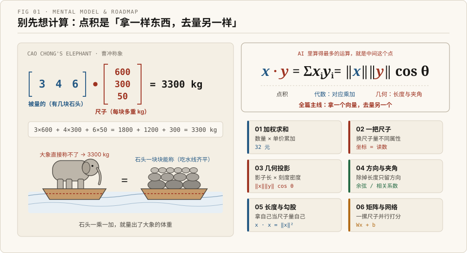
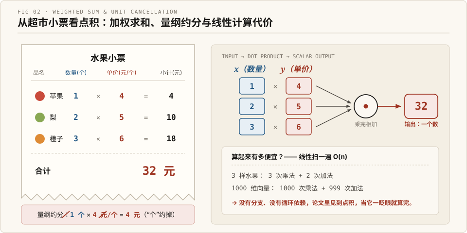
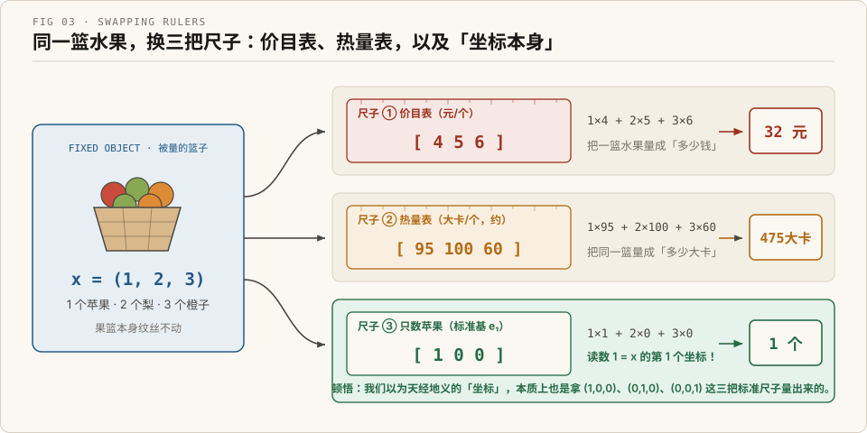
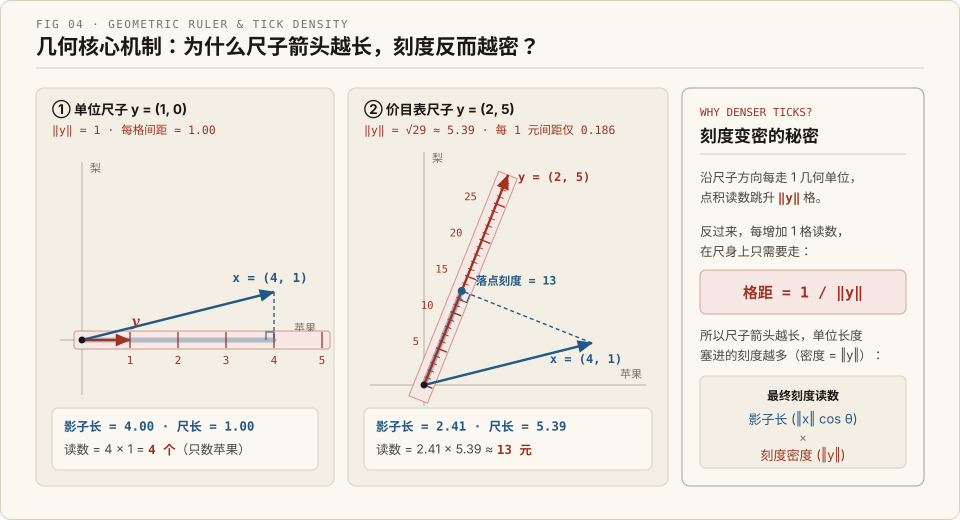
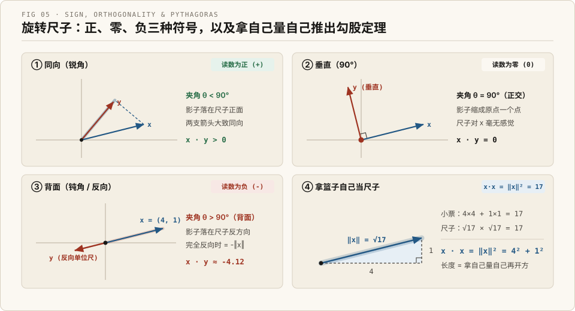
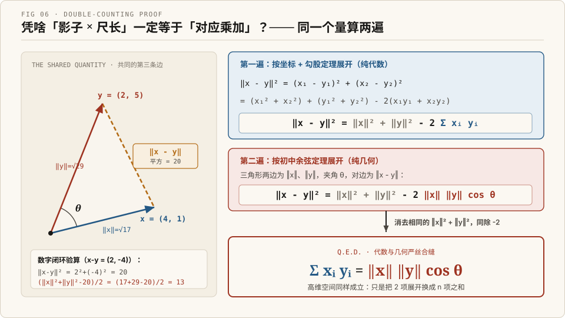
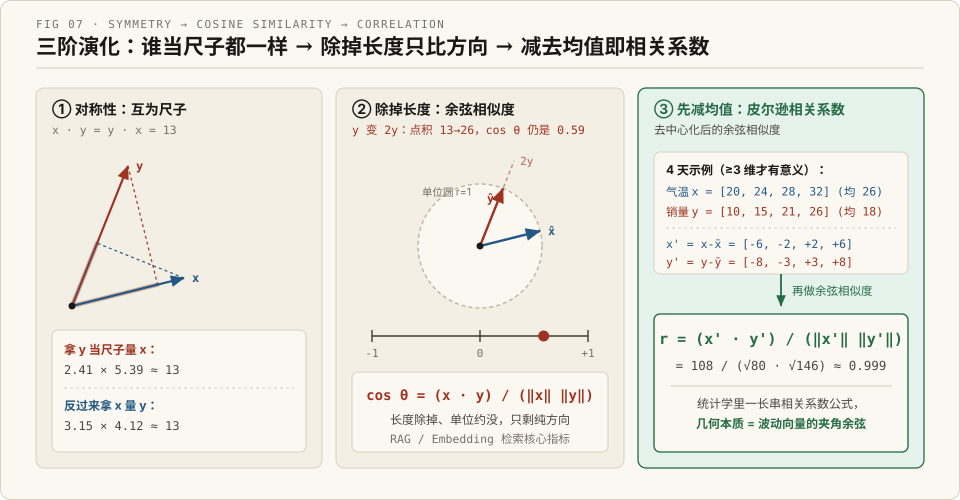
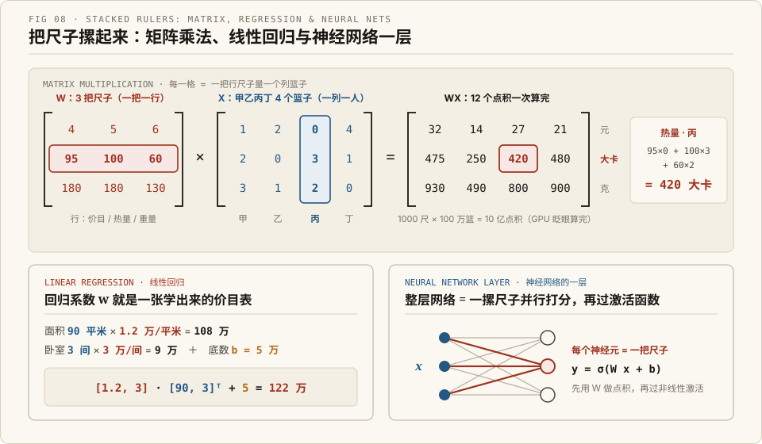

# 拿一把尺子去量世界：循序渐进拆解向量点积

看到下面这个式子，你脑子里第一个蹦出来的念头是什么？

$$[3,\ 4,\ 6] \cdot \begin{bmatrix} 600 \\ 300 \\ 50 \end{bmatrix} = 3 \times 600 + 4 \times 300 + 6 \times 50 = 3300\text{ kg}$$

大多数人被应试教育训练出的第一反应是**“怎么算”**——赶紧拿笔把第一个乘第一个、第二个乘第二个、第三个乘第三个，再加起来。

但“怎么算”这件事，交给电脑就行。人脑真正该想的是另一件事：**它在干什么？**

答案其实很朴素，用中国小学生都听过的故事就能讲清——**曹冲称象**。大象太重，直接搬不上秤；可石头可以一块一块搬上去，只要吃水线齐平，船里压着的石头就和大象一样重。

假设压沉到同一条吃水线，一共搬了 **3 块大石头（每块 600 kg）、4 块中石头（每块 300 kg）、6 块小石头（每块 50 kg）**。左边那串 `[3, 4, 6]` 是**被量的对象**（各搬了几块石头），右边那串 `[600, 300, 50]` 是**尺子**（每种石头每块有多重）。石头一乘一加，就量出了大象的体重 `3300 kg`。

这就是整篇文章想帮你建立的唯一心智模型：

> **向量点积，本质上不是在“做算术”，而是在“拿一个向量当尺子，去量另一个向量”。**

在整个人工智能世界里，从词向量检索到大语言模型的每一层权重计算，算得最多的运算，就是下面这个公式中间那个小小的实心点：

$$\mathbf{x} \cdot \mathbf{y} = \sum x_i y_i = \|\mathbf{x}\| \|\mathbf{y}\| \cos\theta$$

*图 1：左栏是曹冲称象的向量表达——数量是“被量的”，单块重量是“尺子”；右栏是全篇主线，从同一个实心点出发，串联加权求和、尺子与坐标、几何投影、余弦与相关系数、长度勾股，直到矩阵乘法与神经网络。*

下面我们不跳步，从最普通的一张超市小票开始，一级一级往上走。

---

## 一、从超市小票说起：加权求和、量纲约分与算力账本

忘掉“线性代数”四个字，先看一张最普通的买水果小票：

- 苹果：`1 个 × 4 元/个 = 4 元`
- 梨：`2 个 × 5 元/个 = 10 元`
- 橙子：`3 个 × 6 元/个 = 18 元`
- 合计：`4 + 10 + 18 = 32 元`

这里藏着一个特别细腻、却常被忽略的细节——**单位约分（量纲约分）**：

$$1\text{ 个} \times 4\text{ 元/个} = 4\text{ 元}$$

把“个”和“/个”斜着约掉，最后只剩下“元”。为什么这个小动作值得停下来看两秒？因为它悄悄揭示了点积里两个向量其实扮演着**不对等的物理角色**：

- 第一串数 $\mathbf{x} = (1, 2, 3)$ 是**数量**（单位：个），它在算式里充当**权重**；
- 第二串数 $\mathbf{y} = (4, 5, 6)$ 是**单价**（单位：元/个），它是一张把“个数”换算成“多少钱”的**换算标准**；
- 对应相乘再相加，就是用数量当权重把单价加起来——也就是统计学和工程里天天挂在嘴边的**加权求和（weighted sum）**。

再看一眼点积的输入、输出与计算代价：

- **输入**：两串**一样长**的数；
- **输出**：永远压缩成**一个数**（标量）；
- **代价**：3 样水果，只需要 **3 次乘法、2 次加法**；哪怕扩展到 1000 维向量，也不过是 **1000 次乘法、999 次加法**（线性时间 $O(n)$），没有分支跳转，没有前后依赖，硬件最喜欢这种活。

以后在任何 AI 论文里见到 $\mathbf{x} \cdot \mathbf{y}$ 或者 $\sum x_i y_i$，别被求和符号吓住——在脑子里直接当它**一眨眼就算完**。

*图 2：小票里的每一次乘法都在做单位约分（“个”与“/个”抵消，留下“元”）；点积接收两串等长数列，线性扫一遍即输出一个标量。*

---

## 二、视角翻转：把第二串数看成“一把尺子”

小票大家都会算，但真正让点积活起来的，是下面这次**视角翻转**：

把手里那一篮水果 $\mathbf{x} = (1, 2, 3)$（1 苹果、2 梨、3 橙子）固定在桌子上不动，然后把**单价那一串数 `[4, 5, 6]` 看成一把尺子**——它的作用，是把桌子上这篮水果“量”成“值多少钱”（`32 元`）。

既然它是尺子，我们就可以随时**换一把尺子**去量同一篮水果：

1. **换上价目表尺子** $[4,\ 5,\ 6]$（元/个）：
   $$1\times 4 + 2\times 5 + 3\times 6 = 32\text{ 元}$$
2. **换上热量表尺子** $[95,\ 100,\ 60]$（大卡/个，约）：
   $$1\times 95 + 2\times 100 + 3\times 60 = 95 + 200 + 180 = 475\text{ 大卡}$$
3. **换上一把极简的“只数苹果”尺子** $[1,\ 0,\ 0]$：
   $$1\times 1 + 2\times 0 + 3\times 0 = 1\text{ 个}$$

请在这里停三秒，因为一句点石成金的洞见就藏在眼前：**坐标，也是这样量出来的。**

盯紧第三把尺子 $[1,\ 0,\ 0]$：它对苹果给权重 `1`，对梨和橙子全给 `0`，量出来的结果是 `1`——这恰好就是果篮向量 $\mathbf{x} = (1, 2, 3)$ 的**第一个坐标**！同理，拿 $[0,\ 1,\ 0]$ 量出第二个坐标 `2`，拿 $[0,\ 0,\ 1]$ 量出第三个坐标 `3`。

平时我们总觉得“坐标”是刻在对象身上的静态标签；换上“尺子视角”后你会豁然开朗：**坐标并不是天生的，而是拿标准基向量 $(1,0,0)$、$(0,1,0)$、$(0,0,1)$ 当尺子量出来的读数。** 换上价目表或热量表，本质上和读坐标是同一件事——只是换了一把倾斜的、带自己刻度的尺子去给同一篮东西打分。（在高等线性代数里，把向量映射成一个标量的“尺子”有个很吓人的名字叫**线性泛函 / 对偶向量**，其实说的就是它。）

*图 3：果篮 x = (1, 2, 3) 保持不变，连续换上价目表、热量表与标准基 e₁ 三把尺子。拿 (1, 0, 0) 量出的 1 正是 x 的第一个坐标。*

---

## 三、走进几何空间：箭头、投影，以及“为什么尺子越长刻度越密”

刚才我们一直在用算术和表格理解尺子；现在把视角推进一步，看看点积在几何空间里长什么样。

三样水果是三维空间，纸上不好画，先**退到两样**：横轴代表**苹果**，纵轴代表**梨**。

现在，一篮水果不再只是一对数字，而是平面上从原点出发的一支**箭头**：

$$\mathbf{x} = (4,\ 1) \quad\text{（4 个苹果，1 个梨）}$$

由勾股定理，这支箭头的几何长度是 $\|\mathbf{x}\| = \sqrt{4^2 + 1^2} = \sqrt{17} \approx 4.12$。

奇妙的是，**尺子本身也是平面上的一支箭头 $\mathbf{y}$**！现在我们保持篮子 $\mathbf{x} = (4, 1)$ 不动，依次换上不同方向、不同长度的尺子箭头，看看几何上到底发生了什么。

### 1. 单位尺子：只数苹果 $\mathbf{y} = (1, 0)$

先把尺子沿横轴平放：$\mathbf{y} = (1, 0)$。它的长度 $\|\mathbf{y}\| = 1$，尺身上每走 `1` 个几何单位长度，刻度就前进 `1` 格。

从篮子箭头 $\mathbf{x} = (4, 1)$ 的尖端，向尺子 $\mathbf{y}$ 做一条垂线——就像太阳从正上方垂直照下来，篮子在尺子上投出一道**影子**。这道影子正好落在刻度 **`4`** 上，读数 = `4 个`（只数苹果）。

### 2. 价目表尺子 $\mathbf{y} = (2, 5)$：为什么尺子变长，刻度反而变密？

现在把尺子换成**价目表** $\mathbf{y} = (2, 5)$（苹果 2 元/个，梨 5 元/个）。

画面上同时发生了两件事：
1. **尺子转向了**：不再水平躺着，而是斜指向 $(2, 5)$（与横轴夹角约 $68.2^\circ$）；
2. **尺子变长了**：它的几何长度变成了 $\|\mathbf{y}\| = \sqrt{2^2 + 5^2} = \sqrt{29} \approx 5.39$。

**最反直觉的地方来了：尺子变长了，刻度不应该变疏吗？为什么反而变密了？**

用最朴素的算术就能看破：
- 假设沿着 $\mathbf{y}$ 方向走 1 个**几何单位长度**（即单位向量 $\hat{\mathbf{y}} = \mathbf{y} / \|\mathbf{y}\|$），它和尺子 $\mathbf{y}$ 做点积是多少？
  $$\hat{\mathbf{y}} \cdot \mathbf{y} = \frac{\mathbf{y} \cdot \mathbf{y}}{\|\mathbf{y}\|} = \|\mathbf{y}\| \approx 5.39\text{ 元}$$
- 也就是说，在尺身上每往前挪 `1` 个几何长度，读数就要跳升 **`5.39` 元**！
- 反过来说，**每增加 `1` 元，在尺身上只需要走 $\frac{1}{\|\mathbf{y}\|} = \frac{1}{\sqrt{29}} \approx 0.186$ 个几何单位！**

这就是全部秘密：**尺子向量越长，尺身上的刻度就越密**——单位几何长度里塞进了 $\|\mathbf{y}\|$ 个刻度。

现在再看篮子 $\mathbf{x} = (4, 1)$ 在这把价目表尺子上的读数：
- 篮子往尺子方向做垂直投影，算出的几何**影子长度**是 $\|\mathbf{x}\|\cos\theta = \frac{13}{\sqrt{29}} \approx 2.41$；
- 每单位几何长度有 $\|\mathbf{y}\| = \sqrt{29} \approx 5.39$ 格刻度；
- 于是尺子上的最终读数就是：
  $$\text{刻度读数} = \text{影子长} \times \text{刻度密度} = 2.414 \times 5.385 = 13\text{ 元}$$
- 回头用小票算法验算一下：$4 \times 2 + 1 \times 5 = 8 + 5 = 13$ 元——**严丝合缝！**

如果再换成**热量表** $\mathbf{y} = (95, 100)$（苹果 95 大卡、梨 100 大卡），尺子长度暴涨到 $\sqrt{95^2 + 100^2} \approx 137.93$，刻度密到只能以“一格 100 大卡”来标，影子落点直接读出 $4\times 95 + 1\times 100 = 480$ 大卡。

*图 4：从单位尺子 (1, 0) 切换到价目表尺子 (2, 5)，尺子变长到 √29 ≈ 5.39，每 1 元的刻度间距随之压缩为 1/5.39 ≈ 0.186。最终读数 = 影子长度 (‖x‖ cos θ) × 刻度密度 (‖y‖)。*

### 3. 方向决定正、零、负；拿自己量自己，撞上勾股定理

弄懂了“投影 × 刻度密度”，把一把长度为 1 的单位尺子绕原点转一圈，就能一口气看清点积的四种经典情形：

1. **锐角同向（$\theta < 90^\circ$）**：影子落在尺子正面，读数为**正**。
2. **转到垂直（$\theta = 90^\circ$）**：例如 $\mathbf{y} = (-1/\sqrt{17},\ 4/\sqrt{17})$，篮子垂直照下来，影子缩成了原点处的一个点，长度是 `0`，读数为 **`0`**。在线性代数里，点积为 `0` 叫**正交（orthogonal）**——意味着这把尺子对目标向量“毫无感觉”，两者在方向上完全独立。
3. **转到背面（$\theta > 90^\circ$）**：影子落在尺子的反方向延长线上，读数为**负**。当单位尺子转到与 $\mathbf{x} = (4, 1)$ 完全相反（$180^\circ$）时，读数达到最小：$-\sqrt{17} \approx -4.12$。
4. **拿篮子自己当尺子，量它自己（$\mathbf{x} \cdot \mathbf{x}$）**：
   - 按小票算：$4\times 4 + 1\times 1 = 17$；
   - 按几何尺子算：自己和自己完全同向（$\theta = 0^\circ$，$\cos 0^\circ = 1$），影子就是自己本身（长 $\sqrt{17}$），尺子也是自己（长 $\sqrt{17}$），读数 = 影子 × 尺长 = $\sqrt{17} \times \sqrt{17} = 17 = \|\mathbf{x}\|^2$！
   - 于是**勾股定理** $\|\mathbf{x}\|^2 = 4^2 + 1^2 = 17$ 就这样自然而然地长在了点积里：向量的长度（欧几里得范数），原来就是“拿自己量自己，再开个根号”：
     $$\|\mathbf{x}\| = \sqrt{\mathbf{x} \cdot \mathbf{x}}$$

*图 5：固定篮子 x = (4, 1)，尺子旋转经过同向（正）、垂直（零）、背面（负），最后拿自己当尺子量出 17 = 4² + 1² = ‖x‖²，与勾股定理无缝合流。*

---

## 四、凭啥两种算法一定相等？——“同一个量，算两遍”

到这里，一个敏锐的读者一定会敲桌子发问：

- **算法一（按尺子刻度读）**：先算影子 $\|\mathbf{x}\|\cos\theta$，再乘尺子长度 $\|\mathbf{y}\|$，得到 `2.41 × 5.39 ≈ 13`；
- **算法二（按超市小票算）**：压根不管什么角度和投影，直接把坐标对应相乘再相加：`4 × 2 + 1 × 5 = 13`。

一个活在几何三角里，一个活在算术小票里，**凭什么它们永远相等？**

证明这件事，数学里有一招最经典、也最让人拍案叫绝的思路：**同一个量，用两种办法各算一遍。**

把 $\mathbf{x}$ 和 $\mathbf{y}$ 的起点拼在原点，再用一条虚线把它们的箭头尖端连起来，就围成了一个三角形。这个“同一个量”，就是三角形的**第三条边**——差向量 $\mathbf{x} - \mathbf{y}$ 的长度平方 $\|\mathbf{x} - \mathbf{y}\|^2$。

### 第一遍：按坐标 + 勾股定理展开（纯代数）

在二维平面上，$\mathbf{x} = (x_1, x_2)$，$\mathbf{y} = (y_1, y_2)$，所以差向量是 $\mathbf{x} - \mathbf{y} = (x_1 - y_1,\ x_2 - y_2)$。

根据勾股定理，它长度的平方等于两个坐标差的平方和：

$$\|\mathbf{x} - \mathbf{y}\|^2 = (x_1 - y_1)^2 + (x_2 - y_2)^2$$

把完全平方一项项拆开：

$$= (x_1^2 - 2x_1 y_1 + y_1^2) + (x_2^2 - 2x_2 y_2 + y_2^2)$$

把 $x$ 归到一堆、$y$ 归到一堆、交叉项归到一堆：

$$= \underbrace{(x_1^2 + x_2^2)}_{\|\mathbf{x}\|^2} + \underbrace{(y_1^2 + y_2^2)}_{\|\mathbf{y}\|^2} - 2(x_1 y_1 + x_2 y_2) = \|\mathbf{x}\|^2 + \|\mathbf{y}\|^2 - 2\sum x_i y_i$$

（顺便一提：如果向量是 3 维、100 维甚至 12288 维，展开只是多写几项 $(x_i - y_i)^2$，合并完还是完全一样的式子！）

### 第二遍：按初中余弦定理展开（纯几何）

再看同一个三角形：两条邻边长分别是 $\|\mathbf{x}\|$ 和 $\|\mathbf{y}\|$，夹角是 $\theta$，对边长是 $\|\mathbf{x} - \mathbf{y}\|$。直接套初中几何里的余弦定理 $c^2 = a^2 + b^2 - 2ab\cos\theta$：

$$\|\mathbf{x} - \mathbf{y}\|^2 = \|\mathbf{x}\|^2 + \|\mathbf{y}\|^2 - 2\|\mathbf{x}\|\|\mathbf{y}\|\cos\theta$$

### 两式对撞，消去公共项

两遍算的都是同一条边 $\|\mathbf{x} - \mathbf{y}\|^2$，所以右边必须相等：

$$\|\mathbf{x}\|^2 + \|\mathbf{y}\|^2 - 2\sum x_i y_i = \|\mathbf{x}\|^2 + \|\mathbf{y}\|^2 - 2\|\mathbf{x}\|\|\mathbf{y}\|\cos\theta$$

两边同时划掉一模一样的 $\|\mathbf{x}\|^2 + \|\mathbf{y}\|^2$，再同时除以 $-2$，剩下那两项**只能相等**：

$$\sum x_i y_i = \|\mathbf{x}\|\|\mathbf{y}\|\cos\theta$$

我们拿前文的 $\mathbf{x} = (4, 1)$ 和 $\mathbf{y} = (2, 5)$ 做一次数字闭环验算：
- 差向量 $\mathbf{x} - \mathbf{y} = (4 - 2,\ 1 - 5) = (2,\ -4)$，所以第三边平方 $\|\mathbf{x} - \mathbf{y}\|^2 = 2^2 + (-4)^2 = 20$；
- 另两边平方和 $\|\mathbf{x}\|^2 + \|\mathbf{y}\|^2 = 17 + 29 = 46$；
- 两者相减再除以 2：$(46 - 20) / 2 = 26 / 2 = 13$，分毫不差！

*图 6：三角形第三边 ‖x - y‖² 充当桥梁——上方按坐标与勾股展开得到 -2Σxᵢyᵢ，下方按余弦定理展开得到 -2‖x‖‖y‖cos θ，消去公共项后两式合龙。*

---

## 五、对称性、去掉长度、再去掉均值：从点积到余弦相似度与相关系数

证明打通之后，回头再看 $\mathbf{x} \cdot \mathbf{y} = \sum x_i y_i = \|\mathbf{x}\|\|\mathbf{y}\|\cos\theta$，三个极其重要的推论会像多米诺骨牌一样依次倒下。

### 1. 对称性：谁当尺子，读数完全一样

刚才我们一直说“拿 $\mathbf{y}$ 当尺子量 $\mathbf{x}$”，结果是 `影子 2.41 × 尺长 5.39 ≈ 13`。

反过来，如果**拿 $\mathbf{x} = (4, 1)$ 当尺子去量 $\mathbf{y} = (2, 5)$** 呢？
- $\mathbf{y}$ 在 $\mathbf{x}$ 方向上的影子长 $= 13 / \sqrt{17} \approx 3.15$；
- 尺子 $\mathbf{x}$ 的长度 $= \sqrt{17} \approx 4.12$；
- 两者相乘 $= 3.15 \times 4.12 \approx 13$！

谁当尺子、谁是被量的，点积读数一模一样——因为写成坐标，乘法本来就满足交换律：$x_1 y_1 + x_2 y_2 = y_1 x_1 + y_2 x_2$。

### 2. 只想比方向像不像？长短就碍事了 → 余弦相似度

很多时候（比如搜索两篇文档主题像不像、两个用户兴趣像不像），我们压根不关心谁篇幅长、谁买得多，只关心**方向是否一致**。

这时候，直接用点积就会出问题：把尺子 $\mathbf{y}$ 拉长一倍变成 $2\mathbf{y}$，方向纹丝未动，但点积读数会从 `13` 直接翻倍成 `26`——**长短搅和了方向的判断**。

解决办法干脆利落：**把两个向量的长度 $\|\mathbf{x}\|$ 和 $\|\mathbf{y}\|$ 都除掉！**

$$\cos\theta = \frac{\mathbf{x} \cdot \mathbf{y}}{\|\mathbf{x}\| \|\mathbf{y}\|}$$

几何上，这相当于先把 $\mathbf{x}$ 和 $\mathbf{y}$ 各自缩放到半径为 1 的**单位圆**上，再做点积。

代入我们的例子：$\frac{13}{\sqrt{17} \cdot \sqrt{29}} \approx 0.59$。哪怕把 $\mathbf{y}$ 拉长成 $2\mathbf{y}$，分子翻倍、分母也翻倍，结果依然稳稳钉在 **`0.59`**！而且两个长度一除，原本的物理单位也彻底约没了，变成一个严格落在 **$[-1, 1]$** 之间的纯方向分数（`+1` 完全同向、`0` 垂直无关、`-1` 完全相反）。

这就是大语言模型、RAG 知识库与推荐系统里无处不在的**余弦相似度（Cosine Similarity）**。

### 3. 再往前跨半步：先各减掉平均，就是皮尔逊相关系数

再往前跨半步，一条更令人惊喜的桥梁会突然出现：**先各减掉平均再算余弦，就是统计学里的相关系数。**

这句话打通了线性代数与统计学之间最厚的一堵墙，我们一定要把它展开看个明白：

1. 拿到两串数据 $\mathbf{x}$ 和 $\mathbf{y}$，先算出各自的平均值 $\bar{x}$ 和 $\bar{y}$；
2. 每个数减去自己的平均值（叫**去中心化**），得到两串新的**波动向量**：
   $$\mathbf{x}' = \mathbf{x} - \bar{x}, \qquad \mathbf{y}' = \mathbf{y} - \bar{y}$$
3. 对 $\mathbf{x}'$ 和 $\mathbf{y}'$ 做一次余弦相似度：
   $$r = \frac{\mathbf{x}' \cdot \mathbf{y}'}{\|\mathbf{x}'\| \|\mathbf{y}'\|} = \frac{\sum (x_i - \bar{x})(y_i - \bar{y})}{\sqrt{\sum (x_i - \bar{x})^2}\sqrt{\sum (y_i - \bar{y})^2}}$$

睁大眼睛看右边那个分式——它正是统计学课本里看起来又臭又长、背起来头疼的**皮尔逊相关系数（Pearson Correlation）**！

用一个 4 天的小例子马上就有体感（注意：算相关系数至少需要 3 个以上的数据点，因为只有 2 个数时减均值后必呈 $(a, -a)$，夹角非 $0^\circ$ 即 $180^\circ$，相关系数只能是 $\pm 1$）：
- 连续 4 天气温 $\mathbf{x} = [20,\ 24,\ 28,\ 32]$（均值 $26$），减均值后得 $\mathbf{x}' = [-6,\ -2,\ +2,\ +6]$；
- 同期冷饮销量 $\mathbf{y} = [10,\ 15,\ 21,\ 26]$（均值 $18$），减均值后得 $\mathbf{y}' = [-8,\ -3,\ +3,\ +8]$；
- 点积 $\mathbf{x}'\cdot\mathbf{y}' = 48 + 6 + 6 + 48 = 108$，长度分别为 $\sqrt{80}$ 和 $\sqrt{146}$；
- 相关系数 $r = \frac{108}{\sqrt{80}\cdot\sqrt{146}} \approx 0.999$——两个波动向量几乎严丝合缝地指向同一方向！

原来统计学里的“相关性”，翻译成几何语言就一句话：**把两组数据各自平移到均值为零，再看它们起伏方向的夹角余弦。**

*图 7：从左到右的三阶演化——① 互换尺子与被量者读数不变；② 除掉各自长度，缩放至单位圆得到 [-1, 1] 的余弦相似度；③ 先减去各自均值再算余弦，即统计学中的皮尔逊相关系数。*

---

## 六、把尺子摞起来：矩阵乘法、线性回归与神经网络

掌握了“一把尺子量一个篮子”，最后一步就会水到渠成——哪怕你过去一直把矩阵乘法当成玄学死背，看完这一节也会彻底释怀。

### 1. 一摞尺子 = 矩阵 $W$

刚才我们对同一篮水果换了三把尺子：价目表、热量表、重量表。与其一把一把拿起来量，不如把它们**一把一行，垂直摞成一个矩阵 $W$**：

$$W = \begin{bmatrix} 4 & 5 & 6 \\ 95 & 100 & 60 \\ 180 & 180 & 130 \end{bmatrix} \begin{array}{l} \leftarrow\text{ 价目表（元/个）} \\ \leftarrow\text{ 热量表（大卡/个）} \\ \leftarrow\text{ 重量表（克/个）} \end{array}$$

### 2. 先量甲一个人（$W\mathbf{x}$），再把甲乙丙丁一起量（$WX$）

先把**甲**的果篮竖着写成一列 $\mathbf{x} = \begin{bmatrix} 1 \\ 2 \\ 3 \end{bmatrix}$（单位：个）。用三把尺子同时量甲，量出来也是一列：`32 元`、`475 大卡`、`930 克`。

现在**乙、丙、丁**也提着果篮走了过来，每人占一列，并排拼成矩阵 $X$：

$$X = \begin{bmatrix} 1 & 2 & 0 & 4 \\ 2 & 0 & 3 & 1 \\ 3 & 1 & 2 & 0 \end{bmatrix} \quad (\text{四列依次为甲、乙、丙、丁})$$

把 $W$ 和 $X$ 乘起来，四个人的三项指标**一次全部算完**：

$$WX = \begin{bmatrix} 32 & 14 & 27 & 21 \\ 475 & 250 & \mathbf{420} & 480 \\ 930 & 490 & 800 & 900 \end{bmatrix} \begin{array}{l} \text{元} \\ \text{大卡} \\ \text{克} \end{array}$$

彻底忘掉“前行乘后列”的机械口诀吧！请记住更直白的一句话：

> **矩阵乘法结果里的每一格，就是左面的一把行尺子，去量右面的一个列篮子。**

比如第 2 行第 3 列高亮的 **`420`**，就是拿第 2 把尺子（热量表 `[95, 100, 60]`）去量第 3 个篮子（丙 `[0, 3, 2]`）：$95\times 0 + 100\times 3 + 60\times 2 = 420$ 大卡。

把规模放大到工业界：如果有 **1,000 把尺子**，同时去量 **1,000,000 个篮子**，结果表里一共有 **10 亿个格子**——也就是 **10 亿次彼此独立的点积**。因为每一格互不干扰，GPU 成千上万个核心可以同时开火，眨眼就算完。

### 3. 线性回归与神经网络：AI 的核心地基

走到这里，机器学习和深度学习里最核心的两个结构也瞬间透明了：

- **线性回归（Linear Regression）**：预测公式 $\hat{y} = \mathbf{w} \cdot \mathbf{x} + b$。
  假设我们要预测一套房子的价格：
  - 面积 `90 平米 × 1.2 万/平米 = 108 万`（“平米”约掉）；
  - 卧室 `3 间 × 3 万/间 = 9 万`（“间”约掉）；
  - 加上底数（偏置项）$b = 5\text{ 万}$，预测房价 $= 122\text{ 万}$。
  写成点积就是 $\begin{bmatrix} 1.2 & 3 \end{bmatrix} \cdot \begin{bmatrix} 90 \\ 3 \end{bmatrix} + 5 = 122$。所谓“训练线性回归”，说白了就是让机器从历史成交数据里，反推出那张最靠谱的**价目表 $\mathbf{w}$**。
- **神经网络的一层（Neural Network Layer）**：
  - 单个神经元，就是拿着自己的一把尺子 $\mathbf{w}_i$ 给输入特征 $\mathbf{x}$ 打分，再加上偏置 $b_i$；
  - 一整层全连接网络，就是把成百上千把尺子摞成权重矩阵 $W$，并行去量同一个输入 $\mathbf{x}$，算出 $W\mathbf{x} + \mathbf{b}$，最后再过一个非线性激活函数（如 ReLU / GELU）：
    $$\mathbf{y} = \sigma(W\mathbf{x} + \mathbf{b})$$
  - 哪怕一路延伸到今天的大语言模型（Transformer），最核心的注意力机制（Attention）本质上也还是同一套动作：拿 Query 向量当尺子，去量每一个 Key 向量和当前上下文有多契合。

*图 8：上栏展示 3×3 尺子矩阵 W 与 3×4 篮子矩阵 X 的批量点积（高亮“热量 · 丙 = 420 大卡”）；下栏展示线性回归（单张学出来的价目表）与神经网络单层（一摞尺子并行打分再过激活）。*

---

## 七、回到大象：一句话收束

现在再回头看文章开头那头站在木船上的大象：

$$[3,\ 4,\ 6] \cdot \begin{bmatrix} 600 \\ 300 \\ 50 \end{bmatrix} = 3300\text{ kg}$$

- `[3, 4, 6]` 是被量的石头数量；
- `[600, 300, 50]` 是每块石头的重量尺子；
- 它们一乘一加，就量出了大象。

我们一路走过的六个场景，原本散落在小学算术、解析几何、数理统计、线性代数和深度学习五门完全不同的课本里，拆到最底层，其实只是**同一个动作换了六件外衣**：

| 场景 | 被量的向量 $\mathbf{x}$ | 充当尺子的向量 $\mathbf{y}$ | 点积结果在量什么 |
| :--- | :--- | :--- | :--- |
| **超市小票** | 各种水果的数量（个） | 价目表 / 热量表（元/个、大卡/个） | 总价（32 元）/ 总热量（475 大卡） |
| **读取坐标** | 任意向量 $(x_1, x_2, x_3)$ | 标准基 $(1, 0, 0)$ | 向量在第一根轴上的坐标 $x_1$ |
| **几何投影** | 平面箭头 $\mathbf{x}$ | 倾斜且带密度的尺子箭头 $\mathbf{y}$ | 影子长 $\times$ 刻度密度 $= \|\mathbf{x}\|\|\mathbf{y}\|\cos\theta$ |
| **向量长度** | 箭头 $\mathbf{x}$ | 箭头 $\mathbf{x}$ 自己 | 长度的平方 $\|\mathbf{x}\|^2$（勾股定理） |
| **余弦 / 相关** | 归一化或去均值后的 $\mathbf{x}$ | 归一化或去均值后的 $\mathbf{y}$ | 纯方向相似度 $[-1, 1]$ / 波动相关性 $r$ |
| **矩阵 / 神经网络** | 一排输入样本 $X$ | 一摞权重尺子 $W$ | 批量特征打分 $WX$（再加偏置过激活） |

所以，下次再在公式、代码或论文里撞见那个小小的实心点 `·`，不必再条件反射地背诵计算步骤。只要在心里默念一句：

**点积，就是拿一个向量，去量另一个。**

---

*参考来源：小红书笔记 [《向量点积，到底在干什么？》](https://www.xiaohongshu.com/explore/6afe7198000000001c031448?xsec_token=CBDpoD_u3klmsDr2zLqQDepW87jjlbYVmi5NlobVqiYCc=&xsec_source=app_share)（作者：城北朱公）。*
