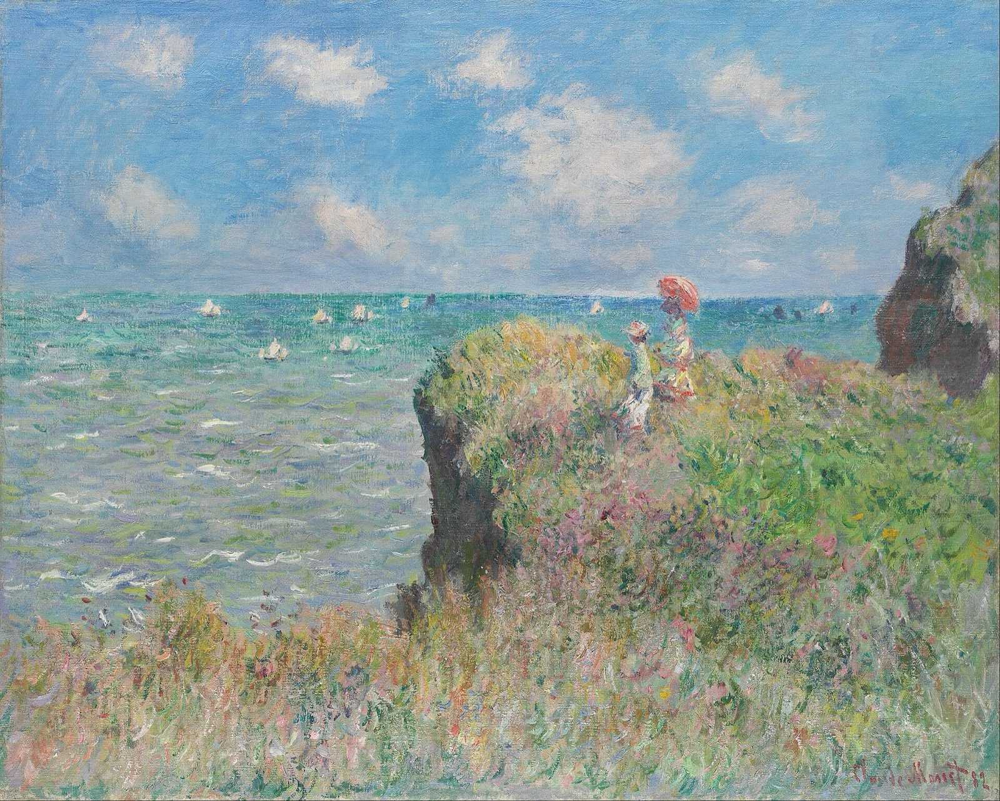
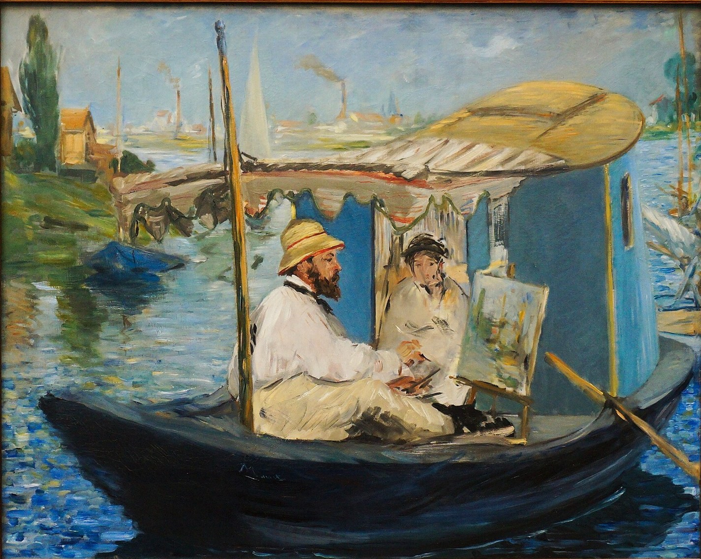
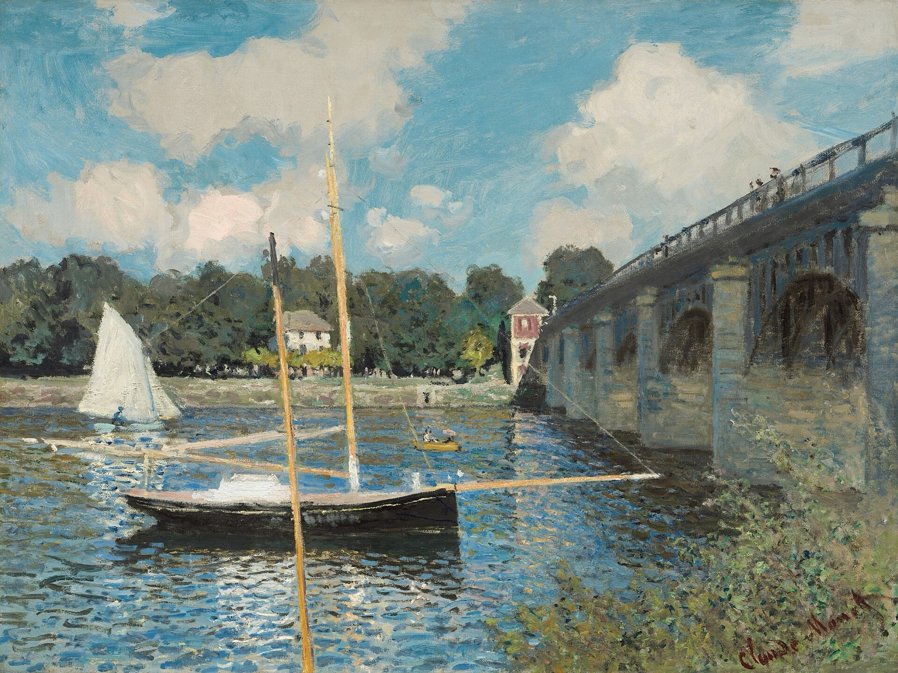
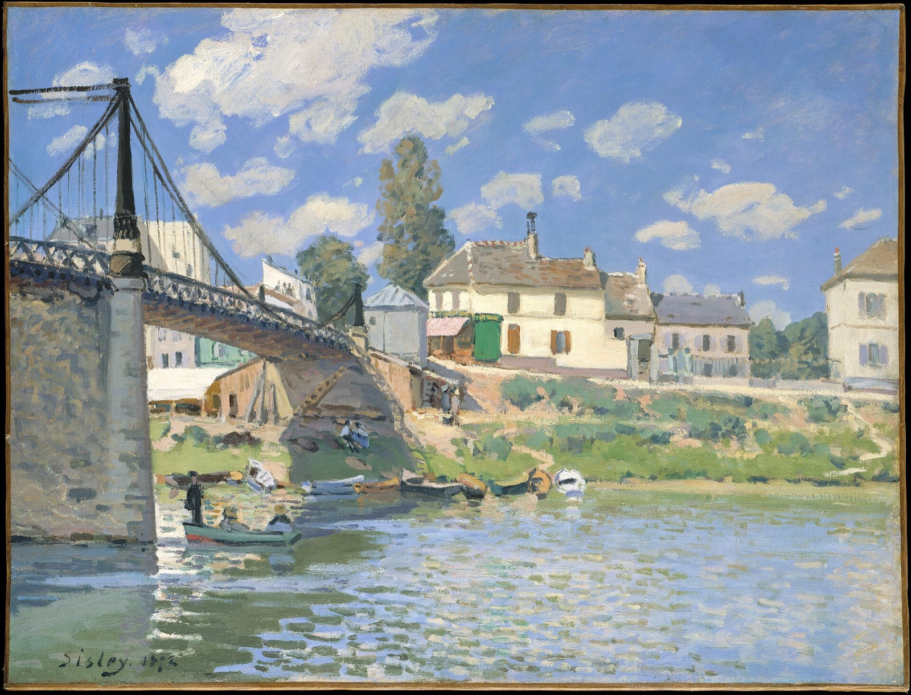

# 许愿编程从业余到专业，最该修炼的 8 个基本功

最近看身边越来越多非技术同事用 AI 自己搭工具——有人做数据看板，有人写周报聚合，也有人拉出给小团队日常用的内部应用。大家图省事，常把这套做法叫作“许愿编程”。

可跑过几周回头看，同样对着一个模型许愿，做出来的东西质量往往差了一大截。第一天下午大家都能拿出看着挺体面的页面；过半个月，有人的系统稳稳跑在业务里，另一边却已经不敢碰了——改一个小按钮，昨天好好的图表就塌了；加一条新规则，底下的数悄悄算歪了。

很多人会觉得，这是因为自己没学过编程、看不懂语法。其实到今天，敲代码这件事本身已经不再是门槛。真正卡住人的，是几件工程师踩过很多坑后已经变成习惯、平时却很少专门拎出来讲清的事。你不需要转行写代码，把这 8 个点心里有数，让 AI 顺着你的要求去建，结果会完全不一样。

*Claude Monet，《Cliff Walk at Pourville》（普尔维尔悬崖漫步，1882，芝加哥艺术学院藏）。晴朗开阔的悬崖草坡与海面——跨过最初那点手忙脚乱，用 AI 做东西其实可以走得很从容。*

## 01 留存档，也把草稿桌分开

自己用 AI 改页面时，最让人泄气的瞬间莫过于：刚才明明还好好的，顺口让它把筛选框调一下，整个页面突然白屏。赶紧让它“改回刚才那样”，越改越乱，最后只好把整个文件夹另存一份，桌面上慢慢堆出一排 `项目_v2`、`项目_最终版`、`项目_别删`。

工程师平时几乎不操心这种事，靠的是两个很朴素的习惯。

一个是随时存档，工具叫 **Git**。你不必去背那些命令行，只要养成一个节奏：每跑通一个小功能、自己点过确认没毛病，就让 AI 顺手打一个存档点（commit），把这次改了什么写清楚。有了这串按时间排好的快照，后面不管怎么大胆试错，改坏了随时一句话退回十分钟前。心里有退路，手脚才放得开。

另一个是把草稿桌分开。假如你正在让 AI 大改核心报表逻辑，半路临时要先修一个错别字并立刻发出去，两件事堆在同一个文件夹里，文件互相盖来盖去，很容易把半成品一起带出去。工程里用**分支（Branch）**和**多工作区（Worktree）**来隔离——说白了，就是从主版本里另辟出几张互不干扰的独立工作台。你甚至可以让两个 AI 会话同时在两张工作台上各试一套方案，做完摆在一起比一比，挑顺眼的那份合回主线，另一张桌子直接清掉。

*Édouard Manet，《Claude Monet Painting in His Studio Boat》（莫奈在画室船上作画，1874，慕尼黑新美术馆藏）。莫奈当年特意造了一艘画室小船，漂在河面上另辟出一块互不打扰的工作区；多分支与多工作区做的也是同一件事。*

## 02 动手之前，先认清手里是哪份数据

代码改坏了还能退回上一个存档，真实业务数据写坏了，很多时候就真的找不回来了。

我见过好几次类似的惊险场面。有人随口让 AI“把刚才测出来的几条脏数据清掉”，或者“重跑一遍清洗脚本”，AI 手脚极快，几秒钟跑完——回头一看，它连着的是线上真表，把过去半年的客户记录一块抹了；还有人测邮件发送忘了切名单，测试草稿直接飞进了真实客户邮箱。反过来的乌龙也常见：对着电脑里一份三天前的本地拷贝调了半天公式，纳闷为什么线上看板的数字纹丝不动。

所以每次让 AI 动数据之前，先把三件事看清：眼前连着的是线上正在用的**生产主版本**，还是拷出来随便折腾的**本地副本**？接下来要跑的操作是只读查看，还是会修改、覆盖甚至删除原记录？万一跑岔了，有没有原封不动的备份能顶上？

平时调试、试脚本、改口径，一律只给 AI 脱敏或抽样后的本地副本。也可以直接让 AI 在测试页面顶部挂一行醒目的“本地副本”提示，再定死一条规矩：凡是往生产主版本里写数据、删记录或对外发送，程序必须先把要影响多少条、具体动哪几条列出来，等本人确认后再执行。

*Peder Severin Krøyer，《Summer Evening on Skagen's Southern Beach》（斯卡恩海滩的夏日傍晚，1893，斯卡恩博物馆藏）。浅滩与深海之间有一条清清楚楚的水线：岸边沙地上怎么踩都可以重来，跨过那道线进了深水区，每一步都得先看清。*

## 03 有版本意识，并且明着告诉模型

很多人给 AI 提需求时，只说“要做什么”，很少说“现在做到哪一步了”。

其实模型对“阶段”这个信号非常敏感。你不说，它只能自己猜。猜重了，你本来只想午饭前凑个页面跟同事对齐想法，它给你折腾出登录鉴权、缓存和一堆配置，半天连界面都没见着；猜轻了，你打算明天发给全团队一百人用，它顺手写了个图省事的临时脚本，密钥明文写在代码里，两个人同时点一下就报错。

一个东西从念头长到正式能用，通常要过四个阶段，每个阶段盯着的事完全不一样：

- **Demo**：只为把模糊的想法变成能看见、能点两下的画面，确认大家想的是不是一回事。这个阶段用假数据、走捷径完全合理，越快出长相越好，别在底层架构上耗时间。
- **Alpha**：把假数据换成真实数据，拿自己的真实工作流把最核心的一条路跑通。界面糙一点、只跑在自己电脑上、偶尔报错手动重来，都无所谓。
- **Beta**：拉一小批同事或种子用户试用。自己写的东西自己知道哪里不能乱点，别人不知道——他们会传格式错乱的表格、中途关页面、一次塞进十倍的数据。这一阶段的重心是顺着真实反馈把最硌脚的边界补平。
- **Release**：正式对外或给全团队日常用，能跑通只是底线，这时候会一下子冒出四个此前几乎没碰过的新问题：
  1. **安全**：谁能看什么数据，密钥和密码有没有不小心写进代码或公开仓库，会不会越权串看。
  2. **稳定性**：多人同时用会不会卡死，依赖的外部接口超时或挂了，页面能不能妥善提示而不是直接白屏。
  3. **成本**：调用模型或云服务的费用有没有硬封顶，万一某段逻辑陷入死循环，会不会悄悄烧穿预算。
  4. **运维**：出了错有没有日志可查，数据怎么定时备份，新版本有毛病怎么迅速回滚。

每次开新任务，顺手用一句话把阶段挑明——告诉它“现在是 Demo 阶段，假数据十分钟出样子，别过度设计”，或者“准备进 Release 给全团队用，按上线标准查一遍安全、稳定、成本上限和出错兜底”。模型一旦知道所处阶段，给出的策略立刻会贴合得多。

*Claude Monet，《The Bridge at Argenteuil》（阿让特伊之桥，1874，华盛顿国家美术馆藏）。画中这座桥正是战后从临时木架重建为石墩铁桥的模样——临时搭着看一眼的样板，和要经年承重通行的正式工程，用的从来不是同一套料。*

## 04 舍得烧 Token，主动梳理而不是等出事再问

用 AI 做项目久了，会发现大家在 Token 账单上的心态差别很大。不少人习惯省着用，平时轻易不唤它，只有页面冒红字、数字明显算错了，才临时丢一句“这里报错了，帮我修一下”。这种按次救火的做法表面上省了钱，实际上代价最高：你按住了眼前漏水的那一处，暗处还有五六处隐患正攒着，往往专挑最关键的汇报前一起爆出来。

换个角度算这笔账：哪怕你一个月烧掉的 Token 费用达到自己工资的两倍，换来一个 7×24 小时不疲倦、不嫌烦、随时能把整个项目从头到尾细读几十遍的搭档，这笔投入比任何人力都便宜。

关键是把这些算力从“出事再问”，转向定期、成体系地全面梳理。别等 Bug 撞到脸上，隔三差五——甚至趁下班后——让模型沿着三条清晰的脉络，一轮一轮循环（Loop）把整个项目扫透：

- **数据流**：一份数据从填进表单或读入源表开始，经过清洗、计算、汇总、存储，直到画在屏幕上，中间有没有哪一步悄悄丢了字段、混了单位，或者把空值错算成了零。
- **控制流**：点下按钮之后，程序按什么顺序往下走；如果中途断网、接口超时，或者用户心急连点两下提交，会不会拐进没想过的岔路口。
- **状态流转**：凡是有生命周期的业务对象——比如一张审批单从草稿、待审、通过到撤回，或一笔订单从待支付到退款——把所有状态切换列成表逐格核对：会不会出现“已取消的单子还能再点一次退款”，或者单据卡在半路永远关不掉。

让它扫出隐患、修掉、再按这三条线复查一轮，做成持续循环。很多原本要等一个月后才会在真实用户面前露馅的毛病，在昨晚的几轮巡查里就已经安静清掉了。

*Alfred Sisley，《The Bridge at Villeneuve-la-Garenne》（维伦纽夫-拉加雷讷之桥，1872，纽约大都会艺术博物馆藏）。晴朗白日里，整条河道的水流、桥洞与两岸动线一览无余；定期沿着数据与状态的脉络通盘看一遍，比出事后摸黑抢修省心得多。*

## 05 搭自动验证，也给模型找一根“上帝之鞭”

非技术同事验收 AI 写完的东西，最常见的是自己随便填两组数、点两下按钮，看着没报错就收工了。严谨一点的，会在同一个对话框里追问一句“你检查一下有没有问题”，模型往往客客气气地答复“经检查逻辑完整，没有问题”。

让写代码的人自己批改自己的卷子，几乎永远是满分。更麻烦的是回归：这周加了一个很小的筛选条件，新按钮挺顺手，你却不知道它顺手把两周前算折扣的逻辑改偏了。靠人每次把所有旧功能重头点一遍，根本不现实。

想把质量真正稳住，需要三样东西配合起来。

第一样是**自动化验证体系**，把验货交给机器自动跑：
- 把核心计算公式和业务规则拆成独立小块，每次改完代码自动拿几十组正常和刁钻的例子过一遍——工程里叫**单元测试（UT）**，专门防“修新坏旧”。
- 把表单、数据库和外部接口串起来，模拟真实操作从头跑到尾——叫**集成测试**，防止零件单看都对，拼在一起却接不上口。
- 如果系统里有几条绝不能算错的硬底线——比如财务分账总和必须严丝合缝、不同部门的权限绝不能串读、审批流绝不能卡死——单靠挑几个例子抽查其实兜不住，现在已经可以让 AI 借助严谨的数学校验工具把所有可能组合彻底验一遍，也就是**形式化验证**（关于这件事的具体做法，之前在 [#07 用数学给概率兜底](07-formal-verification-in-the-ai-era.html) 里详细聊过）。

第二样是**引入“上帝之鞭”**。同一个模型在同一段长对话里待久了，很容易顺着自己的思路往下滑，对盲区视而不见。最管用的做法是故意制造对抗：让模型 A 写实现，再另开一个干净会话，或者干脆换一家不同厂商的模型 B，只给它一个任务——把这份方案和代码当成对手的作品来挑刺，专找边界漏洞、算错的可能和被忽略的极端情况。把挑出来的硬伤打回给模型 A 去修，几轮对抗下来，系统的结实程度会上一个台阶。

第三样是**立住基线**。别凭“感觉这次好像顺手了点”来做判断。攒一套代表真实业务的测试样本——比如过去最难缠的 20 份真实表单，再定几项硬指标：算对的比例、响应速度，或者上线后实际省下的工时。这就是质量基线与产品指标基线。以后每次大改，先对着基线跑一遍：指标涨了才放行，跌了就拦下。

*Joaquín Sorolla，《Sewing the Sail》（缝帆，1896，威尼斯佩萨罗宫现代艺术美术馆藏）。阳光洒满的院子里，七八双眼睛围着一张大白帆逐寸核对针脚——真正靠谱的验证，从来不是出海后碰运气，也不是自己给自己点头放行。*

## 06 承认系统会变旧，和 AI 一起搭套 Ops

很多人下意识把做好的软件当成买回来的一张实木桌，摆好之后只要没人砸它，就能稳稳用上十年。

真实世界里的系统更像一排摆在窗台上的花，哪怕一行代码没动，放着不管三个月也会悄悄出毛病。背后往往是三件躲不开的事：

- **系统会腐烂**：依赖的外部工具升级了、上游接口悄悄改了返回格式、应急打上去的临时补丁越叠越厚，昨天还顺溜的流程慢慢开始变慢、报错。
- **数据会漂移**：业务一直在动。以前订单都在百元级，这个季度突然来了批大额企业单；上游表格里“华东区”被人随手改成了“东区”；用户在备注里贴进带表情符号的长文本——程序一行错没报，汇总结果却已经偏离了事实。
- **假设会失效**：当初搭系统时默认过很多前提，比如“每天最多一百条数据”“节假日没交易”“某渠道转化率在 5% 左右”。半年后业务翻了几倍，旧前提早不成立了，系统还死守着旧规矩。

工程团队专门盯着这些变化、让系统长期保持可控的工作叫 **Ops（运维）**。非技术同事不需要去盯满屏黑框监控，直接和 AI 一起打磨一套轻巧的巡检节奏就行：

一方面是**按周期巡检**，让 AI 每天或每周固定拉一遍运行日志、核心数据分布、异常报错和费用账单，整理成一份三分钟能看完的简报推给你——比如“本周整体平稳，但新增了 4 条缺少地区字段的记录，某接口平均耗时比上周慢了一倍”。另一方面是**按需排查**，大促前、业务刚改规则，或者你直觉今天看板上的数字有点怪时，随时喊 AI 做一次全量体检，把隐患和建议动作列出来。只要这套汇报一直在转，系统就始终在你眼皮底下。

*Carl Larsson，《Blomsterfönstret》（窗台上的花，1894，斯德哥尔摩瑞典国家博物馆藏）。窗台上的绿植不会自己保持繁茂，靠的是日复一日的浇水、修枝与留心观察；系统上线之后，Ops 做的也是同样安静而持续的照看。*

## 07 Think Big，Build from Small

AI 有个特点：你敢提多大，它就敢一口气写多大。

丢给它一句“帮我做一个带客户分层、自动邮件跟进、权限管理和老板大屏的客户管理系统”，它不会劝你缓一缓，十分钟就能吐出四十个文件、八千行代码。第一眼确实唬人，可真用起来很快就会卡壳——想调一下客户分层的口径，改完邮件模板报错了；修完邮件，权限又乱了。代码全缠在一起，不光你看不懂，连新开一个窗口的 AI 自己也拆不动。

稳住节奏的办法只有一句：**Think Big，Build from Small**（之前在 [#01 Think Big 与 Build from Small](01-think-big-build-from-small.html) 里也专门写过这件事）。

想的时候，格局完全可以放得很大，不必把自己局限在“写个小脚本”，尽管去勾勒理想中整套工作流跑顺了是什么样子。可落手去做时，一定要拆成一块块职责单一、边界干净的小块。先只做“读入原始表格并校验字段齐全”这一块，输入输出清清楚楚，单独测稳、存好档；确认扎实了，再接第二块“按业务规则打标签”；再接第三块“生成汇总视图”。

每一小步都看得清、验得明，哪怕哪一块做歪了，因为边界干净，扔掉重做只要五分钟。一旦一开始就让 AI 摊出一张互相粘连的大饼，长歪了就只能整份重来。

*Georges Seurat，《A Sunday on La Grande Jatte》（大碗岛的星期天下午，1884–1886，芝加哥艺术学院藏）。修拉画这幅两米多宽的宏阔画卷时，落笔却极小——一颗颗干净、独立、边界分明的纯色点，一块一块稳稳拼出了整片阳光草坪与河岸。*

## 08 AI 能替你写代码，替不了你想清楚要做什么

过去写代码贵、排期长，反倒逼着大家在动工前把需求反复掰扯清楚。现在写代码几乎免费，一个新问题冒了出来：含糊的念头会被极快地做成精致而复杂的废品。

随口丢一句“帮我做个更好用的周报分析工具”，AI 三分钟就能端出一个配色讲究、图表齐全的网页。看着像推进了一大步，真用两天就觉得处处别扭：这页到底给谁看？看完希望他做什么决定？屏幕上这五个指标为什么凑在一起？某个数变红之后，现实里下一步该干什么？

这些事模型替你做不了主。凡是你含糊带过的地方，AI 不会停下来等你，它会按“大概率看着像那么回事”替你猜一套规则，然后硬生生写进代码里。比如部分退款后积分怎么扣、同一天重复提交算覆盖还是算两条、大客户和小客户的预警线是不是一样——这些决定系统灵魂的业务规则，只有真正懂业务的人能拍板。

所以动工写第一行代码前，最值的十来分钟其实是先停下来，让 AI 反过来采访你：让它站在苛刻业务搭档的角度，追问八到十个你还没说清的问题——给谁用、解决什么真问题、正常怎么算、例外怎么判、什么明确不做——等你答完，让它整理成一页大白话说明，对齐了再开工。人把业务和目标想透了，模型写出来的东西才真正立得住。

*Winslow Homer，《Breezing Up (A Fair Wind)》（顺风，1873–1876，华盛顿国家美术馆藏）。鼓满风的白帆决定船能跑多快，但稳稳压在船尾舵柄上的那只手、盯着前方海平线的那双眼睛，才决定这艘船究竟驶向哪里。*

## 尾声

把这 8 个点摊开来看，没有哪一条要求你去背代码语法。存档和分桌让你敢试错，分清数据和版本阶段让你不踩大坑，舍得用算力主动扫雷、建好自动验证与异源对抗、加上线后的日常巡检，能让系统长久稳得住；而拆小步推进、亲手想透业务和目标，则把最核心的掌控权留在自己手里。

向 AI 许个愿只要十秒钟。让这个愿望真正落进日常业务里、经得起时间和真实用户的考验，靠的大概就是这 8 件朴素的小事。

---

*本文延伸阅读：关于“想得大、做得小”的讨论见 [#01 Think Big 与 Build from Small](01-think-big-build-from-small.html)，关于形式化验证的实践见 [#07 用数学给概率兜底](07-formal-verification-in-the-ai-era.html)；文中 9 幅公版馆藏画作依次引自克劳德·莫奈、爱德华·马奈、佩德·塞韦林·克罗耶、莫奈、阿尔弗雷德·西斯莱、华金·索罗亚、卡尔·拉尔森、乔治·修拉与温斯洛·霍默。*
