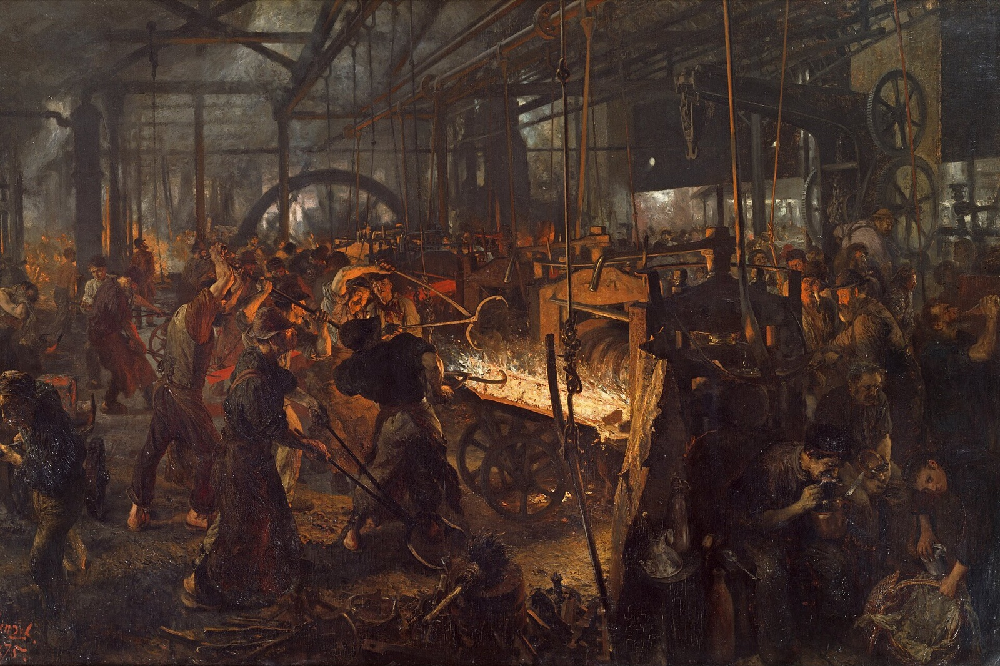
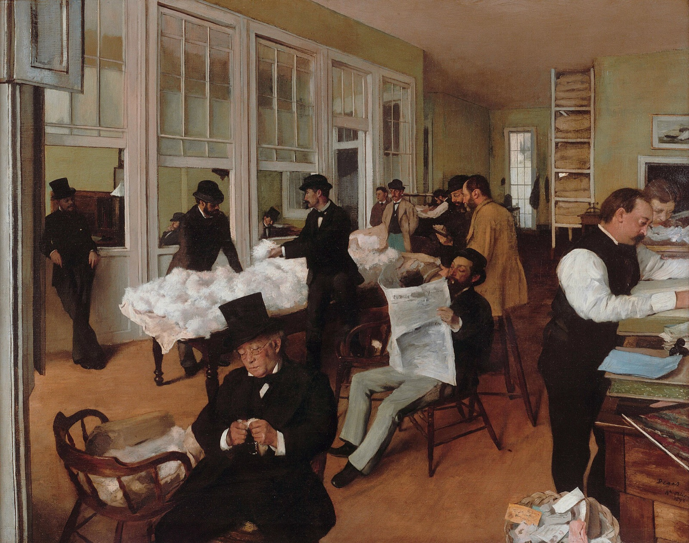
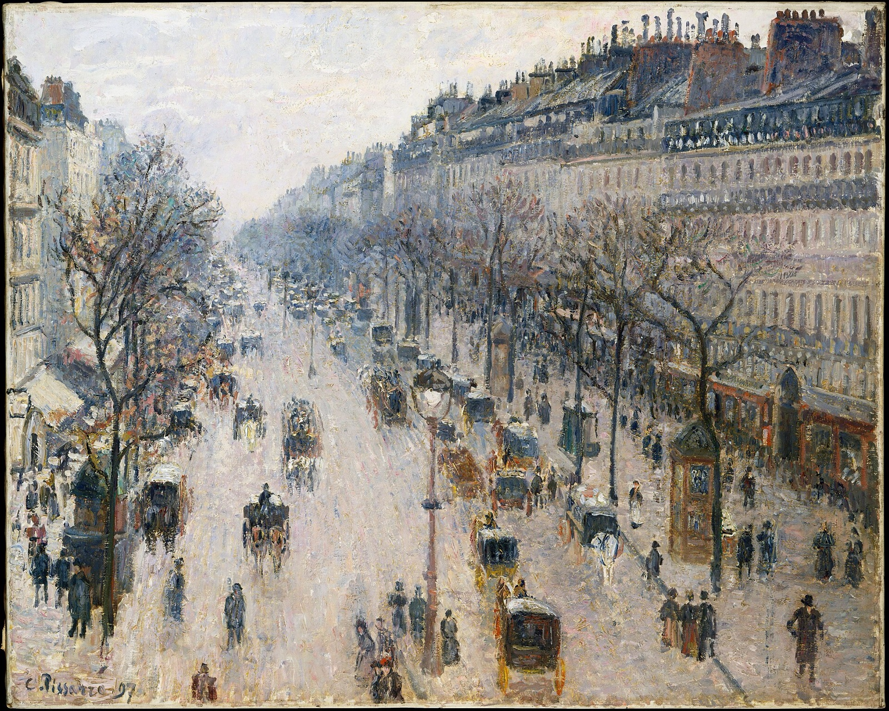

# 配置“配置者”：从土地、资本到智能编排社会

聊起 AGI，大家最容易问两个问题：它会抢掉多少工作？又能带出什么新生意？

这两个问题很切身，只是把眼光放得太近了。回头看过去几百年，真正称得上生产力革命的变化，改掉的从来不止是干活快慢。它往往先把某样原本稀缺的东西变便宜，接着改写资源的调配方式，再改写社会剩余怎么分，最后把新的主导者推上台面，换掉整套社会秩序。

最近读到 liupc 写的一篇一万四千字的长文《[从土地、资本到智能：AGI如何重写资源配置、价值分配与社会形态](https://mp.weixin.qq.com/s/RVk-uDKbofF56-LQi4hygg)》，顺着政治经济学的大脉络，从农业社会一路推演到今天。文章骨架极好，只是篇幅很长，有些判断在各节里反复出现。读完合上页面，我试着顺着它的底子做一次减法，把最要紧的那条主线重新理一遍。

*Claude Lorrain，《Seaport with the Embarkation of the Queen of Sheba》（示巴女王登船的海港，1648，伦敦国家美术馆藏）。晨光初起的海港里，古典石柱、远航帆船、搬运货箱的脚夫与岸边仪仗聚在同一幅画面中。*

## 上一代的主角，下一代的要素

想知道 AGI 会把社会带向哪里，不妨先看看今天这套习以为常的秩序是怎么一层层叠出来的。

农业革命让人类第一次有了稳定的粮食剩余，土地随之成了整个社会的轴心。那时候控制土地不单是占有生产资料，征税、司法、军役和身份等级全都长在土地上，地主、贵族和国家靠地租与贡赋维持秩序。等到商业革命兴起，远洋贸易、银行、汇票和包买商制度跑通了另一条路：商人不必亲自种地，也不必占有农户家里的织机，只要捏住原料供应、长途贩运和销售渠道，就能站到分散的手工业者头顶上。控制连接，第一次展现出不亚于直接控制生产的力量。

工业革命走得更彻底。昂贵的蒸汽机和规模化工厂需要大量工人按同一套节拍协同劳作，原本一人掌握全套手艺的工匠被拆成流水线上的岗位。**工匠变成了标准化的“劳动力”**，现代经济最基本的“工资 + 利润”分配格局由此定型。再往后，电力、铁路与跨国生产把企业规模推到前所未有的高度，股东管不过来，职业经理人和现代大公司应运而生。公司在市场经济内部建起了一套庞大的计划体系，组织能力本身成了核心生产力。整个 20 世纪大体就是一个“组织社会”：人很少直接面对市场，读书、入职、领薪水、拿头衔，几乎都要借由一家公司或机构来完成。

可大公司也没能在最高处待太久。金融化浪潮很快站到了公司上方，资本市场把企业折算成一串未来现金流，基金经理不必懂车间里怎么拧螺丝，就能通过定价、买卖、并购和拆分来调配公司。到了互联网时代，平台又站到了交易入口上，握住搜索、推荐、支付和派单算法，把法律上独立的商家、司机与创作者变成算法网络里的一个个节点。

顺着这六幕回头看，历史其实一直在重复同一个动作：**新生产力很少消灭旧资源，它只是把上一代的主角降格成下一代系统里的普通要素。** 直到今天，土地依然昂贵，但买下一栋楼并不会让你自动获得司法权；工匠成了劳动力，公司成了金融资产，独立商家成了平台节点，旧事物都在，只是让出了组织社会的第一把交椅。所以衡量一场技术变革有没有催生新社会形态，看的从来不是新行业占多少 GDP，而是看上一代发号施令的主体，有没有变成下一层系统里被调用的对象。

与此同时，历史还留过一条冷峻的教训：生产结构总是先一步剧变，分配制度往往要迟到几十年。工业革命先把财富格局冲得七零八落，工会、八小时工作制、劳动法和福利国家是在漫长的摩擦之后才慢慢补齐的。技术只管把旧桌子掀翻，从不负责自动摆好新碗筷。

*Adolph von Menzel，《Das Eisenwalzwerk (Moderne Cyklopen)》（轧铁厂，1875，柏林旧国家画廊藏）。通红的铁坯在巨型轧机间翻滚，数十名工人在烟尘与火光里围着机器协同作业，角落里有人正低头匆匆吞咽午饭。*

## 从拆解职业，到配置“配置者”

拿上面那把尺子去量 AGI，就会发现只盯着“替白领省几小时工时”未免看轻了它。它真正动摇的地方，是一层比一层深的三个台阶。

最表层的一步，是把通用认知从人身上剥离出来。机器替代过体力，电脑廉价化了计算，唯独分析局势、写软件、做方案、谈判、管人、判风险这类综合认知，几百年来一直长在具体的人身上。过去一家公司想把研发或财务分析能力扩充十倍，唯一的办法就是按人头招十倍的工程师和分析师，层层叠叠的部门管理很大程度上都是在为“脑力无法直接复制”买单。大模型和 Agent 成熟之后，高水准的认知第一次像电力一样可复制、可并行、可随时按接口调用。就像当年工厂把工匠拆成工种，今天律师、程序员、顾问和设计师身上大量可验证的本事，正在被抽离成随时待命的**能力模块**。智能不再只是人的禀赋，它变成了生产资料。

往深处再走一步，连“组织”本身也开始变成按需取用的服务。我们今天为什么离不开公司？因为稍微复杂一点的目标，单靠一个人干不成，必须把产品、研发、法务、财务、供应链和销售长期拢在同一屋檐下。现代公司能统治过去一百多年，靠的就是垄断了大规模协调的能力。可如果有人只提一句“给东南亚市场做一款新的宠物粮品牌”，底下的 Agent 网络自己就能把调研、配方、找代工厂、核成本、做包装、办注册、投流和管库存一路拆解执行到底，项目跑完当场解散，那“固定公司 → 长期雇佣 → 层级管理”的老路子就松动了。组织不再非得是一栋常年亮灯的写字楼，而越来越像用完即走的云服务（*Organization as a Service*）。

最关键的还在第三步。过去那些强势的资源配置者之间，隔着很硬的制度边界：制造企业管员工和机器，资本市场管企业估值，互联网平台管流量分发，谁也很难直接越界替对方干活。基金经理能买下一家工厂的股票，却没法替它盯生产线；平台能决定给哪家网店导流，却没法替它研发新品。AGI 特殊的地方在于，它第一次跨过了这些边界，把土地厂房、算力软件、真人专长、外部公司、平台渠道统统看成一张由合同、接口与约束连起来的大网，放在同一个系统里通盘调度。

甚至连金融时代站在金字塔尖的资本市场，也未必躲得开这次降格。挑项目、算回报、控回撤、做并购，归根结底都是高强度的信息处理与判断。一旦资金池可以直接交给智能系统去寻觅机会、动态调仓和监督经营，今天的基金与资管机构同样可能从呼风唤雨的主角，退成后台随叫随到的资金管道。

走到这一步，AGI 在历史坐标里的真正位置才算显露出来：**人类第一次造出了一种能够配置“配置者”的技术。** 公司、金融机构和平台都不会凭空蒸发，就像农田和工厂今天照样运转一样；但它们正一点点从牌桌上的庄家，变成更高一层系统手里的牌。

*Joseph Wright of Derby，《A Philosopher Lecturing on the Orrery》（哲学家讲授太阳系仪，约 1766，德比博物馆与美术馆藏）。暗室中央的黄铜天球仪由一盏灯照亮，大小轨道彼此嵌套咬合，围观的人俯身凝视整套星系如何运转。*

## 智能便宜之后，什么反而贵了

每次旧瓶颈被技术推平，人们总容易产生一种错觉，以为稀缺本身要消失了。历史给出的答案从来相反：旧稀缺一退潮，经济租金立刻会涌向新的卡口。当年体力活不值钱了，煤矿、机器和资本变得奇货可居；后来信息分发几乎免费了，人的注意力和流量入口反而贵上了天。

等到通用智能也变得像自来水一样充沛，真正稀缺的东西大概率会收拢到四处：

- **物理世界的硬家底**：土地、能源、矿山、芯片、电网、仓库与机器人。Agent 一晚上能拿出十万份设计稿，可发电厂、铜矿和晶圆厂没法靠复制粘贴变出来。数字智能越充裕，这些扩产极慢的物理资产分量反而越重。
- **制度给的许可证**：产权、金融牌照、频谱、采矿权、数据合规与行业准入。AI 能算出无数套放贷模型，却没法自己给自己发一张银行牌照。很多边界本就不是技术画的，而是法律和权力画的。
- **经得起时间检验的信任**：当漂亮的商业计划书、品牌故事乃至整套网站都能在几分钟里批量生成，“谁说话算数、谁出事能担责”就成了硬通货。合成的东西越泛滥，攒了十年的口碑、真实身份和履约记录就越难替代。
- **决定“做什么”的目标权**：怎么把事情做成的门槛降下来之后，真正稀缺的就只剩下往哪走、求什么、守哪条底线（这一点和之前在 [#02 下一个 Flat 时代](02-the-next-flat-world.html)、[#06 各归其位](06-rights-and-duties-of-agents.html) 里聊到的判断恰好合拢）。

看清这四样稀缺，也就看清了下一个时代的真正主角。**主角不会是 AI 本身**，AI 只是工具和底座；真正坐庄的，是能把**目标定义（Intent）**、**智能调度（Intelligence）**与**现实资产（Assets）**捏到一块儿的人或机构，原文管它叫 **Orchestrator（智能编排者）**。以前这三件事分在不同人手里：股东出钱，董事会定调子，CEO 拆预算，一层层经理盯着员工干活。中间这些传声筒被模型抽掉以后，极小的一班人就能直接支使过去上万人规模的产能，单人的经济杠杆会被拉大好几个数量级。

分钱的规矩也会跟着改写。地租、工资、利润、股息和平台抽成之外，会多出一种更强势的**编排租金**。掌握编排系统的人未必亲自开工厂或写代码，但靠把资金、牌照、算力、供应商和渠道重新拼装起来，就能拿走整条链路上最厚的一块剩余。它比互联网平台吃得更深：平台只是守在集市门口收摊位费，编排者却直接下场组局、定配比、改产线。

再往深想一层，连“产权”的重心都在往上移。过去两百年争论的核心一直是“生产资料归谁”；往后看，同等要命的另一个问题是**“目标函数归谁管”**。一套自动运转的经济系统，究竟该追求短期现金流还是长期安全？利润优先还是公共福利优先？允许冒多大险，哪几条红线碰都不能碰，谁又有权去改这些参数？当执行过程高度无人化，对目标和约束边界的定义权，就成了悬在传统产权头顶上的那道终极控制权。

*Edgar Degas，《A Cotton Office in New Orleans》（新奥尔良的棉花交易所，1873，法国波城美术馆藏）。长桌上铺着刚抽样的白棉，戴高礼帽的合伙人低头拈看成色，身后有人翻阅行情报，右侧账房正伏案核对账册。*

## 公司变小，网络变大，社会变成沙漏

这些变化一旦落进日常经济生活里，会同时推演出几幅乍看彼此打架、细想却是一回事的图景。

先看市场本身。经济学里争了上百年的“市场还是计划”，很可能会在机器手里长出第三种形态。早年集中计划走不通，根子在于信息太碎太杂，没有任何机构能实时摸清几亿人的喜好和每一间仓库的余量，只能靠价格信号去分散试探。以后价格依然会在，但无数代表个人、工厂、电厂、车队和资金池的 Agent 会直接高频议价，一边看价格，一边把库存、运力、风险和长期弹性全算进去。市场既保留了分散博弈的底子，又长出了堪比精密计划系统的全局算力，更接近一张实时自调节的机器规划网。

再看企业的个头。按照科斯当年的解释，公司之所以越长越胖，是因为去市场上找人、谈价、签合同、防扯皮太费劲，不如招进自己院子里省心。一旦 Agent 把外部搜寻、议价和盯交付的摩擦压到很低，公司就没必要再养着一应俱全的庞大部门。两三个人的小团队随时能调来一流的设计、法务、开发和代工产能。公司规模往下缩，市场上的交易频次反而往上爆。工业时代的社会化大生产体现为一座座万人大厂，往后则体现为一张随时聚散的协作网。

与“市场变大”同时发生的，偏偏还有“商业垄断的退潮”。以前想看部合心意的片子得去影院，想管团队账目得买现成的 SaaS，遇到专业门槛得花钱请顾问；往后很多这类需求，让自己的私人 Agent 现做一个就够了。人照样获得了产品和享受，中间却没有发生任何买卖。这看着有点像小农时代的自给自足，底子却完全不同：那时候是因为穷、生产力低才自己动手，以后则是个人站在全社会攒下的模型和算力肩膀上，在家完成了原本得靠一家商业公司才能交付的活。商业依然会管好那些稀缺资源的交换，但不再包办一切生产与消费。

把这几股劲合到一起，20 世纪那种两头小、中间大的“橄榄型组织社会”，很容易被挤压成一只**沙漏**。沙漏最上头，是芯片、发电、电网、云计算、矿产和机器人制造，重资本、强规模效应，只会比今天更集中；沙漏最底下，是成千上万借着便宜算力单干的超个体、夫妻店式微型团队与项目制小公司，生猛而密集；唯独卡在沙漏细腰上的传统白领机构最难受——常规咨询、软件外包、营销中介、基础财税以及大企业里负责传话对表的中层部门，过去靠信息差和协调成本吃饭，如今正好撞在被替代的正中央。

*Camille Pissarro，《The Boulevard Montmartre on a Winter Morning》（蒙马特大道：冬日早晨，1897，纽约大都会艺术博物馆藏）。冬日薄雾里，两侧连绵厚重的石砌楼宇夹出宽阔街面，底下数不清的马车与行人各自寻路、川流不息。*

## 当“你在哪工作”变成“你拥有什么”

大公司缩编、白领中间层变薄，最终一定会碰触现代社会最敏感的一根支柱：**就业**。

过去两百年里，“工作”承担的东西太多了。读书、找份工作、拿月薪、攒钱养老，一个人不仅靠工资吃饭，还靠职位认领自己的社会坐标。陌生人见面寒暄，头一句多半是“你在哪高就”。可如果生产公式越来越向“资本 + 能源 + 算力 + Agent + 少数关键人”倾斜，劳动报酬在国民总收入里切走的比例持续往下掉，靠一份全职岗位连接个人与社会的旧办法就会越来越吃力。衡量一个人处境的问题，也会慢慢从“你在哪工作”，滑向**“你拥有什么、你能调用什么”**——从就业社会走向所有权社会。股权、房产土地、能源收益、知识产权、公共分红乃至个人名下那套智能系统的调度能力，会比一张工牌管用得多（这其实也印证了 [#09 机器与花园](09-finite-and-infinite-games.html) 里卡斯说的那句老话：指向过去的头衔正在飞速折旧）。

好在技术本身从来不替人类拍板最终的制度。同样一套智能基础设施，落在不同的产权与分配安排里，长出来的社会面貌会天差地别。

倘若顶尖模型、核电电网、算力集群和机器人都攥在极少数巨头手里，普通劳动者既没议价权又没资产份额，社会就会滑向比今天更悬殊的**智能寡头时代**；反过来，倘若算力底座带有更强的公共属性，或者国家通过主权财富基金、机器税与全民资本分红，把自动化创造的巨额剩余摊回给每个公民，哪怕传统岗位变少，社会契约也能平稳过渡到**全民资产社会**；再假如模型和算力便宜到人人触手可及，普通人带着自己的私人 Agent 就能独立养活自己、服务身边的小圈子，民间又会长出一片生机勃勃的**超个体社会**。现实很少非黑即白，最可能的结局是三层叠在一起：物理重资产高度集中，数字应用高度分散，公共制度在中间用税收与分红托底。

如果非要给这个正在成形的新阶段留一个名字，叫“AI 社会”太笼统，原文起的**“智能编排社会”**要贴切得多。说到底，人类几千年的社会演进，并不是哪几个热门产业轮流坐庄，而是大规模协调人力和物力的方式换了一茬又一茬：围着土地协调、围着商路协调、围着机器和大公司协调，再到围着金融市场与算法平台协调。AGI 做的事情，是第一次把“协调”本身交给了机器。社会化大生产不会退潮，只会变得更庞大精密；只是托住这套生产的容器，正从常设的人类组织，换成按目标随时聚散的智能体网络。延续百年的现代“组织社会”，大概要在这里翻页了。

*Thomas Cole，《View from Mount Holyoke, Northampton, Massachusetts, after a Thunderstorm—The Oxbow》（牛轭湖，1836，纽约大都会艺术博物馆藏）。暴风雨刚过的山巅上，左侧仍是幽暗狂野的断崖密林，右侧已是阳光铺展的河湾与农田，山脊岩石间藏着一位撑伞作画的人。*

每一场改写时代的大变局落幕时，留给人们的其实都是那三个老问题：最要紧的稀缺握在谁手里？谁有权调配资源？产出来的剩余归谁？农业时代答的是地主与皇权，工业与公司时代答的是资本与大企业，金融与平台时代答的是华尔街与流量入口。

等到智能本身不再稀缺的那一天，真正决定下一个世纪长成什么模样的，大概不是哪几家新科技公司的名字，而是我们最终怎么回答这句话：**谁拥有定义目标、掌管现实资产，并调度无限机器智能去组织整个社会生产的权力？**

---

*本文核心脉络与主要观点提炼、改写自 liupc（公众号「liupc看世界」）长文 [《从土地、资本到智能：AGI如何重写资源配置、价值分配与社会形态》](https://mp.weixin.qq.com/s/RVk-uDKbofF56-LQi4hygg)；文中涉及的相关讨论亦见本站 [#02 下一个 Flat 时代](02-the-next-flat-world.html)、[#06 各归其位：Agent 的权责分化与人机边界](06-rights-and-duties-of-agents.html) 与 [#09 机器与花园：AGI 前夜重读《有限与无限的游戏》](09-finite-and-infinite-games.html)。文中 6 幅公版馆藏画作依次引自克劳德·洛兰、阿道夫·冯·门采尔、德比的约瑟夫·赖特、埃德加·德加、卡米耶·毕沙罗与托马斯·科尔。*
